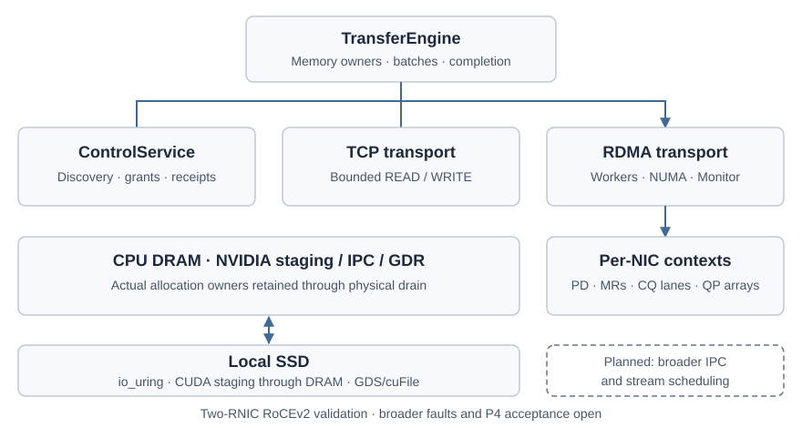

<div align="center">
  <picture>
    <source media="(prefers-color-scheme: dark)" srcset="docs/_static/orbitte-logo-dark.svg">
    
  </picture>
  <h2>A Rust-native transfer engine for AI infrastructure</h2>
  <a href="https://orbitinfra.github.io/OrbitTE/"><strong>Documentation</strong></a>
  | <a href="https://orbitinfra.github.io/OrbitTE/getting-started.html"><strong>Quick Start</strong></a>
  | <a href="https://orbitinfra.github.io/OrbitTE/architecture.html"><strong>Architecture</strong></a>
  | <a href="docs/tent-parity.md"><strong>TENT Reference</strong></a>
  <br><br>

  [](https://github.com/OrbitInfra/OrbitTE/actions/workflows/ci.yml)
  [](https://crates.io/crates/orbit-te)
  [](Cargo.toml)
  [](LICENSE)
</div>

## Overview

OrbitTE is the transfer engine for [OrbitKV](https://github.com/OrbitInfra/OrbitKV)'s
KV cache, replacing its earlier Mooncake TENT dependency. It moves bytes between
CPU memory, NVIDIA GPUs and local SSDs, within and across machines, so every
end-to-end cache path, including GPU↔DRAM and GPU↔SSD, runs through one engine.
The design follows Mooncake TENT's engine, transport, context, buffer, endpoint
and worker boundaries, implemented in Rust with no Mooncake C++ dependency.

<div align="center">
  
</div>

## Updates

- **Nov 3, 2026**: Requests are built with `TransferRequest::new`; local SSD
  paths through io_uring and GDS become core targets.
- **Nov 2, 2026**: FIFO/EDF admission windows, TENT-format QoS contracts and
  receiver credit windows.
- **Nov 1, 2026**: Bandwidth-aware multirail selection from CUDA/NUMA topology
  and TENT priority matrices; CUDA 13 native batch copies for NVLink groups.
- **Oct 28, 2026**: Bounded GPUDirect RDMA, CUDA IPC and remote CUDA staging
  profiles pass installed H20/RoCE tests.
- **Oct 27, 2026**: The bounded host RDMA RoCE profile is independently accepted.

## Highlights

- **Owned memory, explicit completion.** Registrations keep their real
  allocations, and nothing is released until the backend proves it can no
  longer touch the memory, including after failed native cleanup.
- **Multirail, topology-aware RDMA.** Persistent MRs, reusable QP arrays and
  shared CQ workers spread slices across NICs by NUMA/PCIe distance and
  measured bandwidth, with periodic route recovery.
- **NVIDIA data paths.** GPUDirect RDMA, CUDA IPC/NVLink with native batch
  copies, and pinned staging for TCP and RDMA, all on the CUDA Driver API.
- **Bounded admission and QoS.** High/Medium/Low priority, FIFO/EDF dispatch
  windows, per-tenant QoS budgets and receiver credits limit what each peer
  can hold in flight.

## Supported paths

| Transport | Memory | Status |
| --- | --- | --- |
| TCP | DRAM; CUDA through staging | Implemented |
| RDMA | DRAM; CUDA through GPUDirect or staging | Implemented; bounded RoCE profiles accepted |
| NVLink / CUDA IPC | CUDA and pinned DRAM on one host | Implemented; bounded H20 profiles accepted |
| io_uring, GDS | DRAM/CUDA ↔ local SSD | Planned (P7) |
| HP-TCP, SHM | DRAM | Planned (P3) |
| MNNVL | CUDA fabric memory | Planned (P5) |
| MPComm, libfabric | Optional network providers | Planned (P8) |

TENT's C, C++ and Python APIs and wire compatibility are planned in P9.
[Capabilities](docs/capabilities.md) lists the exact limits of each path.

## Quick Start

On Linux with Rust 1.85 or later:

```sh
git clone https://github.com/OrbitInfra/OrbitTE.git
cd OrbitTE
cargo run --locked --example tcp_roundtrip
```

Expected output:

```text
18 bytes: hello from OrbitTE
```

The CPU/TCP example needs no CUDA or RDMA SDK. Enable the `rdma` and `cuda`
features with the [build guide](docs/build.md), then continue with the
[Rust API guide](docs/rust-api.md) and [RDMA/CUDA guide](docs/rdma-cuda.md).

## Status

OrbitTE is in alpha. The bounded host RDMA, GPUDirect RDMA, CUDA IPC and
staging profiles above passed installed tests on H20/RoCE hosts and
independent review; newer source has CPU controls and awaits its hardware pass.
[Qualification](docs/qualification.md) records the evidence, and the
[completion plan](docs/completion-plan.md) is the work queue. The `orbit-te`
crate on crates.io only reserves the name; build from source.

## Documentation

| Topic | Guides |
| --- | --- |
| Getting started | [Quick Start](docs/getting-started.md), [Build](docs/build.md), [Capabilities](docs/capabilities.md) |
| Using the engine | [TCP and memory ownership](docs/cpu-tcp.md), [Async batches](docs/async-batches.md), [RDMA and CUDA](docs/rdma-cuda.md), [CUDA IPC](docs/cuda-ipc.md), [Staging](docs/staging.md) |
| Design and API | [Architecture](docs/architecture.md), [Rust API](docs/rust-api.md), [TENT parity](docs/tent-parity.md) |
| Development | [Contributing](docs/contributing.md), [Qualification](docs/qualification.md), [Completion plan](docs/completion-plan.md) |
| Operations | [Troubleshooting](docs/troubleshooting.md), [Installed host validation](docs/installed-host.md), [Native cleanup](docs/native-cleanup.md) |

## Contributing

Start with the [contributor guide](docs/contributing.md) and the
[source reading order](docs/architecture.md#source-reading-order). Coding agents
follow [AGENTS.md](AGENTS.md).

## License

OrbitTE is an independent [OrbitInfra](https://github.com/OrbitInfra) project,
licensed under [Apache-2.0](LICENSE). [Mooncake TENT](https://github.com/OrbitInfra/Mooncake/tree/e2d6e8e0f2df113d84f9e39379f98c4b67b199ab/mooncake-transfer-engine/tent)
is its frozen capability and architecture reference.
