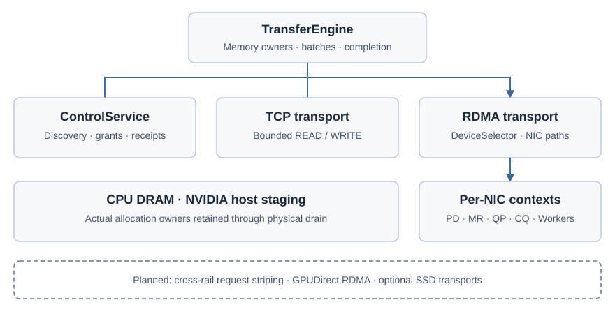

<div align="center">
  <picture>
    <source media="(prefers-color-scheme: dark)" srcset="docs/_static/orbitte-logo-dark.svg">
    
  </picture>
  <h2>A Rust-native transfer engine for AI infrastructure</h2>
  <a href="https://orbitinfra.github.io/OrbitTE/"><strong>Documentation</strong></a>
  | <a href="https://orbitinfra.github.io/OrbitTE/getting-started.html"><strong>Quick Start</strong></a>
  | <a href="https://orbitinfra.github.io/OrbitTE/architecture.html"><strong>Architecture</strong></a>
  | <a href="docs/tent-parity.md"><strong>TENT Reference</strong></a>
  <br><br>

  [](https://github.com/OrbitInfra/OrbitTE/actions/workflows/ci.yml)
  [](https://crates.io/crates/orbit-te)
  [](Cargo.toml)
  [](LICENSE)
</div>

## Overview

OrbitTE moves bytes between CPU memory and NVIDIA GPU allocations, within and
across machines. It follows Mooncake TENT's engine, topology, context, buffer,
endpoint and worker architecture, with resource ownership and transfer state
machines implemented in Rust. The runtime has no Mooncake C++ dependency.

TCP, RDMA and opt-in CUDA IPC are separate payload transports. A shared control service handles
peer discovery, memory grants and receipts. Applications own cache identity,
recovery policy and replica placement.

<div align="center">
  
</div>

## Highlights

- **Owned memory and explicit completion.** Registrations retain their actual
  allocations; asynchronous READ/WRITE batches, cancellation and notifications
  share bounded admission. Each request selects ordinary transfer or remote GPU
  staging over TCP/RDMA; mixed batches preserve ordered completion and reuse
  bounded staging resources. Failed native cleanup
  retains unresolved memory.
- **Persistent host RDMA.** Context-owned MRs, reusable QP arrays, shared CQ
  lanes and a transport worker pool serve concurrent requests. A periodic
  monitor fences failed routes and resumes drained contexts.
- **Topology-aware multirail transfers.** Device masks, NUMA priorities and
  in-flight byte accounting select paths for bounded request slices. Parent
  completion requires every slice and its source receipt.
- **Optional NVIDIA support.** Device and pinned-host allocations use the CUDA
  Driver API. Device transfers select owned staging or explicit GPUDirect RDMA,
  with allocation-range ownership and consumer visibility before completion.
  Cooperative same-host GPU IPC adds explicit export ownership and close receipts;
  local owned pinned host READ/WRITE, bounded cross-submission import reuse,
  idle LRU reclamation and explicit cache flush are also available. Eligible
  NVLink groups use CUDA 13 native batch copies, shared streams and event-query
  completion; this current path has source controls, with hardware/performance
  qualification pending. TCP and staged RDMA share reusable local CUDA staging chunks.

## Quick Start

On Linux with Rust 1.85 or later:

```sh
git clone https://github.com/OrbitInfra/OrbitTE.git
cd OrbitTE
cargo run --locked --example tcp_roundtrip
```

Expected output:

```text
18 bytes: hello from OrbitTE
```

The CPU/TCP example needs no CUDA or RDMA SDK. Select optional `rdma` and `cuda`
features with the [build guide](docs/build.md), then follow the
[Rust API guide](docs/rust-api.md) and [RDMA/CUDA guide](docs/rdma-cuda.md).

## Project Status

**The bounded host-RDMA RoCE profile is independently accepted.** The packaged host API
passes the declared two-host RoCE concurrency, resource-cleanup, restart,
engine-replacement and in-flight DMA profiles. Native WR/CQE accounting verifies
shared QP limits and exact bytes on two physical rails. Installed automatic
discovery also matches a separately collected PCI, NUMA, port and GID inventory.
Full P4 acceptance still requires physical link/device-loss evidence, provider
teardown and InfiniBand. Four fresh independent two-host RoCE repeats pass.
P5 CUDA work proceeds
with the available hardware; see the fixed
[acceptance queue](docs/completion-plan.md#p4-remaining-delivery).

OrbitTE remains under development. The [bounded GPU Direct profile](docs/qualification.md#gpudirect-rdma)
passes 72 installed H20/RoCE cases on stable and Rust 1.85, with an explicit
host-wide context inventory limit. Direct mode has provider prerequisites. The
[cooperative CUDA IPC/NVLink path](docs/cuda-ipc.md) passes 48 installed H20 cases
with explicit exporter-lifetime limits. Bounded subbatch import reuse passes
28 additional installed cases on two H20 hosts; local owned pinned host
READ/WRITE and mixed host/GPU groups pass 30 further cases plus four independent
repeats. These bounded profiles are independently accepted. Optional
cross-submission import caching passes 34 installed cases plus four independent
repeats, with bounded mappings and explicit exporter close receipts for a fixed
working set. Current source additionally supports idle LRU reclamation,
continuing flush and [grouped CUDA submission](docs/cuda-ipc.md#completion-and-shutdown):
ordered copies share one completion event. A bounded [CUDA stream/event pool](docs/cuda-ipc.md#shared-cuda-stream-pool)
reuses resources across changing local allocations in the same native context.
[Shared NVLink event progress](docs/cuda-ipc.md#event-completion-progress) lets
independent groups complete while another CUDA event is pending; already-ready
copies avoid a worker hop. Actual memory owners survive until proven completion. These changes have source checks; their current installed DMA and performance
qualification remain open. Source allocations stay loaned until acknowledged
mapping close.
[Local staging chunks](docs/staging.md) share pinned buffers across TCP and
staged RDMA; 24 installed H20 cases plus four independent repeats pass for
that bounded healthy profile. Opt-in [remote Pin/Delegate/Unpin sessions](docs/staging.md#serial-remote-staging)
pass 16 installed H20 TCP/RDMA cases plus four independent repeats, with scoped
completion and private MR cleanup. This healthy serial profile is independently
accepted. The opt-in [bounded remote pipeline](docs/staging.md#bounded-remote-pipeline)
supports up to 16 reusable slots and passes 24 fresh installed H20 TCP/RDMA
cases plus four independent repeats. Source and this healthy pipeline profile
are accepted for that recorded artifact. Requester staging now uses a bounded
ring with per-chunk PRE/CROSS/POST progress, nonblocking CUDA event queries,
negotiated chunk sizes and a bounded CROSS queue. Up to eight shared staging worker shards progress network operations
while local CUDA advances; queued cancellation precedes Pin, and final success
still requires remote receipts and full drain. RDMA now admits several CROSS
chunks on the same connection, queries their payload completion independently,
and releases each slot only after bilateral cleanup. Remote CUDA Delegate
acceptance and completion are separate: scoped event queries keep other
submitted CROSS owners moving while a remote copy is pending. TCP payload and
staging Delegate/query/Unpin receipts now use bounded nonblocking socket progress,
retaining partial frames and actual memory owners. Staging cancellation from a
local failure can join while the peer still withholds bytes. Staging connection
setup now retains one pending socket with the original deadline; worker stop
also interrupts Pin and native handshake socket waits. Incomplete Pin replies
never publish a chunk. Requester RDMA finish now polls its completion SEND and
reusable-grant cleanup, retaining partial ACK/READY frames while other submitted
CROSS errors remain observable. Requester RDMA setup also retains partial path,
admission, OFFER and GRANT frames while observing other submitted CROSS owners;
all slice grants must validate before any payload is submitted. Waiting for a
cold QP builder now yields while retaining one grant lease and the canonical
endpoint array. Waiting for a persistent MR creator also yields, with one
`GrantConstruction` retaining the admitted buffer, credit and connection claim;
other CROSS errors, worker stop and deadlines remain observable.
Nonreusable requester QP retirement also yields while the existing CQ worker
closes its native resources; busy cleanup locks leave other CROSS owners queryable.
Error observation does not release memory before native drain. Pin, provider calls,
resource creation, copyback, aggregate failure drain and source handlers retain
synchronous boundaries. Current v21
hardware qualification is pending; earlier H20 results apply to their recorded
artifacts. Opt-in [host staging location selection](docs/staging.md#host-staging-location)
now supports GPU-near or explicit NUMA host buffers, with location-aware reuse
and page-rounded budgets. CPU source checks cover this path; hardware locality
and performance remain unqualified. Remaining control progress stays open.
Broader IPC parity, optional SSD transports and
full TENT API/wire parity remain open.
[Capabilities](docs/capabilities.md) describes supported paths;
[qualification](docs/qualification.md) records exact artifacts and limits.

The published `orbit-te` alpha reserves the package identity. Use the source
checkout for the implementation described here.

## Documentation

| Topic | Guides |
| --- | --- |
| Getting started | [Quick Start](docs/getting-started.md), [Build](docs/build.md), [Capabilities](docs/capabilities.md) |
| Using the engine | [TCP and memory ownership](docs/cpu-tcp.md), [Async batches](docs/async-batches.md), [RDMA and CUDA](docs/rdma-cuda.md), [CUDA IPC](docs/cuda-ipc.md), [Local staging](docs/staging.md) |
| Design and API | [Architecture](docs/architecture.md), [Rust API](docs/rust-api.md), [Frozen TENT reference](docs/tent-parity.md) |
| Development | [Contributing](docs/contributing.md), [Qualification](docs/qualification.md), [Completion plan](docs/completion-plan.md) |
| Operations | [Troubleshooting](docs/troubleshooting.md), [Installed host validation](docs/installed-host.md), [Native cleanup](docs/native-cleanup.md) |

Technical documentation lives in `docs/`. The website uses Mooncake's Sphinx
Book Theme with Orbit branding and deploys automatically from `main` through
GitHub Pages. See [building the website](docs/contributing.md#documentation-site).

## Contributing

Start with the [contributor guide](docs/contributing.md) and the
[source reading order](docs/architecture.md#source-reading-order). The completion
plan is the only execution queue; complete P4 before renewing OrbitKV integration.

## License and Provenance

OrbitTE is an independent [OrbitInfra](https://github.com/OrbitInfra) project,
licensed under [Apache-2.0](LICENSE).
[Mooncake TENT](https://github.com/OrbitInfra/Mooncake/tree/e2d6e8e0f2df113d84f9e39379f98c4b67b199ab/mooncake-transfer-engine/tent)
is the frozen capability and architecture reference. Rust API, native ABI and
wire compatibility are tracked separately in the parity contract.
