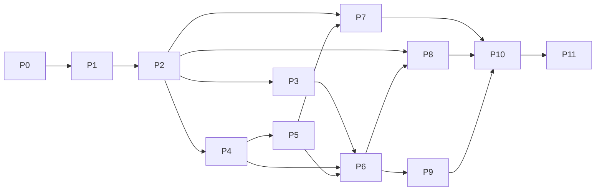

# OrbitTE completion plan

Build an independently maintained Rust network and memory transfer engine for
CPU DRAM and NVIDIA GPUs against the [frozen latest TENT contract](tent-parity.md).
Local file/SSD movement is optional. CPU and CUDA are the selected platforms;
other accelerator vendors are outside scope. Preserve the applicable runtime,
language and operational behavior and all 11 selected transport types. A working
TCP/RDMA subset is an intermediate delivery within this NVIDIA target.

The core must build and run without file/SSD modules or cuFile dependencies.
Optional storage and network-provider modules are opt-in builds, but remain
requirements of the selected complete target. This selection does not restrict
CPU or network-device vendors. No non-NVIDIA accelerator SDK is a dependency.

This is OrbitTE's only execution queue. The parity document defines requirements;
it is not another roadmap. OrbitKV keeps its own existing cache delivery queue.
Do not replace or duplicate that project's state, storage or adapter roadmap here.

## Starting point and delivery states

`orbit-te 0.1.0-alpha.1` is published as an identity-only package. The source
tree now implements the P1.1/P2.1 CPU substage described in
[the CPU TCP contract](cpu-tcp.md). This code is not published to crates.io yet.

Use these states for each substage and each claimed hardware profile:

| State | Meaning |
| --- | --- |
| Planned | Required code or executable acceptance contract is still missing |
| Implemented | Code exists and its stated source checks pass; required runtime qualification remains open |
| Qualified | The exact installed artifact passed the declared correctness, lifetime, compatibility and resource gates in the recorded profile |
| Accepted | An independent reviewer inspected the diff, reran relevant gates and accepted the evidence and remaining limits |
| Unqualified / Failed | Required hardware/evidence is unavailable, or a gate ran and failed; neither counts as passed |

P1.1/P2.1 are implemented and have local Linux loopback/process test evidence;
neither is independently accepted. No complete numbered stage is qualified.
P0's TENT oracle and compatibility fixtures remain open. Missing hardware leaves
a profile unqualified and visible in the full target.

## OrbitKV delivery priority

Prioritize the transfer contracts OrbitKV consumes before widening provider
coverage. At OrbitKV `a9befeec596bb9064d25d34f93d07fe59077809d`, the current
transfer owner needs stable allocator registration, P2P segment lookup, batched
READ, authoritative source epochs, source close/drain, generation-scoped
notifications and NIC-load observations. Source authority comes from the
source grant; a refreshed endpoint must not silently replace that epoch.

The first source delivery implements P1.1/P2.1 below with owned CPU allocations.
Next close the consumer gaps in P1/P2/P9: a frozen CPU comparison trace, external
pinned-allocation ownership and address mapping, bounded notification delivery,
and the adapter surface. Qualify that profile under P10/P11 before switching
OrbitKV's runtime dependency. Then prioritize host RDMA and NVIDIA memory paths
(P4/P5) ahead of HP-TCP/SHM and optional providers when their prerequisites are
ready. The complete parity inventory remains the target; the delivery priority
does not turn incomplete rows into completed features.

## Delivery sequence

| Stage | Concrete delivery | Prerequisites | Current state |
| --- | --- | --- | --- |
| P0 | Frozen contracts, test mapping and differential oracle | Reference inventory | Planned; source baseline recorded |
| P1 | Rust engine, configuration and resource ownership | Frozen P0 subset; remaining P0 before parity acceptance | P1.1 implemented; broader P1 open |
| P2 | P2P control plane and standard TCP vertical path | Corresponding P1 substage | P2.1 implemented; broader P2 open |
| P3 | HP-TCP and shared-memory paths | P2 | Planned |
| P4 | Host RDMA, endpoints and multirail foundation | P2 | Planned |
| P5 | CUDA, GPUDirect, NVLink/MNNVL and staging | P4 | Planned |
| P6 | Complete routing, progress, QoS, deadlines and recovery | P3/P4; staging cases also P5 | Planned |
| P7 | File, io_uring and GDS paths | P2; GDS also P5 | Planned |
| P8 | Additional CPU/NVIDIA-compatible network providers | P1/P2; relevant P4/P5/P6 contracts | Planned, divided below |
| P9 | Complete C/C++/Python and operational compatibility | P0/P2/P6; backend claims require their stages | Planned |
| P10 | Cross-backend fault, lifetime and interoperability acceptance | Relevant P3-P9 deliveries | Planned |
| P11 | Consumer integration, matched performance and installable release | Relevant accepted P2-P10 profiles | Planned |

The graph shows dependencies, not a requirement to land an entire numbered
stage in one PR. Complete one coherent substage at a time. Provider work that
already has its prerequisite contracts can proceed independently; it must not
inherit another provider's hardware qualification. P10 begins with the first
real backend and accumulates evidence; fault testing is required within each
stage, not postponed until all implementations exist. The graph describes full
target closure; an interim P11 release needs P10 acceptance of its explicitly
selected profiles while the other rows remain open.

## P0 — Freeze contracts and executable comparison

Requirements: all F/B IDs in [the parity contract](tent-parity.md).

- [ ] Freeze the reference source, compiler/build options, optional providers
  and external dependency revisions for an isolated C++ oracle. It is a test
  dependency outside the normal OrbitTE build and published package.
- [ ] Map all 33 C functions, richer native/Python/classic-TE surfaces, config
  keys/defaults/environment precedence, transport capability bits, metrics,
  metadata and wire messages to deterministic acceptance cases. Mark reference
  stubs, inactive source and narrative/code disagreements explicitly.
- [ ] Map the 84 reference C++ test sources to retained behavioral cases and
  their CPU, service, GPU, RNIC, filesystem or vendor-hardware triggers. Map
  Python guards, parent compatibility tests and tebench byte checks too. Mark
  excluded-accelerator cases as outside scope and require explicit unavailable
  behavior for their ABI values. Merge overlapping cases; do not mechanically
  port low-value implementation tests.
- [ ] Define a common request trace and runner contract for C++ and Rust:
  initial bytes, registrations, operations, faults, observations and cleanup.
  Compare byte integrity and allowed status/state transitions, not incidental
  timestamps, random IDs or thread schedules. Include deliberate old/broken
  controls for lifetime and epoch checks.
- [ ] Freeze control-RPC/YLT framing and serialization, metadata formats,
  HP-TCP wire frames, provider bootstrap messages and C ABI fixtures. Keep
  small deterministic fixtures in source; raw oracle captures stay external.
- [ ] Reserve qualification resources and write a run manifest schema: source
  and artifact hashes, ABI/profile, hardware/topology, SDK/driver/kernel,
  namespace, budgets, seed, command, correctness and cleanup result.
- [ ] Freeze workload-specific resource and performance guards before formal
  measurements. Record initial estimates after the first representative pilot.

Exit: a reviewer can select any inventory row and find its implemented reference
path, intended Rust owner, test trigger and acceptance result format. The oracle
must build and execute its CPU controls independently of OrbitKV's restaged
native libraries. No feature is considered implemented by completing P0.

## P1 — Core engine and physical ownership

Requirements: F01-F04, F08-F10 foundations, F22.

- [x] **P1.1 — owned CPU foundation (Implemented, not Accepted).** Immutable
  Rust config, random source epochs, owned stable backing, checked ranges and
  permissions, non-reused registration IDs, retained-memory budgets, bounded
  batch admission, resource counters and source-handler close/drain. Local
  Linux checks pass. External pinned allocations, topology/NUMA, TENT config
  precedence, asynchronous task/cancel/merge and native providers remain open.
- [ ] Implement Rust request/status/error/options types and native engine
  construction using frozen per-engine config, without changing process-global
  environment to configure concurrent engines.
- [ ] Make allocation, registration, batch/task and callback ownership concrete.
  An admitted transfer retains actual source/destination backing and native
  registrations until the backend proves it can no longer access them.
- [ ] Represent logical outcome and physical quiescence separately. Define
  engine admission close, requester/handler drain, unregister retry and retained
  resources. A token drop, deadline, failed submit or accepted cancel is not a
  release receipt. Borrowed/raw-pointer APIs have explicit unsafe contracts.
- [ ] Implement CPU allocation/copy/probing, range/overflow/permission validation,
  duplicate registration references, partial rollback, generation checks and
  bounded task/descriptor/payload/retained-resource admission.
- [ ] Implement batch capacity and status accounting, including terminal
  stability and merge/alias ownership contracts, before adding real devices.
- [ ] Freeze config precedence, effective defaults and diagnostics; preserve the
  distinction between bootstrap fields, runtime candidates and implemented live
  updates. Do not add a hot-reload controller to emulate a declaration.

Exit: CPU property/negative tests, concurrent registration and shutdown controls,
allocator failure and partial construction/cleanup tests pass. Test-only fakes
drive production owners. No fake test is described as a network or DMA pass.

## P2 — First complete TCP path

Requirements: B01; F05-F08, F11, F20 foundations.

- [x] **P2.1 — first CPU TCP vertical path (Implemented, not Accepted).** Explicit
  epoch-fenced descriptor open/refresh, sequential READ/WRITE batches with exact
  prefix accounting, source-side validation, staged complete-slice commits,
  final WRITE ACK, absolute I/O deadlines and bounded handlers. Real loopback,
  concurrent and independent-process restart/byte tests pass. The development
  protocol is OrbitTE-only; TENT mixed-peer tests, physical two-host tests,
  notifications, automatic updates and the reference oracle remain open.
- [ ] Implement peer identity, memory descriptors and P2P open/refresh/update
  behavior, owned RPC dispatch and handler isolation/reconnect semantics.
- [ ] Implement actual host READ/WRITE with registration/range/permission checks,
  exact status/byte accounting and copy-error propagation. Retain uncertain
  submitted work and reject stale authority in the declared protocol profile.
- [ ] Implement local and remote notifications, attached notifications and empty
  polling/free behavior, with concurrency and duplicate-delivery controls.
- [ ] Expose a narrow Rust vertical-path API and minimal native adapters needed
  to run the same trace against Rust and frozen TENT. Complete API coverage is P9.
- [ ] Add core resource/failure metrics early so admitted, retained and retired
  work is observable during every later stage.

Exit: real two-process and physical two-host TCP byte tests, mixed-peer tests for
the frozen protocol, permission/range denial, restart, reconnect, partial/lost
reply and normal source/requester shutdown. A lost RPC reply must not authorize
ambiguous replay or memory reuse. Publish a CPU-only recipe with exact limits.

## P3 — HP-TCP and SHM

Requirements: B02/B03; associated F04/F07-F11/F18.

- [ ] HP-TCP: worker-owned persistent lanes/sockets; bounded tasks/bytes/sessions;
  request and generation-scoped registration IDs; remote permissions; complete
  WRITE ACK and READ response accounting; timeout, cancel and close/drain.
- [ ] Reproduce IPv4 rail address validation, per-peer lane rotation, exact
  large-READ partitioning and static rail pairing. Keep WRITEs on one lane and
  preserve the reference's explicit restrictions.
- [ ] SHM: actual shared mappings and offsets, registration/permission checks,
  overlap/alias handling, process lifetime and cleanup. Match its opt-in default.

Exit: Rust/TENT directional HP-TCP interoperability, fragmented frames,
backpressure, partial READ/WRITE, stale registration after restart, unlink/
unregister races, cancellation/drain and same-host shared-byte tests. Multi-rail
qualification requires independently routed physical interfaces, not aliases on
one loopback route.

## P4 — Host RDMA and endpoint ownership

Requirements: B04 host profile; F02/F04/F12/F15/F16/F18 foundations.

- [ ] Implement explicit verbs/provider FFI, device/port/GID discovery, topology,
  MR/PD/CQ/QP registration and lifecycle, bootstrap and endpoint caching.
- [ ] Implement fragmented/large READ and WRITE, actual completion byte/error
  propagation, polling/event progress, cancellation and partial post handling.
- [ ] Implement multirail slicing, masks, initial routing, retry/timeout budgets,
  endpoint incarnation handling and failed-MR/QP cleanup ownership. Preserve a
  registration even if another rail fails before publication.
- [ ] Implement quota and work-request accounting needed for the healthy path;
  leave optional adaptive/deadline policies explicitly disabled until P6 passes.
- [ ] Establish the real source/requester quiescence contract for each verbs
  operation. Prevent stale rkeys, endpoints or remote accesses from reaching a
  reused allocation; local reference counts alone cannot establish this.

Exit: two physical RNIC hosts, IB/RoCE profiles separately, complete sentinels
and READ/WRITE equality, multirail accounting, real completion/endpoint faults,
partial registration/deregistration, concurrent shutdown and restart controls.
Fake verbs tests complement these gates and never replace them.

## P5 — CUDA, GPUDirect and staged transfers

Requirements: B01 device directions, B04 CUDA, B05/B06; F02-F04/F07/F19.

- [ ] Implement CUDA location/pointer classification, allocation, exact context
  restoration and retained streams/events/export/import mappings. Unexpected
  driver errors cannot select an ordinary CPU copy path.
- [ ] Implement GDR discovery and registration, supported host/device READ/WRITE
  combinations, direct-versus-staged routing and explicit unavailable behavior.
- [ ] Implement NVLink IPC handle sharing and copy completion; MNNVL fabric
  import/export and EGM as separate qualified topology profiles.
- [ ] Implement ProxyManager-equivalent chunk/staging ownership, local/remote
  Delegate/Pin/Unpin operations, nested admission and owned proxy shutdown.
- [ ] Cover mixed direct/staged batches, producer readiness and consumer-visible
  completion without early source, destination or staging-buffer reuse.

Exit: full device byte/sentinel assertions, independent producer/consumer
processes, CUDA/GDR/NVLink/MNNVL profile-specific tests, context/copy failures,
partial submission, delayed completion, cancel, teardown and generation reuse.
CPU shims and compiled CUDA stubs cannot pass this stage's device gates.

## P6 — Complete runtime behavior

Requirements: F08-F20; all implemented transports consume the same owners.

- [ ] Implement the full selector contract: policy order/name, all intents,
  priority, segment/memory/size filters, transport hints, device masks and QP
  pools. Merge only requests whose authority and execution-policy fields agree.
- [ ] Implement FIFO/EDF admission, promotion, dispatch windows, independent
  owner/byte budgets, staging reserves and deadline-infeasible cancellation.
  Match eligibility rules, queue bypass, disabled defaults and absent-provider
  behavior. Do not advertise an unconsumed local-recompute callback.
- [ ] Implement per-worker QoS, shared cross-process quotas and cleanup,
  receiver credits/pacing, deadline bandwidth arbitration and telemetry.
- [ ] Implement round-robin/adaptive spraying, topology penalties and strict
  locality; maintain separate selection EWMA and transmit-bandwidth estimates.
- [ ] Implement submit/completion failover, physical-owner/alias mapping,
  per-owner retry budgets and rail cooldown/probe/half-open state. Never replay
  uncertain writes or recycle an old attempt without its declared proof.
- [ ] Complete explicit progress, observational polling, background worker,
  bounded wake/fallback behavior, notification fallback and shutdown races.
- [ ] Complete required metrics and failure attribution; prove metrics disabled
  mode and observer overhead independently.

Exit: production-state-machine tests with deterministic clocks/fault providers,
race detection and real backends; priority/deadline fairness and byte/resource
accounting under contention; installed cross-process quota recovery; no duplicate
physical submit from merged aliases. Match reference behavior on safe inputs and
record any deliberate safety differences with negative controls.

## P7 — Storage transports

Requirements: B07/B08 and F05 file-segment behavior.

- [ ] Implement file descriptors/segments, offsets, permissions, READ/WRITE,
  short/error I/O and their owning completion state.
- [ ] Implement io_uring queue/registered-buffer lifecycle, partial submission,
  cancellation and actual completion drain before releasing file or memory.
- [ ] Implement cuFile/GDS registration and both host/device READ and WRITE,
  status/error propagation and explicit direct-versus-staged behavior.
- [ ] Qualify three distinct bidirectional profiles: DRAM/file io_uring,
  CUDA/DRAM/file staging and CUDA/file native GDS. Disable compatibility for the
  native-only profile and record actual route evidence. A staged or
  compatibility-mode pass cannot qualify native GDS.
- [ ] Keep file modules opt-in and prove the network/memory-only build neither
  loads storage SDKs nor starts storage resources.
- [ ] Audit BufIo source reachability. Preserve any actually consumed behavior;
  document unselected reference code without inventing a public transport.

Exit: real files with full-byte checks, truncation/short/error controls,
concurrent unregister/close and cancellation. GDS requires supported hardware,
filesystem and a recorded direct path; an io_uring fallback is a different gate.

## P8 — Additional network providers

These providers fit the selected host/NVIDIA purpose and remain optional
modules in the target. Each is a separate delivery. Non-NVIDIA accelerator
platforms and dependent transports are excluded in the parity matrix; their
ABI constants must return unavailable rather than instantiate device stubs.

| Substage | Required implementation | Parity IDs | Hardware acceptance |
| --- | --- | --- | --- |
| P8.1 | Native URMA, host UB buffers/endpoints/jetty/JFC, quota, cancellation, recovery and teardown | B09, F15/F18 | Two URMA hosts; provider errors and bonding separately; no GPU capability inferred |
| P8.2 | MPComm adapter, host/NVIDIA registration, peer registry and completion mapping | B15 | Compatible endpoints; NVIDIA GDR only with the frozen provider's required capability |
| P8.3 | Libfabric attributes, registration, endpoint and host data path | B17 | Real compatible provider; EFA on EFA hosts |

Exit per row: build without provider, explicit unavailable result, fake-provider
contract tests, then actual installed bytes, permissions, faults, drain and
applicable mixed-peer interoperability. Fake/stub-only implementations remain
hardware-unqualified. Complete NVIDIA-scope parity requires acceptance of every
in-scope requirement. Excluded accelerator rows require no implementation or
hardware qualification.

## P9 — External APIs and operational compatibility

Requirements: F01/F06/F20-F22 and the complete language inventory.

- [ ] Complete and verify every C symbol/constant/layout and output allocation/
  free contract. Exceptions/panics must not cross FFI. Preserve frozen struct
  layouts and distinguish optional native extensions by version/profile.
- [ ] Complete native C++ source adapters and the classic-TE surface that
  delegates to TENT, including explicit progress and synchronous/wait helpers.
  No adapter may invoke the old TE backend or omit richer native request fields.
- [ ] Complete Python enums/classes/properties/overloads/context managers,
  error translation, GIL release and actual buffer/exporter lifetime.
- [ ] Complete etcd, Redis and HTTP metadata integrations, auth/config behavior,
  transient failures, shared-schema interoperability and installed recipes.
- [ ] Complete metrics names/types/labels/histograms and HTTP/JSON/Prometheus
  endpoints, config precedence and disabled-mode behavior. Avoid secret-bearing
  config/error diagnostics.
- [ ] Exercise plugin ABI registration, bad/missing plugin behavior and actual
  CUDA plugin loading, not just static platform compilation.

Exit: independent Rust, C, C++ and Python consumers run the parity cases against
installed artifacts. Test optional-feature/provider matrices explicitly;
`cargo --all-features` is not a substitute for incompatible SDK combinations.

## P10 — Fault, physical lifetime and interoperability acceptance

Runs throughout P2-P9, with the complete matrix closed before a full-parity
release. Requirements: every F/B row's applicable fault and interoperability
cases, plus declared safety differences.

- [ ] Separate known-unsubmitted rejection/cancel from partial post, running
  work, logical error, physical quiescence and completed cleanup.
- [ ] Test requester/source crash, delayed/lost/duplicate replies and ACKs,
  mid-payload disconnect, same-endpoint/address restart, stale registration and
  provider keys, concurrent buffer reuse and admission exhaustion.
- [ ] Test failed register/deregister, endpoint/context destruction, worker and
  handler shutdown, device loss and late completions after logical cancellation.
- [ ] For failover, prove the previous attempt cannot still modify destination
  memory before replay/reuse; retain ambiguity under explicit budgets. Prove
  eventual reclamation after a valid termination barrier for each claimed path.
- [ ] Run same-host, physical two-host, multirail, storage, device and fabric
  profiles separately; exercise both mixed C++/Rust requester/source directions.
- [ ] Preserve failed runs and counterfactuals alongside accepted runs. A
  watchdog kill, timeout or skipped hardware test does not supply physical drain.

Exit: per-profile accepted evidence of correct bytes, monotonic authority,
bounded ownership, no early reuse and eventual proven cleanup. Unresolved
profiles remain unqualified; do not weaken their gates to finish a release.

## P11 — Consumers, performance and release

Requirements: F22 and applicable accepted backend/compatibility profiles.

- [ ] Run OrbitKV against an installed OrbitTE artifact through its existing
  transfer owner. Audit the old patched ABI first; preserve still-needed source
  epoch and source-close contracts. Keep cache semantics in OrbitKV. Record its
  migration under the existing OrbitKV S3/S4/S8 queue and do not modify that
  runtime dependency merely because this plan exists.
- [ ] Establish a separate consumer contract before claiming DeepInfer support.
  Engine allocation/readiness and P/D ownership are not replaced by TE parity.
- [ ] Compare frozen TENT and OrbitTE with equal bytes, budgets, topology,
  registration, warmup and measurement windows. Include small/large, fragmented,
  READ/WRITE, cold/warm endpoint, concurrent/mixed-priority, CPU/device/file and
  multirail cases. Measure goodput, p50/p95/p99 latency, CPU, RSS/registered/
  retained bytes, queue peaks, fairness and deadline misses.
- [ ] Freeze independent paired repetitions and uncertainty before formal runs;
  qualify instrumentation overhead separately. Initial proposed regression
  guards are goodput ratio at least 0.95, p99 latency ratio at most 1.05 and
  CPU-per-byte/peak-RSS ratios at most 1.10 versus the frozen reference, under
  the same admitted resource caps. Ratify workload-specific guards in P0 before
  collecting acceptance evidence; retain any failed guard unchanged afterward.
- [ ] Test packaged crates/shared libraries/headers/Python wheels outside source
  checkout, with exact provider discovery, runtime paths and artifact provenance.
  Publish examples, support matrix and a concise release qualification record.
- [ ] Verify installed build/link/runtime manifests contain no C++ Mooncake
  engine/common/Store dependency. Keep upstream attribution and license notices
  for translated source and any retained fixtures.

CPU/TCP or NVIDIA/RDMA releases may ship earlier with explicit scoped support.
The label **complete NVIDIA-scope TENT parity** requires all in-scope reference
capabilities to be accepted; narrower releases do not remove remaining selected
obligations. It does not claim the excluded accelerator platforms. A feature
being slower or unqualified is recorded
as such rather than described as a performance advantage.

## Code ownership and repository layout

Start with the existing `orbit-te` crate. Organize by owned behavior/resources:

| Location | Responsibility |
| --- | --- |
| `src/engine/` | Engine lifetime, batch/task owners, admission, selector, progress, notifications and staging |
| `src/memory/` | Backing allocation, range geometry, registration and retirement |
| `src/control/` | Peer RPC, segment descriptors, caches and metadata providers |
| `src/transport/` | Actual TCP, HP-TCP, SHM, RDMA, storage and provider byte movement |
| `src/platform/` | Device allocation, probing, contexts and provider ABI ownership |
| `src/config/`, `src/metrics/` | Effective configuration and operational observations |
| `include/`, `bindings/` | C/C++ headers/adapters and Python packaging only |
| `tests/` | Unit, integration, differential, fault and installed-artifact tests |
| `benches/` | Reusable traces, generators, byte checks and matched-run drivers |
| `docs/` | Maintained contracts, recipes, support matrix and this queue |

This is an intended ownership map, not a requirement to create empty directories
or a crate per box. Split crates only when a real FFI, packaging or resource
boundary needs independent ownership. Keep transport safety in actual owners;
avoid a generic forwarding facade or an independent cache/control coordinator.

## Required gates and evidence

| Gate | Trigger | What it may establish |
| --- | --- | --- |
| Source/CPU | Every implementation PR | Local contracts, property/concurrency tests, Rust checks and deterministic production-state-machine controls |
| Real process/TCP/SHM | Control, TCP, memory or lifecycle changes | Actual cross-process bytes, errors, protocol and owned shutdown |
| Metadata services | P2/P9 metadata changes | Real etcd/Redis/HTTP behavior and schema interoperability |
| RDMA/device/storage/provider | Corresponding implementation changes | Actual backend bytes and hardware-specific completion/lifetime behavior |
| Cross-language/mixed-peer | API, wire or binding changes | Installed caller behavior and directional interoperability |
| Matched performance | Hot-path, scheduling, metrics or release changes | Measured benefit/regression only for the recorded profile |
| Final installed artifact | Every supported release profile | Real package/runtime dependency and loader behavior outside source |

The implementation PR must name its actual commands and required environment;
do not create a broad gate that silently skips the profile it claims to test.
Use tests that exercise production owners and a real boundary or useful local
contract. Keep private Rust unit modules under `tests/unit/`, mirrored from
`src/` and included by their owner without exposing internals for tests. Keep
test-only providers/helpers under `tests/`. Miri, sanitizers,
race/property/fuzz tools apply where supported; none establishes hardware DMA
termination by itself.

Select an explicit external artifact root before running experiments. Raw logs,
traces, JSON/CSV, captures, manifests, generated charts and per-run reports stay
outside the checkout and Git history. Source retains reusable workloads, small
deterministic fixtures and reproduction instructions. Freeze libraries before
runtime gates; never restage a mapped native library under another process.

Each delivery handoff contains the commit, F/B requirement IDs, changed contracts,
commands/results, installed artifact hashes/locations and remaining limits. The
reviewing agent independently inspects the diff and reruns applicable gates
before dependent work is accepted. Preparation, implementation, qualification
and independent acceptance remain separate states.

## Immediate next delivery

Independently review P1.1/P2.1 and rerun the [CPU gates](cpu-tcp.md#verification).
Then deliver the frozen TENT CPU comparison trace and externally owned pinned
allocation contract required by OrbitKV, followed by bounded notifications and
the native consumer adapter. Keep the larger 33-symbol/native-schema oracle,
wire compatibility and other parity work visible in P0/P9. Hardware RDMA/CUDA
qualification remains required before OrbitKV can adopt those profiles.

Calendar estimates require measured progress on this first slice and confirmed
maintainer, hardware and provider-SDK capacity. Hardware acquisition is a
prerequisite to qualification, not grounds to reduce the full-parity target.
