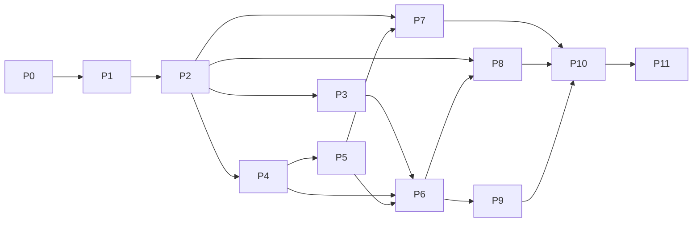

# OrbitTE completion plan

Build an independently maintained Rust network and memory transfer engine for
CPU DRAM and NVIDIA GPUs against the [frozen latest TENT contract](tent-parity.md).
Local file/SSD movement is optional. CPU and CUDA are the selected platforms;
other accelerator vendors are outside scope. Preserve the applicable runtime,
language and operational behavior and all 11 selected transport types. A working
TCP/RDMA subset is an intermediate delivery within this NVIDIA target.

The core must build and run without file/SSD modules or cuFile dependencies.
Optional storage and network-provider modules are opt-in builds, but remain
requirements of the selected complete target. This selection does not restrict
CPU or network-device vendors. No non-NVIDIA accelerator SDK is a dependency.

This is OrbitTE's only execution queue. The parity document defines requirements;
it is not another roadmap. OrbitKV keeps its own existing cache delivery queue.
Do not replace or duplicate that project's state, storage or adapter roadmap here.

## Starting point and delivery states

`orbit-te 0.1.0-alpha.1` is published as an identity-only package. The source
tree implements the P1.1-P1.4/P2.1/P2.2 CPU substages described in
[the CPU TCP contract](cpu-tcp.md), plus the P4.3 direct host RDMA and
P4.1/P5.1 RDMA/CUDA staging paths. P1.5 adds the opt-in consumer allocation
bridge; P2.3 connects the consumer TCP peer path below. This code is not
published to crates.io yet.

Use these states for each substage and each claimed hardware profile:

| State | Meaning |
| --- | --- |
| Planned | Required code or executable acceptance contract is still missing |
| Implemented | Code exists and its stated source checks pass; required runtime qualification remains open |
| Qualified | The exact installed artifact passed the declared correctness, lifetime, compatibility and resource gates in the recorded profile |
| Accepted | An independent reviewer inspected the diff, reran relevant gates and accepted the evidence and remaining limits |
| Unqualified / Failed | Required hardware/evidence is unavailable, or a gate ran and failed; neither counts as passed |

P1.1/P2.1 were merged in #2 after passing stable/MSRV CI and local CPU checks.
P1.2's external host ranges and P2.2's bounded notifications were merged in
#3/#4 after passing the same source gates. They have local Linux loopback/process evidence;
independent acceptance is still open. No complete numbered stage is qualified.
PRs #5-#9 are merged through `02d64e552f94ef965eff32b35a55789018223439`,
covering the CPU comparison, host batches, async ownership and native RDMA/CUDA
bindings. Stable/MSRV checks, 58 Rust tests, two supervision controls and eight
healthy two-host H20 staging cases passed for that tree. These scoped results
do not establish independent acceptance, complete native faults or full parity.
P0.1 adds a [scoped native CPU comparison](cpu-oracle.md); the complete P0 oracle
and compatibility inventory remain open. Missing hardware leaves
a profile unqualified and visible in the full target.

## Native-engine delivery focus

Complete OrbitTE's native RDMA stage P4 against frozen TENT before resuming
OrbitKV integration. Deliver reviewable substages inside P4: direct application
DRAM registration, endpoint/MR reuse, fragmented work/completion ownership,
discovery/topology and multirail, with the physical fault and shutdown gates
below. Advance NVIDIA P5 owners where those prerequisites are ready. Do not
upgrade OrbitKV's dependency or add consumer adapters between these substages.
The return to consumer work requires independent acceptance of the complete P4
exit, not a healthy staging pilot or one additional merged PR. Remaining P5-P10
contracts stay in scope; accepting P4 does not establish full TENT parity.

Use TENT's context/PD, registered-buffer, endpoint-store and worker/slice
boundaries as the implementation reference. Preserve the Rust contract that
failed native cleanup retains actual owners and budget charges. Every substage
records its exact source correspondence and deliberate safety differences.

## Historical OrbitKV contracts and evidence

These records preserve earlier consumer requirements and accepted profiles;
they do not set the current execution order. At OrbitKV
`a9befeec596bb9064d25d34f93d07fe59077809d`, the audited transfer owner needs stable
allocator registration, P2P segment lookup, batched READ, authoritative source epochs, source close/drain, generation-scoped
notifications and NIC-load observations. Source authority comes from the
source grant; a refreshed endpoint must not silently replace that epoch.

P1.1/P2.1 establish the CPU path; P1.2 adds externally owned host allocations,
duplicate registration references, shared alias locking and address lookup.
P2.2 adds bounded local/remote notifications and separate attached-delivery
outcomes. OrbitKV already owns generation scopes and matching counts in its
notification mailbox (verified at `3f4d65709e86a060f323da7e0d1b59975f6939bc`);
those remain consumer policy. P0.1 adds a frozen valid-input CPU comparison
trace. P1.3 adds atomic host-region registration batches and absolute-address
requests that retain their resolved owners. The OrbitKV consumer audit remains
at `3f4d65709e86a060f323da7e0d1b59975f6939bc`; its native fork is
`12cbf549b6351c800de0f94a480276d216b9a43b`, with an extended request ABI.
P1.4 adds bounded asynchronous batch/task ownership and requester drain for
CPU TCP. P1.5 implements the first real pinned-allocation bridge in
[OrbitKV #303](https://github.com/OrbitInfra/OrbitKV/pull/303), with a scoped H20
TCP ownership pilot. P2.3 connects the opt-in OrbitKV TCP payload provider in
[OrbitKV #304](https://github.com/OrbitInfra/OrbitKV/pull/304), preserving source
grants, their epochs and the existing generation-scoped gRPC completion owner.
That Manager owner is separate from the transfer notification mailbox; this
change does not add a mailbox adapter. Whole-pool native adaptation, installed
consumer qualification and remaining notification integration stay open in
P1/P2/P9/P11. RDMA and CUDA development
proceeds with these owners; no hardware qualification is inferred from CPU progress.
Any later OrbitKV runtime switch still needs its own P10/P11 qualification.
Native P4/P5 now proceed ahead of consumer linkage, HP-TCP/SHM and optional
providers when their prerequisites are ready. The complete parity inventory
remains the target; the current order does not reduce the required scope.

## Delivery sequence

| Stage | Concrete delivery | Prerequisites | Current state |
| --- | --- | --- | --- |
| P0 | Frozen contracts, test mapping and differential oracle | Reference inventory | P0.1 implemented; complete mapping/oracle open |
| P1 | Rust engine, configuration and resource ownership | Frozen P0 subset; remaining P0 before parity acceptance | P1.1-P1.4 implemented; P1.5 consumer candidate implemented; broader P1 open |
| P2 | P2P control plane and standard TCP vertical path | Corresponding P1 substage | P2.1-P2.3 implemented; broader P2 open |
| P3 | HP-TCP and shared-memory paths | P2 | Planned |
| P4 | Host RDMA, endpoints and multirail foundation | P2 | P4.1-P4.4 implemented with scoped native acceptance; full P4 open |
| P5 | CUDA, GPUDirect, NVLink/MNNVL and staging | P4 | P5.1 allocation/copy staging implemented; full P5 open |
| P6 | Complete routing, progress, QoS, deadlines and recovery | P3/P4; staging cases also P5 | Planned |
| P7 | File, io_uring and GDS paths | P2; GDS also P5 | Planned |
| P8 | Additional CPU/NVIDIA-compatible network providers | P1/P2; relevant P4/P5/P6 contracts | Planned, divided below |
| P9 | Complete C/C++/Python and operational compatibility | P0/P2/P6; backend claims require their stages | Planned |
| P10 | Cross-backend fault, lifetime and interoperability acceptance | Relevant P3-P9 deliveries | Planned |
| P11 | Consumer integration, matched performance and installable release | Relevant accepted P2-P10 profiles | Planned |

The graph shows dependencies, not a requirement to land an entire numbered
stage in one PR. Complete one coherent substage at a time. Provider work that
already has its prerequisite contracts can proceed independently; it must not
inherit another provider's hardware qualification. P10 begins with the first
real backend and accumulates evidence; fault testing is required within each
stage, not postponed until all implementations exist. The graph describes full
target closure; an interim P11 release needs P10 acceptance of its explicitly
selected profiles while the other rows remain open.

## P0 — Freeze contracts and executable comparison

Requirements: all F/B IDs in [the parity contract](tent-parity.md).

- [x] **P0.1 — shared CPU comparison trace (Implemented, not Accepted).**
  Unmodified frozen TENT and public Rust drivers execute one deterministic
  registration/READ/WRITE/notification trace over actual host memory and TCP.
  Both must match 25 independent expected observations (including P1.3 batch registration). Reference/dependency
  revisions, library paths and hashes are checked; six comparator controls must
  reject broken results. Native notification free/reuse is exercised. A separate
  native CI gate preserves external evidence; the fast Rust fixture gate does
  not claim native execution. This covers selected valid-input CPU behavior,
  not the complete P0 mapping, native faults, wire compatibility or hardware.
- [ ] Freeze the reference source, compiler/build options, optional providers
  and external dependency revisions for an isolated C++ oracle. It is a test
  dependency outside the normal OrbitTE build and published package.
- [ ] Map all 33 C functions, richer native/Python/classic-TE surfaces, config
  keys/defaults/environment precedence, transport capability bits, metrics,
  metadata and wire messages to deterministic acceptance cases. Mark reference
  stubs, inactive source and narrative/code disagreements explicitly.
- [ ] Map the 84 reference C++ test sources to retained behavioral cases and
  their CPU, service, GPU, RNIC, filesystem or vendor-hardware triggers. Map
  Python guards, parent compatibility tests and tebench byte checks too. Mark
  excluded-accelerator cases as outside scope and require explicit unavailable
  behavior for their ABI values. Merge overlapping cases; do not mechanically
  port low-value implementation tests.
- [ ] Define a common request trace and runner contract for C++ and Rust:
  initial bytes, registrations, operations, faults, observations and cleanup.
  Compare byte integrity and allowed status/state transitions, not incidental
  timestamps, random IDs or thread schedules. Include deliberate old/broken
  controls for lifetime and epoch checks.
- [ ] Freeze control-RPC/YLT framing and serialization, metadata formats,
  HP-TCP wire frames, provider bootstrap messages and C ABI fixtures. Keep
  small deterministic fixtures in source; raw oracle captures stay external.
- [ ] Reserve qualification resources and write a run manifest schema: source
  and artifact hashes, ABI/profile, hardware/topology, SDK/driver/kernel,
  namespace, budgets, seed, command, correctness and cleanup result.
- [ ] Freeze workload-specific resource and performance guards before formal
  measurements. Record initial estimates after the first representative pilot.

Exit: a reviewer can select any inventory row and find its implemented reference
path, intended Rust owner, test trigger and acceptance result format. The oracle
must build and execute its CPU controls independently of OrbitKV's restaged
native libraries. No feature is considered implemented by completing P0.

## P1 — Core engine and physical ownership

Requirements: F01-F04, F08-F10 foundations, F22.

- [x] **P1.1 — owned CPU foundation (Implemented, not Accepted).** Immutable
  Rust config, random source epochs, owned stable backing, checked ranges and
  permissions, non-reused registration IDs, retained-memory budgets, bounded
  batch admission, resource counters and source-handler close/drain. Local
  Linux checks pass. External pinned allocations, topology/NUMA, TENT config
  precedence, asynchronous task/cancel/merge and native providers remain open.
- [x] **P1.2 — external host owner and address registration (Implemented, not
  Accepted).** A retained host-allocation owner, checked registered subranges,
  TENT-style duplicate references/first permission and containing-buffer lookup,
  shared alias locks, retained-range conflicts and versioned base-address
  descriptors. Real TCP tests use external source/destination backing and prove
  unregister/timeout cannot release the owner while a handler remains active.
  This substage does not pin pages itself. P1.5 adds an actual CUDA-pinned
  consumer bridge; whole-pool integration and native free-failure qualification
  remain open.
- [x] **P1.3 — native host batch inputs (Implemented, not Accepted).**
  Absolute-address READ/WRITE inputs resolve all registered ranges before I/O
  and retain actual backing through completion. Host range batches preflight
  bounds, alias locks, references, IDs and retained budgets before one atomic
  publication. Real external allocations, multi-region TCP bytes and concurrent
  requester unregister/close are tested. The shared native trace now exercises
  batch duplicate references and complete cleanup. New in-batch duplicates are
  coalesced in Rust; this restriction is distinguished from the frozen native
  publication behavior. This is allocator-facing input support, not an
  installed OrbitKV adapter, C ABI or CUDA-pinned qualification.
- [x] **P1.4 — asynchronous CPU batches (Implemented, not Accepted).**
  Bounded allocate/append/seal/status/free, stable public task indices and
  post-seal terminal state, worker-driven progress and observational polling.
  Task/submission data outcomes and notifications are independent. Queue time
  consumes the submission deadline. Cancellation never releases running owners;
  dropped handles retain the engine, backing and allocation/admission charges
  until accepted work exits. Requester close/drain is separate from source
  close. Real blocked TCP controls exercise cancel, wait timeout, unregister,
  detach and release. The native comparison now uses async allocation, multiple
  submits, repeated terminal polling and free. See [the contract](async-batches.md).
  Merge/alias mapping, explicit progress, backend aborts, priority and native
  deferred-free compatibility remain open; this is not the complete F08 stage.
- [x] **P1.5 — OrbitKV pinned allocation bridge (Implemented consumer candidate,
  not Accepted).** [OrbitKV #303](https://github.com/OrbitInfra/OrbitKV/pull/303)
  at `f9eda6acd9defdae46d95514bd4e94d48b657fc6` pins OrbitTE `02d64e55` and
  exposes one canonical host view per real `PinnedAllocation`. The view retains
  that exact slot and its shard; a weak cache avoids cycles and independent
  alias locks. Strict default-feature Clippy passes. Two explicit hardware
  controls passed on H20 GPU 7 with private CUDA 12.2: production memfd/CUDA host
  registration, actual TCP READ/WRITE bytes, duplicates, cancel/wait timeout,
  unregister, failed early free, detach, slot exhaustion, allocator drop and
  eventual release. The native child and supervisor were reaped and locks
  released. Evidence is external at
  `/root/orbitte-artifacts/merge-and-allocator-20261021/allocator-hardware/`.
  This is an opt-in allocation-range bridge in a consumer PR, not a Manager
  transport replacement, whole-pool MR cache, source-grant/mailbox integration,
  installed serving, RDMA or device-DMA failure qualification. The caller must
  still coordinate external CPU/GPU/process access. See the maintained
  [consumer contract and hardware gate](https://github.com/OrbitInfra/OrbitKV/blob/f9eda6acd9defdae46d95514bd4e94d48b657fc6/docs/transport.md#experimental-orbitte-allocation-bridge).
- [ ] Implement Rust request/status/error/options types and native engine
  construction using frozen per-engine config, without changing process-global
  environment to configure concurrent engines.
- [ ] Make allocation, registration, batch/task and callback ownership concrete.
  An admitted transfer retains actual source/destination backing and native
  registrations until the backend proves it can no longer access them.
- [ ] Represent logical outcome and physical quiescence separately. Define
  engine admission close, requester/handler drain, unregister retry and retained
  resources. A token drop, deadline, failed submit or accepted cancel is not a
  release receipt. Borrowed/raw-pointer APIs have explicit unsafe contracts.
- [ ] Implement CPU allocation/copy/probing, range/overflow/permission validation,
  duplicate registration references, partial rollback, generation checks and
  bounded task/descriptor/payload/retained-resource admission.
- [ ] Implement batch capacity and status accounting, including terminal
  stability and merge/alias ownership contracts, before adding real devices.
- [ ] Freeze config precedence, effective defaults and diagnostics; preserve the
  distinction between bootstrap fields, runtime candidates and implemented live
  updates. Do not add a hot-reload controller to emulate a declaration.

Exit: CPU property/negative tests, concurrent registration and shutdown controls,
allocator failure and partial construction/cleanup tests pass. Test-only fakes
drive production owners. No fake test is described as a network or DMA pass.

## P2 — First complete TCP path

Requirements: B01; F05-F08, F11, F20 foundations.

- [x] **P2.1 — first CPU TCP vertical path (Implemented, not Accepted).** Explicit
  epoch-fenced descriptor open/refresh, sequential READ/WRITE batches with exact
  prefix accounting, source-side validation, staged complete-slice commits,
  final WRITE ACK, absolute I/O deadlines and bounded handlers. Real loopback,
  concurrent and independent-process restart/byte tests pass. The development
  protocol is OrbitTE-only; TENT mixed-peer tests, physical two-host tests,
  transport notification fallback, automatic updates and the reference oracle
  remain open.
- [x] **P2.2 — bounded CPU notifications (Implemented, not Accepted).** TENT-style
  named local/remote messages, atomic drain/empty polling and one attached
  message after successful nonempty synchronous batches. Queue count/bytes
  include incoming reservations. Source close drains admitted handlers and
  leaves queued messages readable. Data results remain intact if notification
  delivery fails; an ambiguous receipt is not replayed. Real TCP, concurrency,
  malformed/partial-body, queue-pressure and independent-process restart tests
  pass. The original substage used OrbitTE wire v3 (now v5); native C allocation/free, asynchronous
  multi-target hooks, RDMA/RPC fallback and C++ differential gates remain open.
- [x] **P2.3 — OrbitKV TCP peer integration (Implemented consumer candidate;
  scoped source/H20 pilot reviewed; installed prerequisite accepted in P11).** [OrbitKV #304](https://github.com/OrbitInfra/OrbitKV/pull/304)
  at `5a50d092c651d28ff3f79f6de661c9da8120b2b3` pins OrbitTE `02d64e55`.
  An explicit `orbitte-tcp` provider shares Manager discovery, source admission,
  planning and gRPC generation completion. The standalone build excludes
  Mooncake; the runtime default remains TENT. Source tickets retain actual
  allocation registrations; requester READ preserves the grant epoch through
  metadata open and payload. Cancellation retains the blocking owner;
  unquiesced work retains the source ticket, destination buffers and admission.
  Source close fences before requester drain, even after cleanup failure.
  The first profile allows 64 MiB/16,384 split descriptors per READ and 4,096
  active/retained allocation regions. It rejects excess work; planner resizing
  is not implemented. Strict default/dual/standalone checks, real TCP epoch and
  protocol controls, ticket loss/retry/cancellation and isolated quarantine
  controls pass. Two exact H20 source gates passed with private CUDA 12.2:
  duplicate grant registration, generation reuse, eviction and TCP bytes;
  then real Manager services, etcd/inventory, multi-grant READ, GPU Save/Restore
  byte comparison, membership fencing and worker/service drain. The run verifies
  private libraries, no mapped TENT, owned child/supervisor/etcd reaping and GPU
  lease release. An independent reviewer accepted the limited source/H20
  evidence after rerunning the source/CPU gates and both frozen hardware tests;
  the report is `independent-review.json` under the evidence root below.
  The failed first cleanup-assertion attempt is retained with
  the passing corrected run in the external evidence root
  `/root/orbitte-artifacts/peer-read-20261021/`.
  This does not qualify an installed Manager/wheel, serving, CUDA 13 runtime,
  physical cross-host Manager traffic, RDMA, GDR, multirail, SSD or TENT wire
  compatibility. Transfer notification-mailbox adaptation remains separate.
  See the maintained [consumer contract and explicit gates](https://github.com/OrbitInfra/OrbitKV/blob/5a50d092c651d28ff3f79f6de661c9da8120b2b3/docs/transport.md#experimental-orbitte-peer-tcp-profile).
- [ ] Implement peer identity, memory descriptors and P2P open/refresh/update
  behavior, owned RPC dispatch and handler isolation/reconnect semantics.
- [ ] Implement actual host READ/WRITE with registration/range/permission checks,
  exact status/byte accounting and copy-error propagation. Retain uncertain
  submitted work and reject stale authority in the declared protocol profile.
- [ ] Implement local and remote notifications, attached notifications and empty
  polling/free behavior, with concurrency and duplicate-delivery controls.
- [ ] Expose a narrow Rust vertical-path API and minimal native adapters needed
  to run the same trace against Rust and frozen TENT. Complete API coverage is P9.
- [ ] Add core resource/failure metrics early so admitted, retained and retired
  work is observable during every later stage.

Exit: real two-process and physical two-host TCP byte tests, mixed-peer tests for
the frozen protocol, permission/range denial, restart, reconnect, partial/lost
reply and normal source/requester shutdown. A lost RPC reply must not authorize
ambiguous replay or memory reuse. Publish a CPU-only recipe with exact limits.

## P3 — HP-TCP and SHM

Requirements: B02/B03; associated F04/F07-F11/F18.

- [ ] HP-TCP: worker-owned persistent lanes/sockets; bounded tasks/bytes/sessions;
  request and generation-scoped registration IDs; remote permissions; complete
  WRITE ACK and READ response accounting; timeout, cancel and close/drain.
- [ ] Reproduce IPv4 rail address validation, per-peer lane rotation, exact
  large-READ partitioning and static rail pairing. Keep WRITEs on one lane and
  preserve the reference's explicit restrictions.
- [ ] SHM: actual shared mappings and offsets, registration/permission checks,
  overlap/alias handling, process lifetime and cleanup. Match its opt-in default.

Exit: Rust/TENT directional HP-TCP interoperability, fragmented frames,
backpressure, partial READ/WRITE, stale registration after restart, unlink/
unregister races, cancellation/drain and same-host shared-byte tests. Multi-rail
qualification requires independently routed physical interfaces, not aliases on
one loopback route.

## P4 — Host RDMA and endpoint ownership

Requirements: B04 host profile; F02/F04/F12/F15/F16/F18 foundations.

- [x] **P4.1 — owned staging RC verbs (Implemented, not Accepted).** Explicit
  single device/port/GID, bounded per-slice PD/CQ/QP/MR, real READ/WRITE WR/CQ,
  fenced control bootstrap and commit/ACK, exact teardown ordering and retained
  native resources on failure. Explicit request hints reject unavailable RDMA.
  CPU ABI fault controls pass; physical profiles remain subject to the
  [RDMA/CUDA gates](rdma-cuda.md). This does not register application/GPU memory
  directly, cache endpoints, implement multirail or close full P4.

  The binding maintenance substage reuses published `ibverbs-sys` rather
  than carrying an OrbitTE C bridge. It preserves explicit fallible teardown
  and retained DMA owners; the backend's qualification limits still apply.
- [x] **P4.2a — OrbitKV RDMA selection and registered-host execution candidate
  (Implemented; scoped installed consumer gate accepted, broader faults open).** The consumer
  explicitly enables `orbitte-rdma`, configures one RNIC/port/GID and advertises
  `orbitte+rdma://`. It reuses allocation registration, grant epoch and completion
  owners; each request selects RDMA without a TCP/TENT payload fallback. The
  first path uses P4.1's private host staging, not application/GPU MRs. A shared
  hardware runner executes the consumer's actual registered-read body with
  ordinary host backing, epoch/namespace controls, fragmented bytes/guards,
  native CQ counts and zero resource charges. The host component is separate
  from the embedded pinned Manager/GPU gate. A CPU verbs fault control uses actual
  TCP framing to show that a source MR-destroy failure can arrive as an ordinary
  backend error while the requester is locally drained: source backing,
  admission/staging charges and pending source close remain retained.
  Independent source/CPU review and two-node host reruns pass at consumer
  `660f893d` and test harness `ff30ee1`: both RoCE directions, native CQ counts,
  bytes/guards and zero normal-close resource charges, with no CUDA/TENT mapped.
  Frozen source, binary and external evidence locations are linked in
  [OrbitTE #12](https://github.com/OrbitInfra/OrbitTE/pull/12) and
  [OrbitKV #305](https://github.com/OrbitInfra/OrbitKV/pull/305). A separate A-node
  CUDA 13.1 compatibility profile passes pinned source grants and embedded
  Manager TCP/RDMA staging GPU Save/Restore at `660f893d`; R535 alone does not
  exclude CUDA 13 when supported compatibility libraries are loaded. See the
  [runtime profile](rdma-cuda.md). B-node compute awaits free GPU leases.
  The later installed IPC/peer-byte gate at consumer `eb1cc90f` is independently
  accepted for the explicit single-runtime H20 profile in [the runtime contract](rdma-cuda.md).
  Installed serving, physical cross-host Manager/GPU, source/requester RNIC
  faults, lost DONE/ACK qualification, endpoint caching,
  zero-copy, GDR and multirail stay open. Old CUDA 12.2 pilots remain historical.
- [x] **P4.2b — shared RNIC context/PD and whole-engine close (Implemented;
  scoped source/CPU/healthy native gates independently Accepted).** A per-engine lazy
  owner reuses one context/PD across slices; CQ/QP/MR/staging stay exclusive.
  Every new endpoint re-queries port/GID addressing. Actual device references
  survive failed slice teardown. Whole-engine `close` fences both directions
  before shared-deadline drain and explicitly destroys PD/context, with stable
  failure retention and no retry from concurrent close or Drop. Existing
  directional close remains independent. CPU ABI/concurrency controls and the
  physical probe require single device construction and complete normal close.
  Source `1782771` passes independent CPU reruns and six two-host RoCE/TCP
  DRAM/A-H20 staging native cases, with actual byte/guard/CQ checks, one device
  open per RDMA peer and zero normal-close charges. See the scoped
  [qualification and external evidence](rdma-cuda.md#shared-device-owner-qualification)
  and [owner contract](rdma-cuda.md#failure-drain-and-resource-ownership).
  This does not add pooled endpoints/MRs, application registrations, GDR,
  multirail or a performance claim. OrbitKV's pinned earlier implementation
  and shutdown receipt must be migrated and qualified separately.
- [x] **P4.3 — direct application host MR (Implemented; scoped source/CPU and
  healthy native gates independently Accepted).** RDMA registers the exact
  requested DRAM or CUDA-pinned host range in the engine's shared PD. Canonical allocation
  range leases retain the real registration, allocation and budget across
  aliases/engines; overlapping CPU or DMA accesses fail while disjoint ranges
  remain usable. Native teardown must succeed before CPU access and source ACK.
  Explicit staging remains selectable; device allocations keep the declared
  staging path, and a failed host registration never falls back to staging.
  Wire v5 rejects earlier peers: WRITE attempts can change application bytes
  before DONE/ACK, and a failed direct READ can already have changed its target.
  CPU fault controls cover mixed policies, exact MR extents, retained teardown,
  unregister and running cancel/detach/close. Source `09fa949` passes independent
  CPU reruns and twelve native two-host DRAM, CUDA-pinned host direct,
  mixed/explicit staging and A-H20 device-staging/TCP cases; full bytes/guards,
  actual direct/CQ counts, frozen libraries and complete normal release pass.
  `dc77a5b` adds only the close-before-drop assertion. See the scoped
  [qualification and external evidence](rdma-cuda.md#direct-host-mr-qualification).
  This is per-request registration, not TENT's persistent MR cache, endpoint
  pooling, GDR or complete P4.
- [x] **P4.4 — bounded native slice submission and completion debt
  (Implemented; source/CPU and healthy native profile independently Accepted).**
  The frozen TENT slice geometry uses a 64 KiB base, adaptive CPU READ cap64 or
  WRITE/device cap32 and quarter-block short-tail folding. One request retains
  its complete MR/DMA lease across bounded, all-signaled WR windows, with unique
  IDs, exact local/remote offsets and CQ status/opcode/READ-length checks.
  Known accepted prefixes release only an unposted suffix; unknown `bad_wr`
  preserves the entire possible debt without dereferencing an untrusted pointer
  or replay. Physical slice bytes/CQs and whole-request completion are distinct.
  Successful QP/MR/CQ teardown clears remaining WR charges; failed teardown
  retains real owners and debt. This prerequisite precedes persistent MR and
  endpoint-store reuse. It does not add pooled CQs/QPs, backend abort, multirail,
  asynchronous event progress, direct GPU registration or complete P4.
  Source `e04e381` passes independent CPU gates and fourteen two-host native
  cases with exact CQ/byte/post counts, folded tails and windows 1/2/3/4/8.
  See the scoped [qualification and external evidence](rdma-cuda.md#bounded-slice-and-wr-progress-qualification).
- [ ] Complete automatic device/port/GID and topology discovery plus persistent
  MR/endpoint-store ownership. Explicit provider FFI, shared context/PD,
  per-request MR/QP/CQ lifecycle and fenced bootstrap are implemented above.
- [ ] Complete shared polling/event progress and backend cancellation for
  fragmented transfers. P4.4 implements adaptive READ/WRITE slices, exact CQ
  byte/error accounting and partial-post controls in exclusive windows;
  real partial-post/CQ/endpoint fault qualification remains open.
- [ ] Implement multirail slicing, masks, initial routing, retry/timeout budgets,
  endpoint incarnation handling and failed-MR/QP cleanup ownership. Preserve a
  registration even if another rail fails before publication.
- [ ] Extend P4.4's exclusive-window WR accounting to shared CQ/SQ quotas,
  persistent owners and multiple rails. Optional adaptive/deadline policies
  remain disabled until P6 passes.
- [ ] Establish the real source/requester quiescence contract for each verbs
  operation. Prevent stale rkeys, endpoints or remote accesses from reaching a
  reused allocation; local reference counts alone cannot establish this.

Exit: two physical RNIC hosts, IB/RoCE profiles separately, complete sentinels
and READ/WRITE equality, multirail accounting, real completion/endpoint faults,
partial registration/deregistration, concurrent shutdown and restart controls.
Fake verbs tests complement these gates and never replace them.

## P5 — CUDA, GPUDirect and staged transfers

Requirements: B01 device directions, B04 CUDA, B05/B06; F02-F04/F07/F19.

- [x] **P5.1 — NVIDIA allocation and synchronized staging (Implemented, not
  Accepted).** Driver API device/pinned host owners; probed external device
  ranges; shared transactional registration; private pinned copy staging,
  context restore/synchronize, and retained unquiesced task/source/requester
  owners with budgets. CUDA can feed TCP or the P4.1 host-MR path. CPU shim
  gates cover copy/restore/sync/unpin and logical failure versus physical drain.
  Hardware qualification is separate. GDR, IPC/NVLink/MNNVL, streams/events,
  producer lifecycle integration and reclaim proofs remain open.

  The binding maintenance substage reuses generated `cudarc` Driver API types
  and signatures with fallible, selective `libloading` lookup. The pinned
  dependency keeps Rust 1.85 and the existing quiescence/retention contract.
- [ ] Implement CUDA location/pointer classification, allocation, exact context
  restoration and retained streams/events/export/import mappings. Unexpected
  driver errors cannot select an ordinary CPU copy path.
- [ ] Implement GDR discovery and registration, supported host/device READ/WRITE
  combinations, direct-versus-staged routing and explicit unavailable behavior.
- [ ] Implement NVLink IPC handle sharing and copy completion; MNNVL fabric
  import/export and EGM as separate qualified topology profiles.
- [ ] Implement ProxyManager-equivalent chunk/staging ownership, local/remote
  Delegate/Pin/Unpin operations, nested admission and owned proxy shutdown.
- [ ] Cover mixed direct/staged batches, producer readiness and consumer-visible
  completion without early source, destination or staging-buffer reuse.

Exit: full device byte/sentinel assertions, independent producer/consumer
processes, CUDA/GDR/NVLink/MNNVL profile-specific tests, context/copy failures,
partial submission, delayed completion, cancel, teardown and generation reuse.
CPU shims and compiled CUDA stubs cannot pass this stage's device gates.

## P6 — Complete runtime behavior

Requirements: F08-F20; all implemented transports consume the same owners.

- [ ] Implement the full selector contract: policy order/name, all intents,
  priority, segment/memory/size filters, transport hints, device masks and QP
  pools. Merge only requests whose authority and execution-policy fields agree.
- [ ] Implement FIFO/EDF admission, promotion, dispatch windows, independent
  owner/byte budgets, staging reserves and deadline-infeasible cancellation.
  Match eligibility rules, queue bypass, disabled defaults and absent-provider
  behavior. Do not advertise an unconsumed local-recompute callback.
- [ ] Implement per-worker QoS, shared cross-process quotas and cleanup,
  receiver credits/pacing, deadline bandwidth arbitration and telemetry.
- [ ] Implement round-robin/adaptive spraying, topology penalties and strict
  locality; maintain separate selection EWMA and transmit-bandwidth estimates.
- [ ] Implement submit/completion failover, physical-owner/alias mapping,
  per-owner retry budgets and rail cooldown/probe/half-open state. Never replay
  uncertain writes or recycle an old attempt without its declared proof.
- [ ] Complete explicit progress, observational polling, background worker,
  bounded wake/fallback behavior, notification fallback and shutdown races.
- [ ] Complete required metrics and failure attribution; prove metrics disabled
  mode and observer overhead independently.

Exit: production-state-machine tests with deterministic clocks/fault providers,
race detection and real backends; priority/deadline fairness and byte/resource
accounting under contention; installed cross-process quota recovery; no duplicate
physical submit from merged aliases. Match reference behavior on safe inputs and
record any deliberate safety differences with negative controls.

## P7 — Storage transports

Requirements: B07/B08 and F05 file-segment behavior.

- [ ] Implement file descriptors/segments, offsets, permissions, READ/WRITE,
  short/error I/O and their owning completion state.
- [ ] Implement io_uring queue/registered-buffer lifecycle, partial submission,
  cancellation and actual completion drain before releasing file or memory.
- [ ] Implement cuFile/GDS registration and both host/device READ and WRITE,
  status/error propagation and explicit direct-versus-staged behavior.
- [ ] Qualify three distinct bidirectional profiles: DRAM/file io_uring,
  CUDA/DRAM/file staging and CUDA/file native GDS. Disable compatibility for the
  native-only profile and record actual route evidence. A staged or
  compatibility-mode pass cannot qualify native GDS.
- [ ] Keep file modules opt-in and prove the network/memory-only build neither
  loads storage SDKs nor starts storage resources.
- [ ] Audit BufIo source reachability. Preserve any actually consumed behavior;
  document unselected reference code without inventing a public transport.

Exit: real files with full-byte checks, truncation/short/error controls,
concurrent unregister/close and cancellation. GDS requires supported hardware,
filesystem and a recorded direct path; an io_uring fallback is a different gate.

## P8 — Additional network providers

These providers fit the selected host/NVIDIA purpose and remain optional
modules in the target. Each is a separate delivery. Non-NVIDIA accelerator
platforms and dependent transports are excluded in the parity matrix; their
ABI constants must return unavailable rather than instantiate device stubs.

| Substage | Required implementation | Parity IDs | Hardware acceptance |
| --- | --- | --- | --- |
| P8.1 | Native URMA, host UB buffers/endpoints/jetty/JFC, quota, cancellation, recovery and teardown | B09, F15/F18 | Two URMA hosts; provider errors and bonding separately; no GPU capability inferred |
| P8.2 | MPComm adapter, host/NVIDIA registration, peer registry and completion mapping | B15 | Compatible endpoints; NVIDIA GDR only with the frozen provider's required capability |
| P8.3 | Libfabric attributes, registration, endpoint and host data path | B17 | Real compatible provider; EFA on EFA hosts |

Exit per row: build without provider, explicit unavailable result, fake-provider
contract tests, then actual installed bytes, permissions, faults, drain and
applicable mixed-peer interoperability. Fake/stub-only implementations remain
hardware-unqualified. Complete NVIDIA-scope parity requires acceptance of every
in-scope requirement. Excluded accelerator rows require no implementation or
hardware qualification.

## P9 — External APIs and operational compatibility

Requirements: F01/F06/F20-F22 and the complete language inventory.

- [ ] Complete and verify every C symbol/constant/layout and output allocation/
  free contract. Exceptions/panics must not cross FFI. Preserve frozen struct
  layouts and distinguish optional native extensions by version/profile.
- [ ] Complete native C++ source adapters and the classic-TE surface that
  delegates to TENT, including explicit progress and synchronous/wait helpers.
  No adapter may invoke the old TE backend or omit richer native request fields.
- [ ] Complete Python enums/classes/properties/overloads/context managers,
  error translation, GIL release and actual buffer/exporter lifetime.
- [ ] Complete etcd, Redis and HTTP metadata integrations, auth/config behavior,
  transient failures, shared-schema interoperability and installed recipes.
- [ ] Complete metrics names/types/labels/histograms and HTTP/JSON/Prometheus
  endpoints, config precedence and disabled-mode behavior. Avoid secret-bearing
  config/error diagnostics.
- [ ] Exercise plugin ABI registration, bad/missing plugin behavior and actual
  CUDA plugin loading, not just static platform compilation.

Exit: independent Rust, C, C++ and Python consumers run the parity cases against
installed artifacts. Test optional-feature/provider matrices explicitly;
`cargo --all-features` is not a substitute for incompatible SDK combinations.

## P10 — Fault, physical lifetime and interoperability acceptance

Runs throughout P2-P9, with the complete matrix closed before a full-parity
release. Requirements: every F/B row's applicable fault and interoperability
cases, plus declared safety differences.

- [ ] Separate known-unsubmitted rejection/cancel from partial post, running
  work, logical error, physical quiescence and completed cleanup.
- [ ] Test requester/source crash, delayed/lost/duplicate replies and ACKs,
  mid-payload disconnect, same-endpoint/address restart, stale registration and
  provider keys, concurrent buffer reuse and admission exhaustion.
- [ ] Test failed register/deregister, endpoint/context destruction, worker and
  handler shutdown, device loss and late completions after logical cancellation.
- [ ] For failover, prove the previous attempt cannot still modify destination
  memory before replay/reuse; retain ambiguity under explicit budgets. Prove
  eventual reclamation after a valid termination barrier for each claimed path.
- [ ] Run same-host, physical two-host, multirail, storage, device and fabric
  profiles separately; exercise both mixed C++/Rust requester/source directions.
- [ ] Preserve failed runs and counterfactuals alongside accepted runs. A
  watchdog kill, timeout or skipped hardware test does not supply physical drain.

Exit: per-profile accepted evidence of correct bytes, monotonic authority,
bounded ownership, no early reuse and eventual proven cleanup. Unresolved
profiles remain unqualified; do not weaken their gates to finish a release.

## P11 — Consumers, performance and release

Requirements: F22 and applicable accepted backend/compatibility profiles.

- [ ] Run OrbitKV against an installed OrbitTE artifact through its existing
  transfer owner. Audit the old patched ABI first; preserve still-needed source
  epoch and source-close contracts. Keep cache semantics in OrbitKV. Record its
  migration under the existing OrbitKV S3/S4/S8 queue and do not modify that
  runtime dependency merely because this plan exists. A scoped installed
  prerequisite is independently accepted at consumer `eb1cc90f` in
  [OrbitKV #307](https://github.com/OrbitInfra/OrbitKV/pull/307): the complete
  CPython 3.11 wheel runs two separate Managers and an installed client, with
  CUDA IPC registration/Publish, 16,384 GPU bytes through TCP and same-RNIC RDMA,
  four original IPC slots repaid per case and normal client/Manager exit. The
  frozen profile explicitly selects Torch CUDA 13.0.96 with an ordinary private
  unversioned alias and compatibility driver 590.48.01 on H20/R535. The private
  etcd fixture is killed/reaped. See [the runtime profile](rdma-cuda.md).
  Default/natural loader configurations, uniform installed CUDA 13.1, inference
  serving, cross-host Manager/GPU, GDR, physical faults and full adoption remain
  open. The default complete consumer wheel still bundles TENT; selecting
  OrbitTE does not map or use it for payloads.
- [ ] Establish a separate consumer contract before claiming DeepInfer support.
  Engine allocation/readiness and P/D ownership are not replaced by TE parity.
- [ ] Compare frozen TENT and OrbitTE with equal bytes, budgets, topology,
  registration, warmup and measurement windows. Include small/large, fragmented,
  READ/WRITE, cold/warm endpoint, concurrent/mixed-priority, CPU/device/file and
  multirail cases. Measure goodput, p50/p95/p99 latency, CPU, RSS/registered/
  retained bytes, queue peaks, fairness and deadline misses.
- [ ] Freeze independent paired repetitions and uncertainty before formal runs;
  qualify instrumentation overhead separately. Initial proposed regression
  guards are goodput ratio at least 0.95, p99 latency ratio at most 1.05 and
  CPU-per-byte/peak-RSS ratios at most 1.10 versus the frozen reference, under
  the same admitted resource caps. Ratify workload-specific guards in P0 before
  collecting acceptance evidence; retain any failed guard unchanged afterward.
- [ ] Test packaged crates/shared libraries/headers/Python wheels outside source
  checkout, with exact provider discovery, runtime paths and artifact provenance.
  Publish examples, support matrix and a concise release qualification record.
- [ ] Verify installed build/link/runtime manifests contain no C++ Mooncake
  engine/common/Store dependency. Keep upstream attribution and license notices
  for translated source and any retained fixtures.

CPU/TCP or NVIDIA/RDMA releases may ship earlier with explicit scoped support.
The label **complete NVIDIA-scope TENT parity** requires all in-scope reference
capabilities to be accepted; narrower releases do not remove remaining selected
obligations. It does not claim the excluded accelerator platforms. A feature
being slower or unqualified is recorded
as such rather than described as a performance advantage.

## Code ownership and repository layout

Start with the existing `orbit-te` crate. Organize by owned behavior/resources:

| Location | Responsibility |
| --- | --- |
| `src/engine/` | Engine lifetime, batch/task owners, admission, selector, progress, notifications and staging |
| `src/memory/` | Backing allocation, range geometry, registration and retirement |
| `src/control/` | Peer RPC, segment descriptors, caches and metadata providers |
| `src/transport/` | Actual TCP, HP-TCP, SHM, RDMA, storage and provider byte movement |
| `src/platform/` | Device allocation, probing, contexts and provider ABI ownership |
| `src/config/`, `src/metrics/` | Effective configuration and operational observations |
| `include/`, `bindings/` | C/C++ headers/adapters and Python packaging only |
| `tests/` | Unit, integration, differential, fault and installed-artifact tests |
| `benches/` | Reusable traces, generators, byte checks and matched-run drivers |
| `docs/` | Maintained contracts, recipes, support matrix and this queue |

This is an intended ownership map, not a requirement to create empty directories
or a crate per box. Split crates only when a real FFI, packaging or resource
boundary needs independent ownership. Keep transport safety in actual owners;
avoid a generic forwarding facade or an independent cache/control coordinator.

## Required gates and evidence

| Gate | Trigger | What it may establish |
| --- | --- | --- |
| Source/CPU | Every implementation PR | Local contracts, property/concurrency tests, Rust checks and deterministic production-state-machine controls |
| Real process/TCP/SHM | Control, TCP, memory or lifecycle changes | Actual cross-process bytes, errors, protocol and owned shutdown |
| Metadata services | P2/P9 metadata changes | Real etcd/Redis/HTTP behavior and schema interoperability |
| RDMA/device/storage/provider | Corresponding implementation changes | Actual backend bytes and hardware-specific completion/lifetime behavior |
| Cross-language/mixed-peer | API, wire or binding changes | Installed caller behavior and directional interoperability |
| Matched performance | Hot-path, scheduling, metrics or release changes | Measured benefit/regression only for the recorded profile |
| Final installed artifact | Every supported release profile | Real package/runtime dependency and loader behavior outside source |

The implementation PR must name its actual commands and required environment;
do not create a broad gate that silently skips the profile it claims to test.
Use tests that exercise production owners and a real boundary or useful local
contract. Keep private Rust unit modules under `tests/unit/`, mirrored from
`src/` and included by their owner without exposing internals for tests. Keep
test-only providers/helpers under `tests/`. Miri, sanitizers,
race/property/fuzz tools apply where supported; none establishes hardware DMA
termination by itself.

Select an explicit external artifact root before running experiments. Raw logs,
traces, JSON/CSV, captures, manifests, generated charts and per-run reports stay
outside the checkout and Git history. Source retains reusable workloads, small
deterministic fixtures and reproduction instructions. Freeze libraries before
runtime gates; never restage a mapped native library under another process.

Each delivery handoff contains the commit, F/B requirement IDs, changed contracts,
commands/results, installed artifact hashes/locations and remaining limits. The
reviewing agent independently inspects the diff and reruns applicable gates
before dependent work is accepted. Preparation, implementation, qualification
and independent acceptance remain separate states.

## Immediate next delivery

Keep implementation and acceptance centered on native OrbitTE. P4.2b's shared
context/PD and whole-engine close have scoped independent CPU and healthy native
acceptance. P4.3 adds scoped independent source/CPU and twelve healthy native
cases for exact DRAM/CUDA-pinned host direct, mixed/explicit staging and A-H20
device-staging/TCP bytes. Its per-request registration and healthy normal release
are accepted for that declared profile; physical faults and complete P4 remain
open. Preserve failed runs and ownership controls. Missing fault or hardware
gates remain unqualified.

P4.4 establishes multi-WR completion and quota ownership before resources become
persistent. Its independent CPU controls and fourteen healthy native cases
accept adapted/folded slices, bounded windows and complete normal release for
the declared profile. Next continue within P4 to persistent MR and endpoint-store
ownership, shared progress, device/topology discovery and multirail. Follow the frozen
TENT context/buffer/endpoint/worker architecture while preserving actual-owner
retention and generation fences. Build NVIDIA P5 capabilities against those
owners, then qualify direct GPU registration and topology profiles separately.
The complete P4 exit and independent acceptance form the first large native
stage boundary; do not substitute a substage's successful CI for that boundary.

Keep the [native CPU comparison](cpu-oracle.md#run-the-gates), CPU negative
controls and physical-profile manifests alongside each delivery. Reference
vanilla TENT and the OrbitKV-extended C layouts separately. The 33-symbol/native
schema oracle, wire interoperability, full F08 and remaining parity rows stay
required in their existing stages. Source/build products and raw run evidence
stay outside source checkouts.

OrbitKV dependency migration, whole-engine shutdown consumption and installed
Manager/serving qualification resume under P11 after the native-stage boundary.
Historical consumer evidence above remains valid only for its recorded artifact
and profile. It does not qualify new native direct MR, GDR or multirail code.
