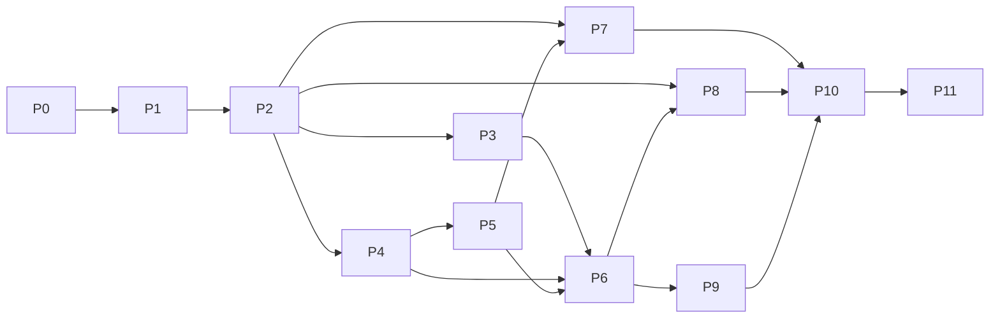

# OrbitTE completion plan

Build an independently maintained Rust transfer engine for CPU DRAM, NVIDIA
GPUs and local SSDs against the [frozen latest TENT contract](tent-parity.md).
OrbitTE replaces OrbitKV's earlier Mooncake TENT dependency and must carry every
end-to-end KV cache path, including GPU↔DRAM and GPU↔SSD. CPU and CUDA are the
selected platforms; other accelerator vendors are outside scope. The target
keeps TENT's applicable runtime, language and operational behavior and all 10
selected transport types.

Storage and optional network providers are opt-in builds, like `rdma` and
`cuda`: a network/memory-only build must run without file/SSD executors,
cuFile or provider SDKs. This does not restrict CPU, SSD or network-device
vendors, and no non-NVIDIA accelerator SDK is a dependency.

This is OrbitTE's only status record and execution queue; the parity document
defines requirements. OrbitKV keeps its own cache delivery queue, and this plan
does not duplicate that project's state, storage-policy or adapter roadmap.

## Delivery states

Every substage and every claimed hardware profile has one state:

| State | Meaning |
| --- | --- |
| Planned | Required code or executable acceptance contract is still missing |
| Implemented | Code exists and its source checks pass; required runtime qualification remains open |
| Qualified | The exact installed artifact passed the declared correctness, lifetime, compatibility and resource gates in the recorded profile |
| Accepted | An independent reviewer inspected the diff, reran relevant gates and accepted the evidence and remaining limits |
| Unqualified / Failed | Required hardware or evidence is unavailable, or a gate ran and failed; neither counts as passed |

`orbit-te 0.1.0-alpha.1` on crates.io is an identity-only package; none of the
implementation below has been published. [Capabilities](capabilities.md)
summarizes current paths and [qualification](qualification.md) records the exact
artifacts and hardware profiles.

## Delivery sequence

| Stage | Concrete delivery | Prerequisites | Current state |
| --- | --- | --- | --- |
| P0 | Frozen contracts, test mapping and differential oracle | Reference inventory | P0.1 implemented; complete mapping and oracle open |
| P1 | Rust engine, configuration and resource ownership | Frozen P0 subset | P1.1–P1.5 and S0 implemented; broader P1 open |
| P2 | P2P control plane and standard TCP path | Corresponding P1 substage | P2.1–P2.3 and S0b implemented; broader P2 open |
| P3 | HP-TCP and shared-memory paths | P2 | Planned |
| P4 | Host RDMA, endpoints and multirail foundation | P2 | Source and bounded RoCE profile accepted; physical and fabric gates unqualified |
| P5 | CUDA, GPUDirect, NVLink/MNNVL and staging | P4 | Bounded GPU Direct, IPC and staging profiles accepted with limits; full P5 open |
| P6 | Routing, progress, QoS, deadlines and recovery | P3/P4; staging cases also P5 | Admission, selection and explicit progress implemented. See [P6](#p6--complete-runtime-behavior) for recovery and qualification. Metrics open |
| P7 | File, io_uring and GDS paths | P2; GDS also P5 | S1–S5 complete at source level. DRAM/file io_uring qualified in Linux CI. Installed CUDA staging and native GDS gates unrun |
| P8 | Additional CPU/NVIDIA-compatible network providers | P1/P2; relevant P4–P6 | Planned |
| P9 | C/C++/Python and operational compatibility | P0/P2/P6 | Planned |
| P10 | Cross-backend fault, lifetime and interoperability acceptance | Relevant P3–P9 deliveries | Planned; evidence accumulates per stage |
| P11 | Consumer integration, matched performance and release | Accepted P2–P10 profiles | Planned |

The graph shows dependencies, not one PR per stage. Provider work whose
prerequisites exist can proceed independently, but never inherits another
provider's hardware qualification. Fault testing belongs to each stage; P10
closes the complete matrix. An interim release needs P10 acceptance of its
selected profiles while other rows stay open.

## Current focus

Since 2026-11-03 no GPU or RDMA machine is available. All remaining in-scope
capabilities are implemented at source level first, with CPU controls driving
production owners and installed hardware gates written but not run; their
commands wait in the qualification verification queue for one later hardware
pass. [AGENTS.md](https://github.com/OrbitInfra/OrbitTE/blob/main/AGENTS.md)
fixes the order (S0–S26) for this period; this plan remains the status record.

S0 and S0b delivered the request API and pre-release wire rules. S1–S5
complete P7 at source level. S6 implements P6 selector routing and S7 implements explicit progress and
notification fallback. S8 implements physical admission and merge. S9 covers transport failover and RDMA rail recovery. OrbitKV
integration stays deferred to P11.

## P0 — Freeze contracts and executable comparison

Requirements: all F/B IDs in [the parity contract](tent-parity.md).

Done:

- **P0.1 — shared CPU comparison trace (Implemented).** Unmodified frozen TENT
  and the public Rust API run one deterministic registration, READ/WRITE, batch
  and notification trace over real host memory and TCP; both must match 25
  observations, and six comparator controls must reject broken results. See
  [CPU oracle](cpu-oracle.md). It covers selected valid-input CPU behavior only.

Open:

- [ ] Freeze the reference source, build options, optional providers and
  dependency revisions for an isolated C++ oracle outside the normal build.
- [ ] Map all 33 C functions, the richer native/Python/classic-TE surfaces,
  config keys and precedence, capability bits, metrics, metadata and wire
  messages to deterministic acceptance cases, marking reference stubs.
- [ ] Map the 84 reference C++ test sources, Python guards and tebench byte
  checks to retained cases with their hardware triggers; mark excluded
  accelerator and UB cases out of scope with explicit unavailable behavior.
- [ ] Define a common request trace and runner contract for C++ and Rust,
  comparing bytes and allowed transitions, with broken lifetime/epoch controls.
- [ ] Freeze control-RPC framing, metadata formats, HP-TCP frames, provider
  bootstrap messages and C ABI fixtures.
- [ ] Write the run-manifest schema and freeze workload-specific resource and
  performance guards before formal measurements.

Exit: any inventory row resolves to its reference path, Rust owner, test trigger
and result format, and the oracle runs its CPU controls independently of OrbitKV.

## P1 — Core engine and physical ownership

Requirements: F01–F04, F08–F10 foundations, F22.

Done (each Implemented, not Accepted):

- **P1.1 — owned CPU foundation.** Immutable config, random source epochs,
  owned backing, checked ranges and permissions, non-reused registration IDs,
  retained-memory budgets, bounded admission and source close/drain.
- **P1.2 — external host owners.** Retained external allocations, duplicate
  references with TENT's first permission, containing-range lookup and shared
  alias locks.
- **P1.3 — native host batch inputs.** Absolute-address requests resolve and
  retain every range before I/O; host range batches publish atomically.
- **P1.4 — asynchronous batches.** Bounded allocate/append/seal/status/free,
  stable task indices, independent data and notification outcomes, and
  cancellation that never releases running owners; see
  [async batches](async-batches.md).
- **P1.5 — OrbitKV pinned allocation bridge (consumer candidate).**
  [OrbitKV #303](https://github.com/OrbitInfra/OrbitKV/pull/303) exposes one host
  view per real `PinnedAllocation`; two H20 hardware controls passed.
- **S0 — request API and safety hygiene.** `TransferRequest::new` with builders,
  non-exhaustive public types, enforced safety notes and Linux-only native
  features.

Open:

- [ ] Native engine construction from frozen per-engine config, without mutating
  process environment.
- [ ] Explicit separation of logical outcome and physical quiescence for every
  remaining owner, with unregister retry and documented unsafe raw-pointer APIs.
- [ ] CPU allocation, copy and probing. P6 covers merge/alias ownership.
- [ ] Config precedence, effective defaults and diagnostics (F01, see P9).

Exit: CPU property and negative tests, concurrent registration and shutdown
controls, and allocator failure and partial-construction tests pass on
production owners.

## P2 — First complete TCP path

Requirements: B01; F05–F08, F11, F20 foundations.

Done (each Implemented):

- **P2.1 — CPU TCP vertical path.** Epoch-fenced descriptor open/refresh,
  READ/WRITE batches with exact prefix accounting, source validation, final
  WRITE ACK, absolute deadlines and bounded handlers; real loopback and
  independent-process tests.
- **P2.2 — bounded notifications.** TENT-style local/remote messages, atomic
  drain, one attached message per successful batch and data results that
  survive notification failure.
- **P2.3 — OrbitKV TCP peer integration (consumer candidate).**
  [OrbitKV #304](https://github.com/OrbitInfra/OrbitKV/pull/304) adds an opt-in
  `orbitte-tcp` provider; the limited source/H20 evidence was independently
  accepted.
- **S0b — frozen pre-release wire.** The OrbitTE-only control protocol stays at
  version 1 until the first release; see the
  [wire policy](tent-parity.md#wire-and-consumer-boundaries).

Open:

- [ ] Peer identity, descriptor update subscriptions and reconnect semantics.
- [ ] Notification RPC fallback and native C allocation/free conventions.
- [ ] Core resource and failure metrics (with P6/P9).
- [ ] Physical two-host TCP and mixed-peer tests against frozen TENT.

Exit: real two-process and two-host TCP byte tests, mixed-peer tests for the
frozen protocol, permission/range denial, restart, reconnect and lost-reply
controls; a lost reply never authorizes ambiguous replay.

## P3 — HP-TCP and SHM

Requirements: B02/B03 with associated F04/F07–F11/F18.

- [ ] HP-TCP: worker-owned persistent lanes, bounded tasks/bytes/sessions,
  generation-scoped registration IDs, remote permissions, WRITE ACK and READ
  accounting, IPv4 rail validation, per-peer lane rotation, large-READ
  partitioning and static rail pairing, as in TENT.
- [ ] SHM: shared mappings and offsets, registration and permissions, alias
  handling, process lifetime and cleanup, with TENT's opt-in default.

Exit: directional Rust/TENT HP-TCP interoperability, fragmented frames,
backpressure, stale registration after restart, unlink/unregister races and
same-host shared-byte tests. Multirail qualification needs independently routed
physical interfaces.

## P4 — Host RDMA and endpoint ownership

Requirements: B04 host profile; F02/F04/F12/F15/F16/F18 foundations.

QP arrays, persistent multi-context MRs, concurrent grants, transport Workers,
NUMA affinity, multirail slicing, discovery and periodic monitor recovery are
implemented. Source and the bounded RoCE profile were independently accepted at
`121ab95`, including four fresh live repeats; see
[P4 review](qualification.md#p4-independent-review). The detailed P4.1–P4.12m
history is in the
[immutable plan before consolidation](https://github.com/OrbitInfra/OrbitTE/blob/f2c7e7f5d32bb9c231596752af6bd59142b1f3a9/docs/completion-plan.md#p4-implementation-record).

### P4 remaining delivery

| Item | State |
| --- | --- |
| Discovery and recovery correspondence (paused contexts, automatic GID reselection, strict pins) | Implemented; [focused native gate](qualification.md#focused-native-recovery) passed and accepted |
| Declared installed RoCE fault profiles: healthy traffic, idle restart, posted-RQ interruption, lost CQEs, [QP cleanup and in-flight DMA](qualification.md#installed-two-host-fault-qualification), [MR/MW cleanup](qualification.md#installed-memory-cleanup-and-replacement), [CQ/channel/PD cleanup](qualification.md#installed-dependency-cleanup), [rail accounting](qualification.md#installed-physical-rail-accounting), [automatic discovery](qualification.md#installed-automatic-discovery) | Qualified for the frozen installed profiles |
| Physical link/device loss, provider teardown and the InfiniBand profile | **Unqualified**; needs authorized disposable hardware |

These results have distinct meanings. Posted-RQ interruption proves
authorization drain before payload; lost CQEs prove recovery after lost engine
observation; neither proves termination of physically interrupted DMA. Process-
local syscall and dependency faults prove retention, not spontaneous hardware
error coverage. RoCE results never satisfy the InfiniBand profile. Priority,
spraying and retry policy belong to P6, GPU paths to P5/P7 and native API/wire
compatibility to P9.

## P5 — CUDA, GPUDirect and staged transfers

Requirements: B01 device directions, B04 CUDA, B05/B06; F02–F04/F07/F19.

Done:

| Substage | State | Evidence |
| --- | --- | --- |
| P5.1 NVIDIA allocation and synchronized staging | Implemented | [CUDA copy](qualification.md#cuda-copy-streams-and-completion-events) |
| P5.2 Owned copy streams and completion events | Local-copy profile qualified (24 H20 cases) | [CUDA copy](qualification.md#cuda-copy-streams-and-completion-events) |
| Owner-backed CUDA pointer/location metadata | Implemented | [pointer and location](qualification.md#cuda-pointer-and-location) |
| CUDA topology and owner-based RDMA selection; custom topology input | Implemented | [topology](qualification.md#cuda-topology-and-rdma-selection), [custom input](qualification.md#custom-topology-input) |
| P5.3 Explicit GPU direct RDMA | Bounded H20/RoCE profile accepted with a host-context inventory limit | [GPUDirect](qualification.md#gpudirect-rdma) |
| P5.4 Cooperative CUDA IPC/NVLink | Accepted (48 cases) | [cooperative IPC](qualification.md#cooperative-cuda-ipc-and-nvlink) |
| P5.4b Subbatch import reuse | Accepted (28 cases) | [subbatches](qualification.md#bounded-cuda-ipc-subbatches) |
| P5.4c Local pinned host directions | Accepted (30 cases) | [pinned host](qualification.md#local-pinned-host-cuda-ipc) |
| P5.4d Cross-submission import cache | Fixed working set accepted (34 cases); LRU reclaim and flush implemented | [cache](qualification.md#bounded-cross-submission-cuda-ipc-cache), [reclamation](qualification.md#cuda-ipc-cache-reclamation) |
| P5.4e–h Grouped completion, shared stream pool, event progress, native batch copy | Implemented | [group](qualification.md#cuda-ipc-group-completion), [streams](qualification.md#cuda-ipc-stream-pool), [events](qualification.md#cuda-ipc-event-progress), [batch](qualification.md#cuda-ipc-native-batch-copy) |
| P5.5a Local staging chunks | Accepted (24 cases) | [local chunks](qualification.md#local-cuda-staging-chunks) |
| P5.5b Remote staging | Serial (16 cases) and ≤16-slot pipeline (24 cases) accepted; later requester ring, shard, event-loop, concurrent CROSS, Delegate query and pollable setup/finish work source-accepted only | [serial](qualification.md#serial-remote-cuda-staging), [pipeline](qualification.md#bounded-remote-cuda-pipeline) |
| Mixed direct/staged batches, per-request remote staging, GPU and pinned producer readiness | Implemented | [mixed](qualification.md#mixed-gpu-batches), [remote selection](qualification.md#per-request-remote-staging), [readiness](qualification.md#cuda-producer-readiness) |

Open:

- [ ] MNNVL fabric export/import and the EGM option (B06).
- [ ] GPU source QP/MR reuse for GPUDirect; remote host exports; exporter-crash
  safety (currently unqualified).
- [ ] Reconcile the remaining ProxyManager resource and control boundaries with
  TENT before claiming full ProxyManager parity.
- [ ] Installed qualification of the current build for every implemented-only
  row above, plus native GPU fault injection.

Exit: full device byte/sentinel assertions, independent producer/consumer
processes, CUDA/GDR/NVLink/MNNVL profile tests, context and copy failures,
partial submission, delayed completion, cancel, teardown and generation reuse.
CPU shims cannot pass this stage's device gates.

## P6 — Complete runtime behavior

Requirements: F08–F20; every implemented transport consumes the same owners.

Done (source scope, CPU controls):

- **Transport selection (S6, F12/F13).** First-match and named policies use
  segment, original memory types, size, effective priority, intent and boot
  identity. Strict hints, per-request NIC masks and endpoint QP pools reach
  the executing owner. Installed two-RNIC qualification is queued.
  See [transport selection](transport-selection.md).
- **Physical admission and merge (S8, F08/F14).** Registered contiguous ranges
  share a physical owner across public task IDs. FIFO/EDF tracks physical
  windows, internal staging reserves, credit and QoS permits. The optional
  deadline threshold uses transport-specific rates. Drops are visible on every
  alias, and unquiesced native work stays charged.
- **Priority and arbitration.** RDMA High/Medium/Low dispatch across contexts,
  TENT's urgency ordering, head-only or per-entry aging and shared priority
  slots; TCP and NVLink accept every priority as advisory.
- **QoS contracts.** Typed and TENT-format JSON global/tenant/intent policies
  with per-contract byte/request caps and delay/reject admission.
- **Receiver credits.** Sender credit gating, bounded automatic receiver
  windows with cumulative sync, and staging/consumer owner credits for remote
  Pin.
- **Progress and notifications (F09/F11).** One bounded progress turn,
  observational status, optional event worker, deferred retirement and
  target-specific notification receipts with transport and control RPC fallback.
- **RDMA rail health (S9, F18).** A pair-level circuit under the existing
  context monitor gates new slices. Recovery requires a native probe receipt.
  Real link-loss qualification is queued. See [rail health](rdma-cuda.md#rail-health).
- **Bandwidth-aware spraying.** Topology penalties, strict locality, rate-seeded
  EWMA, weighted whole-parent distribution, periodic rail exploration and
  effective link-rate discovery.

Open:

- [ ] Hierarchical and cluster quotas, adaptive windows, uncertain-sender
  reclamation and manual resource mapping (F15).
- [ ] Installed transport failover and physical rail fault qualification (F17/F18).
- [ ] Required metrics, failure attribution and disabled-mode overhead (F20).

Exit: deterministic-clock and fault-provider state-machine tests, race detection
and real backends; fairness and byte accounting under contention; installed
cross-process quota recovery; no duplicate physical submit from merged aliases.

## P7 — Storage transports

Requirements: B07/B08 and F05 file-segment behavior. These paths are core:
OrbitKV's SSD tier moves its DRAM↔SSD and GPU↔SSD bytes through them, while
OrbitKV keeps extents, placement, eviction and recovery policy.

- [x] **P7.1 — local file segments (Implemented).** Engine-local `file://`
  segments with cached size and refresh, permissions, checked byte offsets and
  close that drains pending fd users. See [file segments](storage.md).
- [x] **P7.2 — DRAM/file io_uring (Qualified on Linux CI).** One ring per submission,
  exact short/error byte counts, partial submission, queued cancellation and
  CQE drain before releasing registered memory or file leases.
- [x] **P7.3 — CUDA/file staging (Implemented).** Caller-driven rounds of
  charged pinned chunks, device-range loans and event-confirmed copyback.
  The installed GPU/NVMe profile is unqualified.
- [x] **P7.4 — GDS/cuFile (Implemented).** Registered CUDA buffers and direct
  file handles, sliced READ/WRITE, cancellation and drain. The installed
  native-route profile is unqualified.
- [x] **P7.5 — build isolation and BufIo audit (Implemented).** File handles
  stay core. CI checks the dependency graph, unavailable hints and idle
  storage resources. BufIo is unreachable through the frozen loader.

The [qualification record](qualification.md#local-file-segments) links the
ext4/tmpfs evidence and the queued GPU/NVMe and native GDS commands.

## P8 — Additional network providers

These optional providers are separate deliveries. Non-NVIDIA accelerators,
UB/URMA and dependent transports are excluded; their ABI constants return
unavailable instead of instantiating stubs.

| Substage | Required implementation | Parity IDs | Hardware acceptance |
| --- | --- | --- | --- |
| P8.1 | MPComm adapter, host/NVIDIA registration, peer registry and completion mapping | B15 | Compatible endpoints; NVIDIA GDR only with the frozen provider's required capability |
| P8.2 | Libfabric attributes, registration, endpoint and host data path | B17 | Real compatible provider; EFA on EFA hosts |

Exit per row: build without the provider, explicit unavailable result,
fake-provider contract tests, then real installed bytes, permissions, faults,
drain and applicable mixed-peer interoperability.

## P9 — External APIs and operational compatibility

Requirements: F01/F06/F20–F22 and the complete language inventory.

- [ ] Every C symbol, constant, layout and output allocation/free contract; no
  panic crosses FFI.
- [ ] Native C++ source adapters and the classic-TE surface, including explicit
  progress and sync/wait helpers, without calling the old TE backend.
- [ ] Python classes, properties, overloads, context managers, error
  translation, GIL release and buffer lifetime.
- [ ] etcd, Redis and HTTP metadata stores with auth and failure behavior.
- [ ] Metrics names, labels, histograms and HTTP/JSON/Prometheus endpoints.
- [ ] Device plugin ABI registration and real CUDA plugin loading.

Exit: independent Rust, C, C++ and Python consumers run the parity cases
against installed artifacts, with explicit provider/feature matrices.

## P10 — Fault, physical lifetime and interoperability acceptance

Runs throughout P2–P9 and closes before a full-parity release.

- [ ] Separate known-unsubmitted rejection and cancel from partial post, running
  work, logical error, physical quiescence and completed cleanup.
- [ ] Requester/source crash, delayed/lost/duplicate replies, mid-payload
  disconnect, same-address restart, stale registrations and admission exhaustion.
- [ ] Failed register/deregister, endpoint/context destruction, worker and
  handler shutdown, device loss and late completions after cancellation.
- [ ] For failover, prove the earlier attempt can no longer modify destination
  memory before replay, and prove eventual reclamation for each claimed path.
- [ ] Same-host, two-host, multirail, storage, device and fabric profiles, plus
  both mixed C++/Rust directions; keep failed runs and counterfactuals.

Exit: per-profile accepted evidence of correct bytes, monotonic authority,
bounded ownership, no early reuse and eventual cleanup.

## P11 — Consumers, performance and release

Requirements: F22 and the applicable accepted backend and compatibility profiles.

- [ ] Run OrbitKV against an installed artifact through its transfer owner,
  preserving the still-needed source-epoch and source-close contracts. A scoped
  installed prerequisite was accepted at consumer `eb1cc90f`
  ([OrbitKV #307](https://github.com/OrbitInfra/OrbitKV/pull/307)).
- [ ] A separate consumer contract before claiming DeepInfer support.
- [ ] Matched TENT/OrbitTE comparisons (small/large, fragmented, READ/WRITE,
  cold/warm, mixed priority, CPU/device/file, multirail). Initial guards:
  goodput ≥ 0.95, p99 latency ≤ 1.05 and CPU-per-byte and peak-RSS ≤ 1.10 of the
  frozen reference, ratified in P0 before formal runs.
- [ ] Packaged crates, shared libraries, headers and wheels tested outside the
  checkout, with provider discovery, runtime paths and provenance.
- [ ] Installed manifests prove no C++ Mooncake engine/common/Store dependency.

CPU/TCP or NVIDIA/RDMA releases may ship earlier with explicit scoped support.
**Complete NVIDIA-scope TENT parity** requires every in-scope capability to be
accepted; it never claims the excluded accelerators or UB. A slower or
unqualified feature is recorded as such.

## Historical OrbitKV contracts

At OrbitKV `a9befeec596bb9064d25d34f93d07fe59077809d` the audited transfer owner
needs stable allocator registration, P2P segment lookup, batched READ,
authoritative source epochs, source close/drain, generation-scoped
notifications and NIC-load observations; OrbitKV keeps its generation scopes and
mailbox policy. Consumer PRs #303 and #304 pin OrbitTE `02d64e55`; their evidence
lives under `/root/orbitte-artifacts/` and is valid only for those artifacts.

## Code ownership and repository layout

| Location | Responsibility |
| --- | --- |
| `src/engine.rs`, `src/batch.rs` | Engine lifetime, batch/task owners, admission and notifications |
| `src/memory.rs`, `src/segment.rs`, `src/segment/file.rs` | Backing, registration, descriptors, file segments and retirement |
| `src/runtime/` | Control plane, transport selection, admission queue, QoS, receiver credits and ProxyManager |
| `src/transport/tcp/`, `src/transport/rdma/`, `src/transport/nvlink/` | Payload transports and their native resource owners |
| `src/cuda/`, `src/platform/` | NVIDIA allocation, streams, IPC and host topology |
| `include/`, `bindings/` | Future C/C++ headers and Python packaging only |
| `tests/` | Unit (mirroring `src/`), integration, reference, fault and installed tests |
| `benches/` | Future reusable traces and matched-run drivers |
| `docs/` | Contracts, recipes, support matrix and this plan |

Split crates only at a real FFI, packaging or resource boundary. Keep transport
safety in actual owners; avoid forwarding facades or a separate coordinator.

## Required gates and evidence

| Gate | Trigger | What it may establish |
| --- | --- | --- |
| Source/CPU | Every implementation PR | Local contracts, property and concurrency tests, Rust checks |
| Real process/TCP/SHM/file | Control, TCP, memory, storage or lifecycle changes | Real cross-process bytes, errors, protocol and owned shutdown |
| Metadata services | P2/P9 metadata changes | Real etcd/Redis/HTTP behavior and schema interoperability |
| RDMA/device/storage/provider | Corresponding implementation changes | Real backend bytes and hardware-specific completion and lifetime |
| Cross-language/mixed-peer | API, wire or binding changes | Installed caller behavior and directional interoperability |
| Matched performance | Hot-path, scheduling, metrics or release changes | Measured benefit or regression for the recorded profile only |
| Final installed artifact | Every supported release profile | Real package, runtime dependency and loader behavior |

Each PR names its exact commands and environment; no broad gate may silently
skip the profile it claims. Raw logs, traces, manifests and per-run reports stay
outside Git under an explicitly selected artifact root; source keeps reusable
workloads, small fixtures and reproduction steps. Each handoff lists the commit,
F/B IDs, changed contracts, commands and results, artifact hashes and remaining
limits, and an independent reviewer reruns the applicable gates before
acceptance. New hardware evidence names fresh nodes and inventories; missing
hardware stays unqualified.
