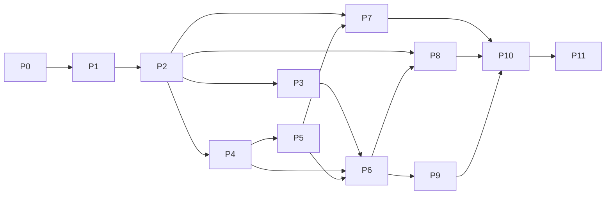

# OrbitTE completion plan

Build an independently maintained Rust network and memory transfer engine for
CPU DRAM and NVIDIA GPUs against the [frozen latest TENT contract](tent-parity.md).
Local file/SSD movement is optional. CPU and CUDA are the selected platforms;
other accelerator vendors are outside scope. Preserve the applicable runtime,
language and operational behavior and all 11 selected transport types. A working
TCP/RDMA subset is an intermediate delivery within this NVIDIA target.

The core must build and run without file/SSD modules or cuFile dependencies.
Optional storage and network-provider modules are opt-in builds, but remain
requirements of the selected complete target. This selection does not restrict
CPU or network-device vendors. No non-NVIDIA accelerator SDK is a dependency.

This is OrbitTE's only execution queue. The parity document defines requirements;
it is not another roadmap. OrbitKV keeps its own existing cache delivery queue.
Do not replace or duplicate that project's state, storage or adapter roadmap here.

## Starting point and delivery states

`orbit-te 0.1.0-alpha.1` is published as an identity-only package. The source
implements the CPU TCP path and NVIDIA host staging, plus host Direct RDMA:
persistent multi-context MRs, fixed-width reusable QP arrays, shared workers/CQs,
multirail slicing, bounded admission and selected-port recovery. See
[capabilities](capabilities.md) for implemented paths and
[qualification](qualification.md) for the exact artifacts and hardware profiles.
These implementations have not been published to crates.io.

Use these states for each substage and each claimed hardware profile:

| State | Meaning |
| --- | --- |
| Planned | Required code or executable acceptance contract is still missing |
| Implemented | Code exists and its stated source checks pass; required runtime qualification remains open |
| Qualified | The exact installed artifact passed the declared correctness, lifetime, compatibility and resource gates in the recorded profile |
| Accepted | An independent reviewer inspected the diff, reran relevant gates and accepted the evidence and remaining limits |
| Unqualified / Failed | Required hardware/evidence is unavailable, or a gate ran and failed; neither counts as passed |

P1.1/P2.1 were merged in #2 after passing stable/MSRV CI and local CPU checks.
P1.2's external host ranges and P2.2's bounded notifications were merged in
#3/#4 after passing the same source gates. They have local Linux loopback/process evidence;
independent acceptance is still open. No complete numbered stage is qualified.
PRs #5-#9 are merged through `02d64e552f94ef965eff32b35a55789018223439`,
covering the CPU comparison, host batches, async ownership and native RDMA/CUDA
bindings. Stable/MSRV checks, 58 Rust tests, two supervision controls and eight
healthy two-host H20 staging cases passed for that tree. These scoped results
do not establish independent acceptance, complete native faults or full parity.
P0.1 adds a [scoped native CPU comparison](cpu-oracle.md); the complete P0 oracle
and compatibility inventory remain open. Missing hardware leaves
a profile unqualified and visible in the full target.

## Native-engine delivery focus

Complete OrbitTE's native RDMA stage P4 against frozen TENT before resuming
OrbitKV integration. Deliver reviewable substages inside P4: direct application
DRAM registration, endpoint/MR reuse, fragmented work/completion ownership,
discovery/topology and multirail, with the physical fault and shutdown gates
below. Advance NVIDIA P5 owners where those prerequisites are ready. Do not
upgrade OrbitKV's dependency or add consumer adapters between these substages.
The return to consumer work requires independent acceptance of the complete P4
exit, not a healthy staging pilot or one additional merged PR. Remaining P5-P10
contracts stay in scope; accepting P4 does not establish full TENT parity.

On 2026-10-27 the user authorized proceeding to P5 with the available RoCE/GPU
resources. Physical link/device loss, provider teardown and InfiniBand remain
unqualified until suitable hardware is available. The independent review accepts
P4 source and bounded RoCE evidence at `121ab95`, including four fresh live
repeats recorded in [qualification](qualification.md#p4-independent-review).
This sequencing decision permits P5 implementation without claiming full P4
acceptance or resuming OrbitKV integration.

Use TENT's context/PD, registered-buffer, endpoint-store and worker/slice
boundaries as the implementation reference. Preserve the Rust contract that
failed native cleanup retains actual owners and budget charges. Every substage
records its exact source correspondence and deliberate safety differences.

## Historical OrbitKV contracts and evidence

These records preserve earlier consumer requirements and accepted profiles;
they do not set the current execution order. At OrbitKV
`a9befeec596bb9064d25d34f93d07fe59077809d`, the audited transfer owner needs stable
allocator registration, P2P segment lookup, batched READ, authoritative source epochs, source close/drain, generation-scoped
notifications and NIC-load observations. Source authority comes from the
source grant; a refreshed endpoint must not silently replace that epoch.

P1.1/P2.1 establish the CPU path; P1.2 adds externally owned host allocations,
duplicate registration references, shared alias locking and address lookup.
P2.2 adds bounded local/remote notifications and separate attached-delivery
outcomes. OrbitKV already owns generation scopes and matching counts in its
notification mailbox (verified at `3f4d65709e86a060f323da7e0d1b59975f6939bc`);
those remain consumer policy. P0.1 adds a frozen valid-input CPU comparison
trace. P1.3 adds atomic host-region registration batches and absolute-address
requests that retain their resolved owners. The OrbitKV consumer audit remains
at `3f4d65709e86a060f323da7e0d1b59975f6939bc`; its native fork is
`12cbf549b6351c800de0f94a480276d216b9a43b`, with an extended request ABI.
P1.4 adds bounded asynchronous batch/task ownership and requester drain for
CPU TCP. P1.5 implements the first real pinned-allocation bridge in
[OrbitKV #303](https://github.com/OrbitInfra/OrbitKV/pull/303), with a scoped H20
TCP ownership pilot. P2.3 connects the opt-in OrbitKV TCP payload provider in
[OrbitKV #304](https://github.com/OrbitInfra/OrbitKV/pull/304), preserving source
grants, their epochs and the existing generation-scoped gRPC completion owner.
That Manager owner is separate from the transfer notification mailbox; this
change does not add a mailbox adapter. Whole-pool native adaptation, installed
consumer qualification and remaining notification integration stay open in
P1/P2/P9/P11. RDMA and CUDA development
proceeds with these owners; no hardware qualification is inferred from CPU progress.
Any later OrbitKV runtime switch still needs its own P10/P11 qualification.
Native P4/P5 now proceed ahead of consumer linkage, HP-TCP/SHM and optional
providers when their prerequisites are ready. The complete parity inventory
remains the target; the current order does not reduce the required scope.

## Delivery sequence

| Stage | Concrete delivery | Prerequisites | Current state |
| --- | --- | --- | --- |
| P0 | Frozen contracts, test mapping and differential oracle | Reference inventory | P0.1 implemented; complete mapping/oracle open |
| P1 | Rust engine, configuration and resource ownership | Frozen P0 subset; remaining P0 before parity acceptance | P1.1-P1.4 implemented; P1.5 consumer candidate implemented; broader P1 open |
| P2 | P2P control plane and standard TCP vertical path | Corresponding P1 substage | P2.1-P2.3 implemented; broader P2 open |
| P3 | HP-TCP and shared-memory paths | P2 | Planned |
| P4 | Host RDMA, endpoints and multirail foundation | P2 | Source and bounded RoCE profile independently accepted, including fresh live repeats; physical/fabric gates deferred and unqualified |
| P5 | CUDA, GPUDirect, NVLink/MNNVL and staging | P4 | Bounded GPU Direct and cooperative IPC/subbatch profiles accepted with explicit limits; full P5 open |
| P6 | Complete routing, progress, QoS, deadlines and recovery | P3/P4; staging cases also P5 | Planned |
| P7 | File, io_uring and GDS paths | P2; GDS also P5 | Planned |
| P8 | Additional CPU/NVIDIA-compatible network providers | P1/P2; relevant P4/P5/P6 contracts | Planned, divided below |
| P9 | Complete C/C++/Python and operational compatibility | P0/P2/P6; backend claims require their stages | Planned |
| P10 | Cross-backend fault, lifetime and interoperability acceptance | Relevant P3-P9 deliveries | Planned |
| P11 | Consumer integration, matched performance and installable release | Relevant accepted P2-P10 profiles | Planned |

The graph shows dependencies, not a requirement to land an entire numbered
stage in one PR. Complete one coherent substage at a time. Provider work that
already has its prerequisite contracts can proceed independently; it must not
inherit another provider's hardware qualification. P10 begins with the first
real backend and accumulates evidence; fault testing is required within each
stage, not postponed until all implementations exist. The graph describes full
target closure; an interim P11 release needs P10 acceptance of its explicitly
selected profiles while the other rows remain open.

## P0 — Freeze contracts and executable comparison

Requirements: all F/B IDs in [the parity contract](tent-parity.md).

- [x] **P0.1 — shared CPU comparison trace (Implemented, not Accepted).**
  Unmodified frozen TENT and public Rust drivers execute one deterministic
  registration/READ/WRITE/notification trace over actual host memory and TCP.
  Both must match 25 independent expected observations (including P1.3 batch registration). Reference/dependency
  revisions, library paths and hashes are checked; six comparator controls must
  reject broken results. Native notification free/reuse is exercised. A separate
  native CI gate preserves external evidence; the fast Rust fixture gate does
  not claim native execution. This covers selected valid-input CPU behavior,
  not the complete P0 mapping, native faults, wire compatibility or hardware.
- [ ] Freeze the reference source, compiler/build options, optional providers
  and external dependency revisions for an isolated C++ oracle. It is a test
  dependency outside the normal OrbitTE build and published package.
- [ ] Map all 33 C functions, richer native/Python/classic-TE surfaces, config
  keys/defaults/environment precedence, transport capability bits, metrics,
  metadata and wire messages to deterministic acceptance cases. Mark reference
  stubs, inactive source and narrative/code disagreements explicitly.
- [ ] Map the 84 reference C++ test sources to retained behavioral cases and
  their CPU, service, GPU, RNIC, filesystem or vendor-hardware triggers. Map
  Python guards, parent compatibility tests and tebench byte checks too. Mark
  excluded-accelerator cases as outside scope and require explicit unavailable
  behavior for their ABI values. Merge overlapping cases; do not mechanically
  port low-value implementation tests.
- [ ] Define a common request trace and runner contract for C++ and Rust:
  initial bytes, registrations, operations, faults, observations and cleanup.
  Compare byte integrity and allowed status/state transitions, not incidental
  timestamps, random IDs or thread schedules. Include deliberate old/broken
  controls for lifetime and epoch checks.
- [ ] Freeze control-RPC/YLT framing and serialization, metadata formats,
  HP-TCP wire frames, provider bootstrap messages and C ABI fixtures. Keep
  small deterministic fixtures in source; raw oracle captures stay external.
- [ ] Reserve qualification resources and write a run manifest schema: source
  and artifact hashes, ABI/profile, hardware/topology, SDK/driver/kernel,
  namespace, budgets, seed, command, correctness and cleanup result.
- [ ] Freeze workload-specific resource and performance guards before formal
  measurements. Record initial estimates after the first representative pilot.

Exit: a reviewer can select any inventory row and find its implemented reference
path, intended Rust owner, test trigger and acceptance result format. The oracle
must build and execute its CPU controls independently of OrbitKV's restaged
native libraries. No feature is considered implemented by completing P0.

## P1 — Core engine and physical ownership

Requirements: F01-F04, F08-F10 foundations, F22.

- [x] **P1.1 — owned CPU foundation (Implemented, not Accepted).** Immutable
  Rust config, random source epochs, owned stable backing, checked ranges and
  permissions, non-reused registration IDs, retained-memory budgets, bounded
  batch admission, resource counters and source-handler close/drain. Local
  Linux checks pass. External pinned allocations, topology/NUMA, TENT config
  precedence, asynchronous task/cancel/merge and native providers remain open.
- [x] **P1.2 — external host owner and address registration (Implemented, not
  Accepted).** A retained host-allocation owner, checked registered subranges,
  TENT-style duplicate references/first permission and containing-buffer lookup,
  shared alias locks, retained-range conflicts and versioned base-address
  descriptors. Real TCP tests use external source/destination backing and prove
  unregister/timeout cannot release the owner while a handler remains active.
  This substage does not pin pages itself. P1.5 adds an actual CUDA-pinned
  consumer bridge; whole-pool integration and native free-failure qualification
  remain open.
- [x] **P1.3 — native host batch inputs (Implemented, not Accepted).**
  Absolute-address READ/WRITE inputs resolve all registered ranges before I/O
  and retain actual backing through completion. Host range batches preflight
  bounds, alias locks, references, IDs and retained budgets before one atomic
  publication. Real external allocations, multi-region TCP bytes and concurrent
  requester unregister/close are tested. The shared native trace now exercises
  batch duplicate references and complete cleanup. New in-batch duplicates are
  coalesced in Rust; this restriction is distinguished from the frozen native
  publication behavior. This is allocator-facing input support, not an
  installed OrbitKV adapter, C ABI or CUDA-pinned qualification.
- [x] **P1.4 — asynchronous CPU batches (Implemented, not Accepted).**
  Bounded allocate/append/seal/status/free, stable public task indices and
  post-seal terminal state, worker-driven progress and observational polling.
  Task/submission data outcomes and notifications are independent. Queue time
  consumes the submission deadline. Cancellation never releases running owners;
  dropped handles retain the engine, backing and allocation/admission charges
  until accepted work exits. Requester close/drain is separate from source
  close. Real blocked TCP controls exercise cancel, wait timeout, unregister,
  detach and release. The native comparison now uses async allocation, multiple
  submits, repeated terminal polling and free. See [the contract](async-batches.md).
  Merge/alias mapping, explicit progress, backend aborts, priority and native
  deferred-free compatibility remain open; this is not the complete F08 stage.
- [x] **P1.5 — OrbitKV pinned allocation bridge (Implemented consumer candidate,
  not Accepted).** [OrbitKV #303](https://github.com/OrbitInfra/OrbitKV/pull/303)
  at `f9eda6acd9defdae46d95514bd4e94d48b657fc6` pins OrbitTE `02d64e55` and
  exposes one canonical host view per real `PinnedAllocation`. The view retains
  that exact slot and its shard; a weak cache avoids cycles and independent
  alias locks. Strict default-feature Clippy passes. Two explicit hardware
  controls passed on H20 GPU 7 with private CUDA 12.2: production memfd/CUDA host
  registration, actual TCP READ/WRITE bytes, duplicates, cancel/wait timeout,
  unregister, failed early free, detach, slot exhaustion, allocator drop and
  eventual release. The native child and supervisor were reaped and locks
  released. Evidence is external at
  `/root/orbitte-artifacts/merge-and-allocator-20261021/allocator-hardware/`.
  This is an opt-in allocation-range bridge in a consumer PR, not a Manager
  transport replacement, whole-pool MR cache, source-grant/mailbox integration,
  installed serving, RDMA or device-DMA failure qualification. The caller must
  still coordinate external CPU/GPU/process access. See the maintained
  [consumer contract and hardware gate](https://github.com/OrbitInfra/OrbitKV/blob/f9eda6acd9defdae46d95514bd4e94d48b657fc6/docs/transport.md#experimental-orbitte-allocation-bridge).
- [ ] Implement Rust request/status/error/options types and native engine
  construction using frozen per-engine config, without changing process-global
  environment to configure concurrent engines.
- [ ] Make allocation, registration, batch/task and callback ownership concrete.
  An admitted transfer retains actual source/destination backing and native
  registrations until the backend proves it can no longer access them.
- [ ] Represent logical outcome and physical quiescence separately. Define
  engine admission close, requester/handler drain, unregister retry and retained
  resources. A token drop, deadline, failed submit or accepted cancel is not a
  release receipt. Borrowed/raw-pointer APIs have explicit unsafe contracts.
- [ ] Implement CPU allocation/copy/probing, range/overflow/permission validation,
  duplicate registration references, partial rollback, generation checks and
  bounded task/descriptor/payload/retained-resource admission.
- [ ] Implement batch capacity and status accounting, including terminal
  stability and merge/alias ownership contracts, before adding real devices.
- [ ] Freeze config precedence, effective defaults and diagnostics; preserve the
  distinction between bootstrap fields, runtime candidates and implemented live
  updates. Do not add a hot-reload controller to emulate a declaration.

Exit: CPU property/negative tests, concurrent registration and shutdown controls,
allocator failure and partial construction/cleanup tests pass. Test-only fakes
drive production owners. No fake test is described as a network or DMA pass.

## P2 — First complete TCP path

Requirements: B01; F05-F08, F11, F20 foundations.

- [x] **P2.1 — first CPU TCP vertical path (Implemented, not Accepted).** Explicit
  epoch-fenced descriptor open/refresh, sequential READ/WRITE batches with exact
  prefix accounting, source-side validation, staged complete-slice commits,
  final WRITE ACK, absolute I/O deadlines and bounded handlers. Real loopback,
  concurrent and independent-process restart/byte tests pass. The development
  protocol is OrbitTE-only; TENT mixed-peer tests, physical two-host tests,
  transport notification fallback, automatic updates and the reference oracle
  remain open.
- [x] **P2.2 — bounded CPU notifications (Implemented, not Accepted).** TENT-style
  named local/remote messages, atomic drain/empty polling and one attached
  message after successful nonempty synchronous batches. Queue count/bytes
  include incoming reservations. Source close drains admitted handlers and
  leaves queued messages readable. Data results remain intact if notification
  delivery fails; an ambiguous receipt is not replayed. Real TCP, concurrency,
  malformed/partial-body, queue-pressure and independent-process restart tests
  pass. The original substage used OrbitTE wire v3 (now v7); native C allocation/free, asynchronous
  multi-target hooks, RDMA/RPC fallback and C++ differential gates remain open.
- [x] **P2.3 — OrbitKV TCP peer integration (Implemented consumer candidate;
  scoped source/H20 pilot reviewed; installed prerequisite accepted in P11).** [OrbitKV #304](https://github.com/OrbitInfra/OrbitKV/pull/304)
  at `5a50d092c651d28ff3f79f6de661c9da8120b2b3` pins OrbitTE `02d64e55`.
  An explicit `orbitte-tcp` provider shares Manager discovery, source admission,
  planning and gRPC generation completion. The standalone build excludes
  Mooncake; the runtime default remains TENT. Source tickets retain actual
  allocation registrations; requester READ preserves the grant epoch through
  metadata open and payload. Cancellation retains the blocking owner;
  unquiesced work retains the source ticket, destination buffers and admission.
  Source close fences before requester drain, even after cleanup failure.
  The first profile allows 64 MiB/16,384 split descriptors per READ and 4,096
  active/retained allocation regions. It rejects excess work; planner resizing
  is not implemented. Strict default/dual/standalone checks, real TCP epoch and
  protocol controls, ticket loss/retry/cancellation and isolated quarantine
  controls pass. Two exact H20 source gates passed with private CUDA 12.2:
  duplicate grant registration, generation reuse, eviction and TCP bytes;
  then real Manager services, etcd/inventory, multi-grant READ, GPU Save/Restore
  byte comparison, membership fencing and worker/service drain. The run verifies
  private libraries, no mapped TENT, owned child/supervisor/etcd reaping and GPU
  lease release. An independent reviewer accepted the limited source/H20
  evidence after rerunning the source/CPU gates and both frozen hardware tests;
  the report is `independent-review.json` under the evidence root below.
  The failed first cleanup-assertion attempt is retained with
  the passing corrected run in the external evidence root
  `/root/orbitte-artifacts/peer-read-20261021/`.
  This does not qualify an installed Manager/wheel, serving, CUDA 13 runtime,
  physical cross-host Manager traffic, RDMA, GDR, multirail, SSD or TENT wire
  compatibility. Transfer notification-mailbox adaptation remains separate.
  See the maintained [consumer contract and explicit gates](https://github.com/OrbitInfra/OrbitKV/blob/5a50d092c651d28ff3f79f6de661c9da8120b2b3/docs/transport.md#experimental-orbitte-peer-tcp-profile).
- [ ] Implement peer identity, memory descriptors and P2P open/refresh/update
  behavior, owned RPC dispatch and handler isolation/reconnect semantics.
- [ ] Implement actual host READ/WRITE with registration/range/permission checks,
  exact status/byte accounting and copy-error propagation. Retain uncertain
  submitted work and reject stale authority in the declared protocol profile.
- [ ] Implement local and remote notifications, attached notifications and empty
  polling/free behavior, with concurrency and duplicate-delivery controls.
- [ ] Expose a narrow Rust vertical-path API and minimal native adapters needed
  to run the same trace against Rust and frozen TENT. Complete API coverage is P9.
- [ ] Add core resource/failure metrics early so admitted, retained and retired
  work is observable during every later stage.

Exit: real two-process and physical two-host TCP byte tests, mixed-peer tests for
the frozen protocol, permission/range denial, restart, reconnect, partial/lost
reply and normal source/requester shutdown. A lost RPC reply must not authorize
ambiguous replay or memory reuse. Publish a CPU-only recipe with exact limits.

## P3 — HP-TCP and SHM

Requirements: B02/B03; associated F04/F07-F11/F18.

- [ ] HP-TCP: worker-owned persistent lanes/sockets; bounded tasks/bytes/sessions;
  request and generation-scoped registration IDs; remote permissions; complete
  WRITE ACK and READ response accounting; timeout, cancel and close/drain.
- [ ] Reproduce IPv4 rail address validation, per-peer lane rotation, exact
  large-READ partitioning and static rail pairing. Keep WRITEs on one lane and
  preserve the reference's explicit restrictions.
- [ ] SHM: actual shared mappings and offsets, registration/permission checks,
  overlap/alias handling, process lifetime and cleanup. Match its opt-in default.

Exit: Rust/TENT directional HP-TCP interoperability, fragmented frames,
backpressure, partial READ/WRITE, stale registration after restart, unlink/
unregister races, cancellation/drain and same-host shared-byte tests. Multi-rail
qualification requires independently routed physical interfaces, not aliases on
one loopback route.

## P4 — Host RDMA and endpoint ownership

Requirements: B04 host profile; F02/F04/F12/F15/F16/F18 foundations.

### P4 remaining delivery

The host data path is implemented. This queue separates actual code gaps from
qualification; a new test geometry is not a new implementation stage. The
[frozen-source audit](architecture.md#p4-source-audit) records the corresponding
TENT owners and deliberate differences.

| Order | Remaining work | Kind and completion condition |
| --- | --- | --- |
| 1 | Accept discovery/recovery correspondence | **Implemented; focused native gate passed:** paused PD/MR ownership, automatic GID reselection and strict pins pass the [one-RNIC native profile](qualification.md#focused-native-recovery) on both toolchains. CPU controls also cover all-paused registration and healthy-sibling dispatch. Source and bounded evidence independently accepted at `121ab95`; this observed-state override does not qualify physical link loss. |
| 2 | Close the declared installed RoCE fault profile | **Qualified for the frozen installed profiles:** healthy traffic, idle restart, posted-RQ interruption and lost successful CQEs; [QP cleanup and in-flight DMA](qualification.md#installed-two-host-fault-qualification); [MR/MW cleanup and engine replacement](qualification.md#installed-memory-cleanup-and-replacement); and [CQ/channel/PD dependency cleanup](qualification.md#installed-dependency-cleanup). The last group passes six two-host cases on stable and Rust 1.85, plus ten affected regressions. Physical failures retain the separate acceptance conditions below. |
| 3 | Finish physical/fabric qualification | **Unqualified:** physical link/device loss and provider teardown, the separate InfiniBand profile, and complete P4 acceptance. The [installed automatic-discovery profile](qualification.md#installed-automatic-discovery) now passes against a separately collected physical inventory on both toolchains. The independent reviewer accepted source, CPU/package gates and bounded RoCE evidence at `121ab95`, including four fresh live discovery/topology cases. Missing hardware does not pass this row. |

**Physical rail contention/accounting is qualified for the bounded installed
profile:** source `cc6ab0f` passes four two-host configurations on stable and
Rust 1.85. Both physical RNICs carry concurrent parent slices on shared QPs;
native WR/CQE identities, full payload/guard checks, exact byte counters and
final owner drain agree. See [the artifact and limits](qualification.md#installed-physical-rail-accounting).
Line-rate saturation, bandwidth arbitration and fairness remain P6 work.

**Installed automatic discovery is qualified for the declared RoCE inventory:**
source `36890c8` passes four two-host automatic cases and two fixed-GID controls.
The packaged collector independently reads PCI, NUMA, port, GID and network
interface data before/after the process under the same resource locks. Public
route selection, strict-pin rejection and memory priority tiers agree with it.
Independent reviewer repetition also passes four fresh two-host cases. Physical
transitions and InfiniBand remain open.

The first row closes the two source gaps found in the frozen-source audit.
Discovery now keeps an otherwise valid down-port context paused, as TENT's
`enable` does. Its PD receives persistent MR copies while route admission stays
disabled. Recovery repeats GID ranking only for automatic configuration, on the
same selected device and port; explicit pins cannot move. Healthy ticks query
the selected index. Native drain and the route generation still gate publication.
New-device hotplug and general cross-rail retry policy remain separate work;
the native observation fixture does not qualify physical link loss.

For the installed RoCE profile, reuse the existing bounded consumer and recorded
geometries: two hosts/two mlx5 RNICs, host Direct READ/WRITE in both directions,
polling/events, 1–3 QPs per peer/context/operation, masks 1/2/3, 12/16/32 parents
and the recorded requests up to 9 MiB. The 256 MiB backing limit is per peer;
these are selected combinations, not every Cartesian product. The existing
72-case healthy matrix and idle-restart, posted-RQ and lost-CQE matrices remain
qualified only for their recorded packages. Re-run affected contracts when code
changes; do not grow the matrix solely by increasing parent count or payload.
The fixture's larger configurable limits are not blanket support claims.

The missing fault evidence has distinct meanings:

- Posted-RQ interruption proves pre-payload authority drain. Lost successful
  CQEs prove recovery after lost engine observation. Neither proves termination
  of physically interrupted DMA.
- Native QP/MR/MW syscall and CQ/channel/PD dependency failures already have
  scoped retention evidence. Their declared installed profiles now pass too.
  CQ/channel failures retain actual backing and unresolved charges; idle PD
  failure releases drained business memory and retains the device/PD only.
  These results do not claim spontaneous hardware error coverage.
- Physical loss requires an authorized disposable link/device and observations
  of its real state. Query failure injection and QP ERR remain useful controls,
  but do not qualify cable loss, device removal or provider teardown.
- InfiniBand remains a separate unqualified fabric. RoCE results, including a
  new GPU node allocation, cannot satisfy that requirement.

QP arrays, persistent MRs, concurrent grant/SQ/RQ ownership, transport Workers,
NUMA affinity and periodic monitor reclaim are implemented. They need regression
coverage for relevant changes, not another feature milestone. Priority/QoS,
bandwidth-aware spraying and generic retry/failover remain P6; direct GPU DMA,
NVLink and GDS remain P5/P7; native API/wire compatibility remains P9. These
boundaries do not remove any requirement from the complete TENT target.

P4 stays open until the above code and qualification gates are accepted. A
reviewer may accept a narrower RoCE profile explicitly, but that does not turn
missing IB/physical-fault evidence into a pass. OrbitKV integration remains after
the accepted P4 boundary; no dependency migration is part of this closeout.

### P4 implementation record

Current ownership and behavior live in [architecture](architecture.md),
[RDMA contracts](rdma-cuda.md), [native cleanup](native-cleanup.md) and
[installed consumers](installed-host.md). Exact source pins, scoped results,
failed runs and artifact locations remain in [qualification](qualification.md).
The detailed P4.1–P4.12m delivery history is preserved in the
[immutable plan before this consolidation](https://github.com/OrbitInfra/OrbitTE/blob/f2c7e7f5d32bb9c231596752af6bd59142b1f3a9/docs/completion-plan.md#p4-implementation-record).
It is historical evidence, not an execution queue. No raw evidence is moved or
deleted by this consolidation.

## P5 — CUDA, GPUDirect and staged transfers

Requirements: B01 device directions, B04 CUDA, B05/B06; F02-F04/F07/F19.

- [x] **P5.1 — NVIDIA allocation and synchronized staging (Implemented, not
  Accepted).** Driver API device/pinned host owners; probed external device
  ranges; shared transactional registration; private pinned copy staging,
  context restore/synchronize, and retained unquiesced task/source/requester
  owners with budgets. CUDA can feed TCP or the P4.1 host-MR path. CPU shim
  gates cover copy/restore/sync/unpin and logical failure versus physical drain.
  Hardware qualification is separate. GDR, IPC/NVLink/MNNVL, transport-wide stream
  scheduling, producer lifecycle integration and reclaim proofs remain open.

  The binding maintenance substage reuses generated `cudarc` Driver API types
  and signatures with fallible, selective `libloading` lookup. The pinned
  dependency keeps Rust 1.85 and the existing quiescence/retention contract.
- [x] **P5.2 — Owned copy streams and completion events (Implemented; local-copy
  profile Qualified).** Each
  `CudaMemory` lazily reuses a nonblocking stream and blocking completion event
  under its allocation lock. Private pinned staging stays owned until that event
  completes; failed submit/record drains the same stream, while an unproven wait
  retains device, staging and native handles. Cleanup is never a completion
  receipt. Public read/write still wait; external producers must be ready before
  handoff. CPU controls cover concurrent reuse, delayed completion, partial
  construction/submission, record/wait/destroy failures and budget retention.
  The explicit `cuda_copy` GPU gate passes 24 GPU/size/toolchain combinations
  on two H20 hosts, with full-byte/guard checks and final owner release. See
  [exact artifacts and limits](qualification.md#cuda-copy-streams-and-completion-events);
  native error injection remains a separate qualification requirement.
- [ ] Implement CUDA location/pointer classification, allocation, exact context
  restoration and retained streams/events/export/import mappings. Unexpected
  driver errors cannot select an ordinary CPU copy path.
- [x] **P5.3 — Explicit GPU direct RDMA (Source and bounded installed profile accepted with limits).**
  Actual CUDA allocation/context registration, SYNC_MEMOPS and write visibility;
  persistent requester MRs on selected contexts; exact source MR/PD/QP isolation
  without unsupported PeerDirect MWs. v15 binds an ordinary SEND receipt to the
  grant; source ACK follows native close and GPU visibility. Failed registration
  never selects staging. CPU controls cover aliases, partial construction,
  payload/RQ MR and PD cleanup, context restore and retained owners/budgets.
  Both installed compiler artifacts pass 72 H20/RoCE cases, covering both host
  directions, CPU/GPU/GPU combinations, tiny requests, folded tails and two
  contexts. Two extra live-PID repeats prove eight native context identities
  close. Independent review accepts the bounded evidence; B host-wide context
  non-growth remains unqualified because six additional entries have no assigned
  owner. See [qualification](qualification.md#gpudirect-rdma). GPU source QP/MR
  reuse, automatic GPU topology policy, broader providers and native GPU faults
  remain open; this is not full P5 acceptance.
- [ ] **P5.4 — CUDA IPC/NVLink ownership and completion.** Follow frozen TENT
  `NVLinkTransport`: same-host handle export/import, retained exporter/importer
  allocations, peer copy streams/events, process-generation validation and
  close/drain. Qualify independent producer/consumer processes on two local
  NVIDIA GPUs, including failed imports, stale generations and early shutdown.
  MNNVL fabric import/export and EGM remain separate topology profiles.
  The first cooperative owned GPU/GPU path is implemented: explicit whole-
  allocation export, physical mapping quota, event drain and matching import-
  close receipts, with synchronous/async failure retention controls. Installed
  stable/MSRV qualification passes 48 H20 cases plus four fresh independent
  repeats; source and the bounded cooperative profile are independently accepted.
  **P5.4b — bounded subbatch reuse (Accepted for the declared profile):**
  consecutive same-region/native-context requests share one import and physical
  charge; copied local owners survive through close. Exact envelope relocation,
  typed pre-grant rejection fallback, per-slice cancellation and shared failure
  spans have CPU controls, including nonzero submission indices and combined
  cancel/cleanup failures. Installed consumers pass 28 H20 cases on stable/MSRV,
  covering two local allocations and three ordered copies per import. Four fresh
  independent repeats pass; source and bounded hardware evidence are accepted.
  **P5.4c — local pinned host directions (Accepted for the declared profile):**
  local owned pinned
  host READ/WRITE and mixed host/GPU groups reuse the same native context,
  subbatch import and close protocol. CPU access/RDMA leases share the host
  owner; failed completion retains and fences actual pinned backing. Source
  gates, 30 installed stable/MSRV H20 cases and four fresh independent repeats
  pass. Source and the bounded profile are independently accepted.
  **P5.4d — bounded cross-submission import cache (Accepted for the declared profile):**
  opt-in transport-owned single-flight relocation entries retain context/import
  and physical quota. Every reuse rechecks source authority. An independent
  export owner retains registration and whole-allocation loan until explicit
  native-close receipt; ready-offer prevents late initial grants after close.
  Operation completion releases drained local owners. Requester close retries
  lost close ACKs without repeating native close; mutual shutdown closes outgoing
  imports first. CPU controls include cold concurrency, closed/unregistered/
  read-only sources, lost receipts, late hello, source/requester capacity, actual
  source-owner retention and native cleanup faults. Stable/MSRV installed
  consumers pass 34 H20 cases plus four fresh independent repeats; source and
  this fixed-working-set profile are accepted.
  Cache eviction/continuing flush, remote host exports and broader stream
  scheduling remain open; exporter-crash safety is
  explicitly unqualified. See [the transport contract](cuda-ipc.md).
- [x] **P5.5a — local staging chunks (Accepted for the declared profile).**
  Engine-owned `ProxyManager` bounds lazy CUDA-pinned chunks across source,
  requester and contexts. TCP and staged RDMA consume the same owner; full-range
  GPU locking, tail copies, deadline boundaries, retained failures and explicit
  whole-engine close preserve physical lifetime. CPU controls cover cancellation,
  capacity/close races and combined CUDA/CQ errors. Stable/MSRV installed
  consumers pass 24 H20 TCP/staged-RDMA cases plus four fresh independent
  repeats. Source and this bounded healthy profile are accepted; physical CUDA
  faults and default-capacity stress remain unqualified. See [local staging](staging.md).
- [ ] **P5.5b — remote staging operations (serial session implemented).**
  Opt-in remote CUDA Pin/Delegate/Unpin uses the P5.5a chunk owner and real TCP
  or RDMA CROSS legs. One handler and parent slot suffice; scoped phase receipts,
  explicit private MR retirement and fallible chunk release fence reuse. CPU
  controls cover partial effects, lost receipts and retained CUDA/MR failures.
  The new installed profile is still unqualified. Qualify this serial boundary,
  then complete overlapping PRE/CROSS/POST pipelines and remote scheduling
  before claiming full ProxyManager parity. See [the contract](staging.md#serial-remote-staging).
- [ ] Cover mixed direct/staged batches, producer readiness and consumer-visible
  completion without early source, destination or staging-buffer reuse.

Exit: full device byte/sentinel assertions, independent producer/consumer
processes, CUDA/GDR/NVLink/MNNVL profile-specific tests, context/copy failures,
partial submission, delayed completion, cancel, teardown and generation reuse.
CPU shims and compiled CUDA stubs cannot pass this stage's device gates.

## P6 — Complete runtime behavior

Requirements: F08-F20; all implemented transports consume the same owners.

- [ ] Implement the full selector contract: policy order/name, all intents,
  priority, segment/memory/size filters, transport hints, device masks and QP
  pools. Merge only requests whose authority and execution-policy fields agree.
- [ ] Implement FIFO/EDF admission, promotion, dispatch windows, independent
  owner/byte budgets, staging reserves and deadline-infeasible cancellation.
  Match eligibility rules, queue bypass, disabled defaults and absent-provider
  behavior. Do not advertise an unconsumed local-recompute callback.
- [ ] Implement per-worker QoS, shared cross-process quotas and cleanup,
  receiver credits/pacing, deadline bandwidth arbitration and telemetry.
- [ ] Implement round-robin/adaptive spraying, topology penalties and strict
  locality; maintain separate selection EWMA and transmit-bandwidth estimates.
- [ ] Implement submit/completion failover, physical-owner/alias mapping,
  per-owner retry budgets and rail cooldown/probe/half-open state. Never replay
  uncertain writes or recycle an old attempt without its declared proof.
- [ ] Complete explicit progress, observational polling, background worker,
  bounded wake/fallback behavior, notification fallback and shutdown races.
- [ ] Complete required metrics and failure attribution; prove metrics disabled
  mode and observer overhead independently.

Exit: production-state-machine tests with deterministic clocks/fault providers,
race detection and real backends; priority/deadline fairness and byte/resource
accounting under contention; installed cross-process quota recovery; no duplicate
physical submit from merged aliases. Match reference behavior on safe inputs and
record any deliberate safety differences with negative controls.

## P7 — Storage transports

Requirements: B07/B08 and F05 file-segment behavior.

- [ ] Implement file descriptors/segments, offsets, permissions, READ/WRITE,
  short/error I/O and their owning completion state.
- [ ] Implement io_uring queue/registered-buffer lifecycle, partial submission,
  cancellation and actual completion drain before releasing file or memory.
- [ ] Implement cuFile/GDS registration and both host/device READ and WRITE,
  status/error propagation and explicit direct-versus-staged behavior.
- [ ] Qualify three distinct bidirectional profiles: DRAM/file io_uring,
  CUDA/DRAM/file staging and CUDA/file native GDS. Disable compatibility for the
  native-only profile and record actual route evidence. A staged or
  compatibility-mode pass cannot qualify native GDS.
- [ ] Keep file modules opt-in and prove the network/memory-only build neither
  loads storage SDKs nor starts storage resources.
- [ ] Audit BufIo source reachability. Preserve any actually consumed behavior;
  document unselected reference code without inventing a public transport.

Exit: real files with full-byte checks, truncation/short/error controls,
concurrent unregister/close and cancellation. GDS requires supported hardware,
filesystem and a recorded direct path; an io_uring fallback is a different gate.

## P8 — Additional network providers

These providers fit the selected host/NVIDIA purpose and remain optional
modules in the target. Each is a separate delivery. Non-NVIDIA accelerator
platforms and dependent transports are excluded in the parity matrix; their
ABI constants must return unavailable rather than instantiate device stubs.

| Substage | Required implementation | Parity IDs | Hardware acceptance |
| --- | --- | --- | --- |
| P8.1 | Native URMA, host UB buffers/endpoints/jetty/JFC, quota, cancellation, recovery and teardown | B09, F15/F18 | Two URMA hosts; provider errors and bonding separately; no GPU capability inferred |
| P8.2 | MPComm adapter, host/NVIDIA registration, peer registry and completion mapping | B15 | Compatible endpoints; NVIDIA GDR only with the frozen provider's required capability |
| P8.3 | Libfabric attributes, registration, endpoint and host data path | B17 | Real compatible provider; EFA on EFA hosts |

Exit per row: build without provider, explicit unavailable result, fake-provider
contract tests, then actual installed bytes, permissions, faults, drain and
applicable mixed-peer interoperability. Fake/stub-only implementations remain
hardware-unqualified. Complete NVIDIA-scope parity requires acceptance of every
in-scope requirement. Excluded accelerator rows require no implementation or
hardware qualification.

## P9 — External APIs and operational compatibility

Requirements: F01/F06/F20-F22 and the complete language inventory.

- [ ] Complete and verify every C symbol/constant/layout and output allocation/
  free contract. Exceptions/panics must not cross FFI. Preserve frozen struct
  layouts and distinguish optional native extensions by version/profile.
- [ ] Complete native C++ source adapters and the classic-TE surface that
  delegates to TENT, including explicit progress and synchronous/wait helpers.
  No adapter may invoke the old TE backend or omit richer native request fields.
- [ ] Complete Python enums/classes/properties/overloads/context managers,
  error translation, GIL release and actual buffer/exporter lifetime.
- [ ] Complete etcd, Redis and HTTP metadata integrations, auth/config behavior,
  transient failures, shared-schema interoperability and installed recipes.
- [ ] Complete metrics names/types/labels/histograms and HTTP/JSON/Prometheus
  endpoints, config precedence and disabled-mode behavior. Avoid secret-bearing
  config/error diagnostics.
- [ ] Exercise plugin ABI registration, bad/missing plugin behavior and actual
  CUDA plugin loading, not just static platform compilation.

Exit: independent Rust, C, C++ and Python consumers run the parity cases against
installed artifacts. Test optional-feature/provider matrices explicitly;
`cargo --all-features` is not a substitute for incompatible SDK combinations.

## P10 — Fault, physical lifetime and interoperability acceptance

Runs throughout P2-P9, with the complete matrix closed before a full-parity
release. Requirements: every F/B row's applicable fault and interoperability
cases, plus declared safety differences.

- [ ] Separate known-unsubmitted rejection/cancel from partial post, running
  work, logical error, physical quiescence and completed cleanup.
- [ ] Test requester/source crash, delayed/lost/duplicate replies and ACKs,
  mid-payload disconnect, same-endpoint/address restart, stale registration and
  provider keys, concurrent buffer reuse and admission exhaustion.
- [ ] Test failed register/deregister, endpoint/context destruction, worker and
  handler shutdown, device loss and late completions after logical cancellation.
- [ ] For failover, prove the previous attempt cannot still modify destination
  memory before replay/reuse; retain ambiguity under explicit budgets. Prove
  eventual reclamation after a valid termination barrier for each claimed path.
- [ ] Run same-host, physical two-host, multirail, storage, device and fabric
  profiles separately; exercise both mixed C++/Rust requester/source directions.
- [ ] Preserve failed runs and counterfactuals alongside accepted runs. A
  watchdog kill, timeout or skipped hardware test does not supply physical drain.

Exit: per-profile accepted evidence of correct bytes, monotonic authority,
bounded ownership, no early reuse and eventual proven cleanup. Unresolved
profiles remain unqualified; do not weaken their gates to finish a release.

## P11 — Consumers, performance and release

Requirements: F22 and applicable accepted backend/compatibility profiles.

- [ ] Run OrbitKV against an installed OrbitTE artifact through its existing
  transfer owner. Audit the old patched ABI first; preserve still-needed source
  epoch and source-close contracts. Keep cache semantics in OrbitKV. Record its
  migration under the existing OrbitKV S3/S4/S8 queue and do not modify that
  runtime dependency merely because this plan exists. A scoped installed
  prerequisite is independently accepted at consumer `eb1cc90f` in
  [OrbitKV #307](https://github.com/OrbitInfra/OrbitKV/pull/307): the complete
  CPython 3.11 wheel runs two separate Managers and an installed client, with
  CUDA IPC registration/Publish, 16,384 GPU bytes through TCP and same-RNIC RDMA,
  four original IPC slots repaid per case and normal client/Manager exit. The
  frozen profile explicitly selects Torch CUDA 13.0.96 with an ordinary private
  unversioned alias and compatibility driver 590.48.01 on H20/R535. The private
  etcd fixture is killed/reaped. See [the runtime profile](rdma-cuda.md).
  Default/natural loader configurations, uniform installed CUDA 13.1, inference
  serving, cross-host Manager/GPU, GDR, physical faults and full adoption remain
  open. The default complete consumer wheel still bundles TENT; selecting
  OrbitTE does not map or use it for payloads.
- [ ] Establish a separate consumer contract before claiming DeepInfer support.
  Engine allocation/readiness and P/D ownership are not replaced by TE parity.
- [ ] Compare frozen TENT and OrbitTE with equal bytes, budgets, topology,
  registration, warmup and measurement windows. Include small/large, fragmented,
  READ/WRITE, cold/warm endpoint, concurrent/mixed-priority, CPU/device/file and
  multirail cases. Measure goodput, p50/p95/p99 latency, CPU, RSS/registered/
  retained bytes, queue peaks, fairness and deadline misses.
- [ ] Freeze independent paired repetitions and uncertainty before formal runs;
  qualify instrumentation overhead separately. Initial proposed regression
  guards are goodput ratio at least 0.95, p99 latency ratio at most 1.05 and
  CPU-per-byte/peak-RSS ratios at most 1.10 versus the frozen reference, under
  the same admitted resource caps. Ratify workload-specific guards in P0 before
  collecting acceptance evidence; retain any failed guard unchanged afterward.
- [ ] Test packaged crates/shared libraries/headers/Python wheels outside source
  checkout, with exact provider discovery, runtime paths and artifact provenance.
  Publish examples, support matrix and a concise release qualification record.
- [ ] Verify installed build/link/runtime manifests contain no C++ Mooncake
  engine/common/Store dependency. Keep upstream attribution and license notices
  for translated source and any retained fixtures.

CPU/TCP or NVIDIA/RDMA releases may ship earlier with explicit scoped support.
The label **complete NVIDIA-scope TENT parity** requires all in-scope reference
capabilities to be accepted; narrower releases do not remove remaining selected
obligations. It does not claim the excluded accelerator platforms. A feature
being slower or unqualified is recorded
as such rather than described as a performance advantage.

## Code ownership and repository layout

Start with the existing `orbit-te` crate. Organize by owned behavior/resources:

| Location | Responsibility |
| --- | --- |
| `src/engine.rs`, `src/batch.rs` | Engine lifetime, batch/task owners, admission, transport selection and notifications |
| `src/memory.rs`, `src/segment.rs` | Backing allocation, range geometry, registration, descriptors and retirement |
| `src/runtime/control_plane.rs` | Shared control service/channel, descriptors, notifications, source validation and dispatch |
| `src/transport/tcp.rs` | TCP READ/WRITE payload behavior |
| `src/transport/rdma/` | RDMA transport, context/PD, buffers, endpoints/store, CQ/workers, slices and provider ABI |
| `src/cuda/` | NVIDIA allocation/context/driver ownership and synchronized staging |
| `src/config.rs` | Effective configuration; observations live with the owner they measure |
| `include/`, `bindings/` | C/C++ headers/adapters and Python packaging only |
| `tests/` | Unit, integration, differential, fault and installed-artifact tests |
| `benches/` | Reusable traces, generators, byte checks and matched-run drivers |
| `docs/` | Maintained contracts, recipes, support matrix and this queue |

This is an intended ownership map, not a requirement to create empty directories
or a crate per box. Split crates only when a real FFI, packaging or resource
boundary needs independent ownership. Keep transport safety in actual owners;
avoid a generic forwarding facade or an independent cache/control coordinator.

## Required gates and evidence

| Gate | Trigger | What it may establish |
| --- | --- | --- |
| Source/CPU | Every implementation PR | Local contracts, property/concurrency tests, Rust checks and deterministic production-state-machine controls |
| Real process/TCP/SHM | Control, TCP, memory or lifecycle changes | Actual cross-process bytes, errors, protocol and owned shutdown |
| Metadata services | P2/P9 metadata changes | Real etcd/Redis/HTTP behavior and schema interoperability |
| RDMA/device/storage/provider | Corresponding implementation changes | Actual backend bytes and hardware-specific completion/lifetime behavior |
| Cross-language/mixed-peer | API, wire or binding changes | Installed caller behavior and directional interoperability |
| Matched performance | Hot-path, scheduling, metrics or release changes | Measured benefit/regression only for the recorded profile |
| Final installed artifact | Every supported release profile | Real package/runtime dependency and loader behavior outside source |

The implementation PR must name its actual commands and required environment;
do not create a broad gate that silently skips the profile it claims to test.
Use tests that exercise production owners and a real boundary or useful local
contract. Keep private Rust unit modules under `tests/unit/`, mirrored from
`src/` and included by their owner without exposing internals for tests. Keep
test-only providers/helpers under `tests/`. Miri, sanitizers,
race/property/fuzz tools apply where supported; none establishes hardware DMA
termination by itself.

Select an explicit external artifact root before running experiments. Raw logs,
traces, JSON/CSV, captures, manifests, generated charts and per-run reports stay
outside the checkout and Git history. Source retains reusable workloads, small
deterministic fixtures and reproduction instructions. Freeze libraries before
runtime gates; never restage a mapped native library under another process.

Each delivery handoff contains the commit, F/B requirement IDs, changed contracts,
commands/results, installed artifact hashes/locations and remaining limits. The
reviewing agent independently inspects the diff and reruns applicable gates
before dependent work is accepted. Preparation, implementation, qualification
and independent acceptance remain separate states.

## Immediate next delivery

The two discovery/recovery source gaps are implemented in `9e1fdea`
(PR #57), and the focused native gate now passes on both toolchains.
The installed requester QP cleanup-failure and actual in-flight DMA fixtures
now pass their four frozen two-host cases on both compiler artifacts. Installed
MR/MW retention and same-process engine replacement also pass six frozen cases.
Installed CQ/completion-channel/PD dependency cleanup now passes six frozen cases
and ten affected regressions on both final compiler artifacts.
The bounded installed physical-rail accounting profile now passes four cases
on both compiler artifacts, closing that item in the existing queue.
Installed automatic discovery now passes four two-host cases against separately
collected host inventories, plus two fixed-GID regressions.

P4 implementation and its declared installed fault fixtures are complete.
The independent review accepts source and bounded RoCE evidence at `121ab95`,
including four fresh live repeats. Under the user's 2026-10-27 sequencing decision,
P5.3 source and bounded GPU Direct evidence are independently accepted with the
explicit host-context inventory limit in [qualification](qualification.md#gpudirect-rdma).
The cooperative P5.4 GPU/GPU IPC substage is independently accepted with
48 installed cases and four fresh repeats. P5.4b bounded subbatch reuse passes
28 installed H20 cases plus four fresh repeats and is independently accepted
for that profile. P5.4c local owned pinned host directions and mixed groups
pass 30 installed cases plus four independent repeats and are accepted.
P5.4d bounded cross-submission caching and explicit exporter lifetime owners
pass 34 installed cases plus four fresh independent repeats and are accepted
for the fixed-working-set profile. P5.5a local shared staging chunks pass
24 installed TCP/staged-RDMA cases plus four fresh independent repeats; source
and this bounded healthy profile are accepted. P5.5b serial remote
Delegate/Pin/Unpin and nested admission are now implemented with CPU fault
controls. Next qualify its installed TCP/RDMA profile, then complete overlapping
pipelines and remote scheduling within P5.5b. New hardware evidence must name
fresh nodes; unavailable gates remain unqualified. OrbitKV
linkage remains deferred. Keep the physical/fabric requirements in
[P4 remaining delivery](#p4-remaining-delivery) unqualified; the available
resources provide RoCE without a disposable physical port or InfiniBand fabric.
Do not reopen completed source work or repeat unaffected matrices.
Freeze each missing scenario and its proof before implementing any needed
fixture; use the existing native and installed consumers. Add a case only
for an uncovered contract or a demonstrated bug. Keep source checks,
installed-artifact checks and hardware results separate. A documentation
cleanup or layout refactor does not qualify hardware or close P4.

New test nodes require fresh job/stage, host, provider and RNIC-lock inventories;
never reuse executor identities from a terminated job. A node with one usable
RNIC can qualify only its declared single-rail profile. GPU allocation alone
says nothing about RNIC count, fabric or GPUDirect capability. Keep manifests,
logs and failed controls outside Git.

OrbitKV dependency migration, whole-engine shutdown consumption and installed
Manager/serving qualification resume under P11 after the accepted P4 boundary.
Historical consumer evidence remains valid only for its recorded artifact and
profile. The 33-symbol/native schema oracle, mixed-peer wire compatibility and
remaining parity rows stay in their existing stages.
