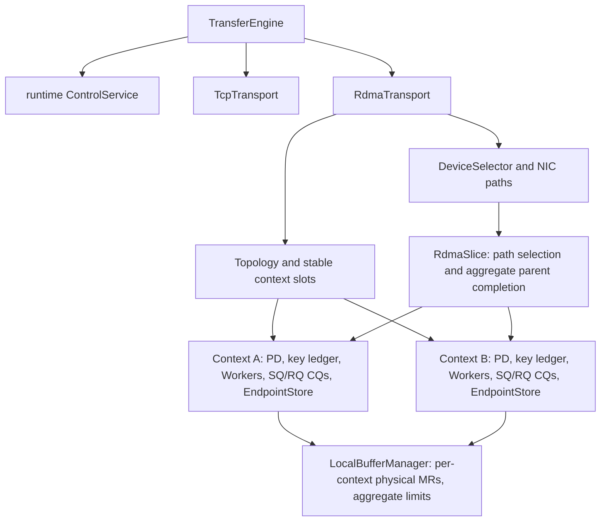

# RDMA registration and CUDA staging

P4.1-P4.12k/P5.1 add opt-in source implementations and qualification gates.
Acceptance is scoped to the exact native profiles below; the complete hardware and parity stages stay open.
The [completion plan](completion-plan.md) is the only execution queue. Direct
application host registration and explicit staging share bounded transport
budgets and per-NIC context owners. P4.12c adds eager all-context host MR
publication and cross-rail slices with aggregate parent completion. P4.12d
validates the declared two-RNIC host Direct profile, including native faults
and drain. P4.12e adds aggregate CQ quota wakeups and scoped concurrent-parent
validation. P4.12f adds whole-parent source RQ admission and scoped
four-parent/three-slice native validation. P4.12g extends the declared fixture to
eight concurrent parents with MiB/folded geometry and two-WR fault windows,
without changing production. P4.12h separates data and endpoint destruction
deadlines, with scoped QP ERR, lost-CQE and fresh-process restart gates.
Broader physical faults and independent P4 acceptance remain open;
these substages do not establish full B04/B01 or native TENT compatibility.

## Build and select a path

The default crate still needs no CUDA/RDMA SDK or native dependency.
`--features rdma` uses the published
[`ibverbs-sys 0.3.2+55.0`](https://docs.rs/ibverbs-sys/0.3.2+55.0/ibverbs_sys/)
release for the standard libibverbs ABI. It links directly to the system
`libibverbs.so.1`. Building needs GCC with the GNU linker, CMake, libclang and
libibverbs development/linker files; install the runtime library and the actual
RNIC provider on each RDMA host. The dependency configures and builds vendored
rdma-core while generating bindings; runtime linking still uses the system
library. No Mooncake source is used.

```sh
# Debian / Ubuntu prerequisites
sudo apt-get install g++ cmake pkg-config libclang-dev libibverbs-dev
CC=gcc CXX=g++ cargo test --locked --all-features
```

The published dependency's symbol-version configure test failed with this
host's Clang 20/LLD combination; GCC/GNU ld passes. The command and CI explicitly
select that tested C toolchain. CI fixes Ubuntu 24.04 and Clang/libclang 18
for binding generation: the moving Ubuntu 26.04 image generated invalid opaque
layouts in `ibverbs-sys` with its default parser toolchain. Build with matching
`CLANG_PATH=/usr/bin/clang-18` and `LIBCLANG_PATH=/usr/lib/llvm-18/lib` when using
that CI profile; layout assertions remain enabled. Only Linux native builds
are tested; cross compilation remains unqualified. Both CI workflows use signed
Ubuntu 24.04 official HTTPS sources through
`.github/scripts/install-native-deps.sh`. The previous Azure HTTP mirror can
stream packages too slowly to finish within the ten-minute dependency step;
that failure occurs before Rust compilation. The source set, Clang 18 pins and
full correctness gates remain explicit.

The standard post/poll inline operations dispatch through the provider function
table exposed by the generated bindings. Missing callbacks return an unsupported
error. Port queries use libibverbs' stable compatibility symbol; the engine
consumes fields from its common output prefix. CQ errors preserve their status
and vendor syndrome without reading success-only opcode/length fields.
OrbitTE carries no C bridge or build script. Engine, protocol, RC setup,
progress, admission and backing owners remain Rust.

`--features cuda` uses [`cudarc 0.19.0`](https://docs.rs/cudarc/0.19.0/cudarc/driver/sys/)
for generated Driver API types and ABI signatures, and `libloading 0.8` for
fallible loading of the 16 required versioned entry points from `libcuda.so.1`.
The signatures are inferred from cudarc's generated fields. Its eager loader
is deliberately not called: a missing unrelated CUDA symbol must not panic an
engine that only needs allocation and copy. The library is retained through
all native owners and failed cleanup. The dependency is pinned to preserve
Rust 1.85; newer cudarc releases using libloading 0.9 need Rust 1.88. The
`cuda-12000` binding selection is a compile-time API baseline, not a requirement
to install a CUDA toolkit. No libcudart, nvcc, cuBLAS or NVRTC is needed.
Unsupported platforms/drivers remain unavailable rather than selecting CPU access.

OrbitTE owns fallible QP/MR/context destruction and DMA quiescence explicitly.
The higher-level wrappers' automatic `Drop` behavior does not supply our
failure-retention contract. Reusing bindings does not establish GPUDirect,
NVLink, device MR support or a new completed parity row.

Set `EngineConfig.rdma = Some(RdmaConfig::new("mlx5_0"))` and explicitly choose
the port/GID index, traffic class, hop limit and endpoint/direct/staging budgets.
`RdmaConfig.host_memory` defaults to `RdmaHostMemory::Direct`: actual DRAM and
CUDA-pinned host ranges use actual application backing. Requesters reuse a local-only MR for the full registered view; P4.7e source
grants reuse a separate MW-bind parent for the full view and bind only the exact
requested range. The source cache has scoped independent source/CPU/native acceptance. Set it to `Staged`
for private host copies. `max_direct_bytes` and `max_staging_bytes` separately
bound each engine's charged native bytes (64 MiB each by default); both share
`max_endpoints`. A failed host MR registration is an error, never a staging
fallback. This policy selects host backing only: `CudaMemory` is explicitly
staged in either mode, because direct GPU MR/GDR is not implemented. An
Ethernet GID must be nonzero; select a routable GID/type from the real device.
Automatic device/port/GID discovery and topology-based selection are available;
explicit pins remain strict. Physical multi-RNIC qualification is separate.
Each `TransferRequest` now includes `transport: Transport::Tcp` or `Rdma`.
An uncompiled/unconfigured RDMA request fails preflight, with no fallback.
The peer also rejects unavailable RDMA before exposing a descriptor.

`CudaMemory::allocate` owns device memory and its primary-context reference.
Unsafe `CudaMemory::from_raw_parts` retains the supplied actual allocation AND
context owner, probes device type/context/ordinal/allocation extent, and rejects
host/managed pointers. All aliases must share one `Arc<CudaMemory>`.
`register_cuda_memory_batch` uses the same transactional range, duplicate,
permission and retired-owner accounting as host registration.
`cuda::allocate_pinned_host` returns a `HostMemory` backed by a real CUDA-pinned
allocation and its deallocator/context; ordinary host registration does not pin.

Before handing off an external GPU range, the caller must finish producers and
stop conflicting external accesses. After completion, the caller must hand off
ready bytes to consumers through its own stream/lifecycle contract. These APIs
do not infer arbitrary framework readiness or generation leases.

## Actual data paths and completion

```text
TCP:  CPU/GPU -> owned host bytes -> socket -> owned host bytes -> CPU/GPU
RDMA host direct: actual application host range <-> RC RDMA READ/WRITE <-> peer MR
RDMA staging: CPU/GPU -> owned host MR <-> RC RDMA READ/WRITE <-> owned host MR -> CPU/GPU
CUDA copy: device <-> private CUDA-pinned staging <-> caller host slice
```

P4.12c opens enabled RNIC contexts and protection domains (PDs) during host
Direct registration; other paths initialize them on first native use.
Overlapping and successive requests retain that actual shared owner; separate
engines do not share PDs. P4.6 introduced shared progress. P4.7d gives that context separate shared SQ
and RQ CQs, polled by one post/poll worker. Each grant owns an exact direct range
lease or stable staging and its one-use source MW. P4.7e parent MRs outlive
grants. P4.7f retains the real connected QP/PSN/incarnation when both peers
negotiate host Direct and finish the complete operation-drain protocol below.
The first profile fixes role and READ/WRITE capability, with one active grant
per QP. Staged or device-backed peers still use per-request QPs and both
physical close barriers. Parent MRs have LOCAL_WRITE|MW_BIND only; requester
MRs have LOCAL_WRITE only. Neither parent key is exported. The shared PD is
not a source-grant authorization boundary. Port state, MTU, LID and selected GID
are re-queried for each new physical endpoint; retaining a QP does not rediscover
a changed route or add port recovery.

This follows the frozen TENT `e2d6e8e0` hierarchy in
`tent/src/transport/rdma/context.cpp`, `buffers.cpp` and `endpoint.cpp`: context/PD
outlive their endpoints and memory registrations. `LocalBufferManager` passes
application buffer addresses and lengths to each context's `registerMemReg`;
P4.3 establishes that direct host path with stricter exact-request MR extents
and retained failure owners. It does not copy TENT's removal behavior that can
erase an owner after failed deregistration. P4.5 follows TENT's independent
registered-buffer owner and separates local MR lifetime from endpoint lifetime.
P4.6 follows context-owned `cq.cpp` and worker-owned `workers.cpp` progress,
including quota reservation and retaining a completion owner through the end
of its handler. P4.7f adds the [scoped connected reuse](#connected-qp-reuse)
described below. Resource reuse alone is no performance result.

The persistent cache uses the actual `RdmaContext`/PD owner together with
`RegisteredMemory` identity and capability. Host Direct registration prepares
all enabled contexts atomically before publication. The cache registers the
entire registered view with `IBV_ACCESS_LOCAL_WRITE` for a requester
or `LOCAL_WRITE|MW_BIND` for a source, and retains its real allocation and device.
Capability is part of the cache key: one view used in both roles needs two actual
MRs, with two full-view byte charges. A local-only MR is never silently upgraded. `max_cached_mrs` and
`max_cached_mr_bytes` bound physical count and full-view bytes (defaults 64 and
64 MiB), independently of exact active DMA bytes. Creating, closing and retained
MRs remain charged. Published active registrations cannot be evicted. Other
unpublished idle entries are evicted in least-recently-used order; borrowed
or creating entries cannot be evicted. A view larger than the byte
budget or a cache full of busy owners returns `ResourceExhausted`; registration
errors never trigger staging. Concurrent callers share one in-progress
registration. Waiting for another creator uses the existing request deadline;
a timed-out waiter returns only its own reservation and exact DMA lease.
Native register/deregister executes outside the cache lock.

An idle MR holds no DMA exclusion lease, so normal CPU access stays available.
Each request independently retains its exact allocation-relative range through
all slices and successful native teardown. Physical QP destruction or the negotiated complete operation-drain receipt
precedes return of its cached-MR borrow. CPU exclusion ends only after the
corresponding native grant cleanup succeeds. Posting validates the request-local base and length inside the
larger MR, and constructs local SGEs relative to that request base. Remote
addresses remain relative to the source grant.

Final explicit unregister removes lookup visibility and marks the identity
inactive before retiring its cached MR. Duplicate registration references keep
it active until the final unregister. Already resolved work may finish with its
retained identity; an in-progress or borrowed MR becomes retiring and cannot
return to idle residency. A new registration at the same address has a distinct
identity. Idle retirement performs native deregistration immediately, so
`unregister_memory` can return `Unquiesced` after visibility was already removed.
That error does not restore visibility or authorize a second unregister to retry
native cleanup. Failed deregistration retains the real MR/backing/device and
full physical charge, poisons further RDMA admission, and is never retried by
close or Drop.

Source parent MRs deliberately have no remote read/write permission. Their
one-use Type-2B MWs grant only the exact requested range and direction. The
provider must advertise Type-2B MW support; unsupported allocation is an error,
never a fallback to a remote-enabled parent MR. A requester cached MR remains
local-only. The actual PD now owns a bounded, non-evicting full-rkey burn domain,
and both endpoint incarnations are explicit in the public protocol. These are
prerequisites for connected reuse; QP/grant owner separation and a physical
quiescence contract are still required before enabling it.

Canonical `HostMemory` owns raw stable backing and a range-access authority.
Direct leases use allocation-relative ranges and retain the exact
`RegisteredMemory`, its allocation and registration charge. Overlapping CPU
copies or DMA leases return unavailable across aliases and engines; disjoint
ranges may proceed. CPU copies form no allocation-wide Rust slice across DMA.
Unregister hides lookup but cannot release admitted backing. Native teardown
must succeed before the range is unlocked; failed QP/MR/CQ teardown retains
that real lease. External callers still coordinate access outside this owner.

Source admission, authoritative epoch, registration bounds and permissions are
checked before bootstrap. With staging, READ snapshots source bytes and WRITE
preloads requester staging. With direct host MRs, the RNIC accesses the actual
leased application range without those copies. Either peer can independently
select host direct or staging. Device pointers always use declared staging.
Protocol v12 retains the bounded NIC/PD path table; rendezvous then precedes the QP-only descriptors with zero memory address/key, plus
identities owned by each process, actual PD and connection. Every phase binds
the exact request, both identities and an independent source grant generation.
Both RC QPs connect; the source posts BIND_MW and consumes its exact successful
SQ CQE. It then registers a distinct local-only 141-byte receive buffer and
waits for native RQ acceptance before publishing the MW grant. GRANT does not
wait for a receive CQE, which requires the requester to have received the grant.
The requester validates the full binding and QP/PSN/GID, then submits bounded
signaled READ/WRITE slices. After all payload CQEs pass, it posts a signaled,
fenced SEND_WITH_INV on that same QP using a distinct local-only message MR.
The source's actual RQ CQE must match its own CQ, WR namespace, QPN, RECV opcode,
141-byte length, exactly WITH_INV, host-order invalidated rkey and full binding.
A requester SEND CQE or TCP DONE alone cannot prove source completion.

For negotiated host Direct, the requester consumes its SEND CQE, closes its
local grant/message MR and loan, and sends bound DONE. The source requires
both DONE and the actual validated RQ receipt, then deallocates its invalidated
MW, returns the parent borrow, closes the message MR and releases the exact
loan/grant before ACK. ACK is written before source READY publication; a final
bound READY frame lets the requester confirm publication before caching its
half. No old grant, preposted RQ or completion debt remains on an idle QP.
For either staged peer, both physical QP-close barriers remain. WRITE staging
commits and drops its output before ACK; READ staging copies back after ACK.
Idle active parent MRs remain registered independently of the connection, until
unregister, eviction or close. Historical LOCAL_INV and parent-key probes remain
separate regression controls. See [the complete reuse scope](#connected-qp-reuse).

P4.4 follows frozen TENT `slice.h::planRdmaSlices`,
`endpoint.cpp::submitSlices` and `workers.cpp` completion ownership. The base
`RdmaConfig.block_size` defaults to 64 KiB. Requests adapt to at most 64 slices
for host-local READ or 32 for WRITE/device-local READ; CUDA-pinned host memory
counts as host. A final tail shorter than one quarter of the chosen block folds
into the preceding slice. The entire requested range remains leased even after
a window's CQEs have arrived. Each request keeps an exclusive QP window within
the shared CQ.

`max_send_wr` defaults to 16 and accepts 1..64 per QP. `max_cqes` defaults to
1024 and accepts 1..4096 separately for each shared SQ and RQ CQ across all
attached request QPs; `max_endpoints` accepts
1..4096. The provider must return the requested CQ and QP capacities. The worker
reserves the minimum of remaining slices, QP window and currently free CQ
slots before dispatch. A full CQ backpressures other requests without losing
owners; completing one window allows the next. Round-robin dispatch avoids a
fixed first-QP preference. Every data submission, BIND, SEND and receive burns a fresh 128-ID namespace
within the worker/actual-CQ lifetime, including successive submissions on the
same physical QP. Zero is unassigned; checked allocation rejects exhaustion
before native posting or namespace publication. Slot identities are bounded
within that namespace. Completion routing validates the actual SQ/RQ CQ,
namespace, expected WR and native QPN. A prefix from an earlier operation cannot
pay current queue debt. These namespaces cannot be reset while live QPs remain;
worker/CQ replacement with live connections is not implemented.
RDMA READ credit stays at one; SQ/CQ capacity is not a throughput claim. Window
metadata remains bounded to at most 64 slices. Discovery and optional event progress are scoped below. P4.12b adds
request-level rail selection; P4.12c adds the cross-rail parent/slice protocol
described below. Physical multirail and fault recovery remain unqualified. Connected host Direct reuse is scoped below.

Before a post dispatch, all window slots become charged. A known `bad_wr`
identity proves only an accepted prefix and an unposted suffix. A null/foreign
pointer on post failure leaves the whole window potentially posted; the engine
never dereferences or subtracts that pointer. Post failure stops the request
and sends no DONE. Unknown/duplicate CQ identity, wrong success opcode/READ
length, CQ errors and deadline expiry also stop progress. A logical failure
clears no unproven native debt. An ambiguous/partially accepted post, invalid
completion, CQ error or deadline with pending WRs poisons the entire shared
lane. New posts and registrations stop. Every attached record is fenced under
the same mutex used to create/connect a QP, all QPs are destroyed, then both CQs
are destroyed before either SQ or RQ debt is cleared. Only then are remaining
MRs/borrows and direct loans released. Failed teardown retains actual queue
metadata, allocation, registration and charges. TENT's pre-destroy cancellation of quota is not a release proof here.

`completed_reads`/`completed_writes` count successful slice CQEs;
`completed_read_bytes`/`completed_write_bytes` count their exact payload bytes.
`posted_work_requests` counts the proven accepted prefix, `post_calls` counts
verbs-post dispatch calls, and `partial_posts`/`uncertain_posts` distinguish
error receipts. `work_requests` counts reserved or possibly posted slots;
`retained_work_requests` survives failed teardown, and `peak_work_requests`
records the runtime high-water charge. A completed CQE can release its WR slot,
while the complete request's DMA lease remains until native close. Application
batch completion/bytes still require the whole request and final source receipt;
physical CQ progress alone cannot publish or roll back application data.
Running cancellation remains logical and does not interrupt accepted windows.

Wire v12 explicitly rejects v1-v11; it is OrbitTE-only. A WRITE attempt is marked
`RemoteEffect::Unknown` before posting regardless of requester memory policy:
the peer may expose direct host memory. DONE/ACK are completion receipts, not
an atomic commit boundary for direct transfers. Failed direct WRITE may have
changed remote bytes without DONE. Failed direct READ may have changed its local
target before a lost/failed ACK. Successful native destruction proves local
quiescence, not transactional rollback or remote source drain. A failed report
must not authorize replay. Staged source WRITE still requires DONE to copy into
application backing, but the requester does not assume that peer policy.

CUDA copies serialize per allocation, push its retained context, use private
pinned staging, synchronize, and pop/verify the context even on copy errors.
Caller host slices are never submitted to CUDA. A normal copy error followed by
successful synchronization returns an error without publishing partial READ
host-slice bytes. A failed H2D/registered-GPU commit can have changed GPU bytes
even when synchronization proves quiescence; a failure does not establish rollback
or authorize consumers to publish those bytes. Synchronization/restoration ambiguity retains device owner, pinned
staging and context. Failed native frees retain resources and their driver.

## Failure, drain and resource ownership

Endpoint count, registered direct host bytes and staging bytes stay bounded
per engine. A negotiated host Direct success cleans only its grant and retains a READY
QP. A staged success or any failed operation retires its QP and active grant
while the shared CQ remains open; unresolved debt uses the whole-lane barrier. Under the request mutex, registry membership is removed before Closed
is published. The close receipt then moves drained resources/output into the
caller endpoint, including on a logical transfer error. A worker snapshot keeps
only metadata; dropping the endpoint immediately returns its byte/count charge
even if that snapshot remains alive. Output stays stable until that drop.
A lane fault uses the all-QP/CQ barrier above. Cleanup stops on the first
native error: the entire remaining lane, its actual owners and unresolved
charges stay retained without retry. Later RDMA admission is rejected. A fatal
lane remains terminal even after successful cleanup; automatic recovery or CQ
replacement is not implemented. Even dropping the engine cannot destroy a context/PD still retained
by an endpoint.

`TransferEngine::close(timeout)` locks source then requester admission, fences
both before waiting, and gives their accepted operations one shared drain
deadline. Already accepted work can still create its endpoints during this drain;
closing admission does not cancel it. Once both owners are drained, the runtime
permanently closes device and claim admission, detaches and retires idle QPs,
allows accepted constructors/grants to finish or retire, waits for actual
connection/grant charges to reach zero, then drains cached host MRs, closes both shared CQs and joins its progress worker,
then explicitly destroys PD -> context. Waiting for another MR creator or
closer uses the same absolute whole-engine deadline. Parent request cleanup
instead receives one fresh shared thirty-second destruction deadline in
`close_slices` (P4.12h), independently of the data deadline. Expiry before a
physical receipt returns `Unquiesced`, including when another native call
holds the shared worker. The lane continues to own and clean the actual
record. A retained receipt waits
until all accepted constructors are fenced and actual remaining owners/charges
are recorded, using that same
deadline. Requester and source always consume the idempotent close receipt
before claiming drain. Timeout preserves the actual owner,
its charge and the PD; a later close can continue waiting.
Concurrent/repeated callers serialize native destruction. A timeout leaves both
admissions closed and the device live; another call can continue waiting.
Native teardown failure retains the actual resources, remains charged, returns
`Unquiesced` and cannot be retried by another close caller or Drop. Successful
close does not unregister caller-held memory or free allocated batch handles;
those owners retain their backing/capacity until explicit unregister/free/drop.

`close_source` and `close_requester` preserve their independent contracts: either
one leaves the other direction and shared device available. Neither alone nor
the pair supplies an explicit PD/context teardown receipt. Use whole-engine
`close` before releasing an owner's native-resource budget. Drop can attempt
best-effort device teardown after the last endpoint disappears, but cannot
report failure; it preserves the same retention rule. The pinned OrbitKV
consumer still uses the earlier per-slice implementation; its pin and explicit
shutdown-receipt migration require a separate consumer gate.

`RdmaStats` reports active/retained/opened CQ counts, live progress workers,
permanent lane failures and peak simultaneously pending QPs, alongside shared
device counts. An idle open engine can have one active device and zero endpoints;
whole-engine close returns active devices to zero on success. Existing retained
endpoint/byte and successful requester READ/WRITE CQ counts remain independent
of application commit/notification results. `direct_bytes` remains charged
through endpoint-owner release (or forever on unquiesced retention);
`opened_direct_endpoints` counts successfully constructed direct host endpoints.
Staging-only or device-staged peers report zero direct opens.
`persistent_mrs`/`persistent_mr_bytes` count both cached local-only and MW-bind
physical owners, including creation/closing/retention; `retained_persistent_mrs`
records failed deregistration. Successful creation, cache reuse and idle eviction
have separate cumulative counters. `persistent_source_mrs`, `opened_source_mrs`
and `reused_source_mrs` report the MW-bind subset. `retained_source_mrs` counts
parents retained by failed deregistration; a failed MW deallocation still keeps
its parent borrow charged in `persistent_source_mrs` without attempting deregistration.
Private staging and completion-message MRs are outside these cache counters. Successful
whole-engine close requires zero remaining persistent MRs before PD release.

`Error::Unquiesced` means a backend could not prove termination/teardown. A
synchronous report or async task/group can be logically failed with
`locally_drained == false`. Requester registrations/admission, and async batch
capacity/engine references, stay retained even after handle drop. Explicit free
returns `BatchBusy`; requester close times out. A source with unquiesced work
similarly retains its actual registered owner and source permit, so source close
cannot report a false drain. Ordinary remote backend errors do not assert local
physical ambiguity; the remote engine owns that retention.

Retention is conservative protection, not implemented recovery. There is no
reclaim proof/API for quarantined operations yet; process-scoped retained CUDA
resources are observable through `cuda::retained_resources`. A context with
failed restore/unpin is poisoned. GPU/RNIC loss, hardware abort/drain and physical
concurrent shutdown/reuse qualification remain open. Synchronous native calls/teardown
can exceed an API deadline; no hard real-time or provider interrupt is claimed.

## Verification and physical execution

P4.3 CPU controls verify owned/external canonical ranges across two engines,
exact MR addresses/lengths, independent direct/staging quotas, all mixed host
policies over real control sockets, post-failure direct WRITE ambiguity, failed
direct READ receipts and retained source leases. Running cancel, wait timeout,
unregister, detach and engine drop preserve the real direct loan until worker
exit. QP/MR/CQ and partial-construction failure controls keep the actual owner
and registration charge. These are CPU contract controls, not DMA receipts.

The P4.2b CPU controls exercise overlapping/consecutive slice reuse, device
lifetime after runtime drop, partial device construction, every slice teardown
failure retaining its device, PD/context cleanup failure, concurrent exactly-once
close, directional close, whole-close admission fencing, drain timeout and a
previously accepted operation opening its slice after the fence. The physical
probe uses whole-engine close and requires exactly one device open per RDMA
peer, zero shared devices after shutdown and all existing byte/guard/CQ checks.
The scoped native qualification below applies to these new code paths. Earlier
consumer profiles pinned to `02d64e55` remain separate and do not qualify a
consumer dependency or shutdown migration.

CPU-only ABI shims cover verbs descriptor layout, malformed fields, construction,
post/poll/CQ errors, deadline and every teardown boundary; they assert exact
retained budgets and admission rejection. CUDA shims cover pointer extent/type,
copy/sync/restore/unpin, private staging, whole-buffer guards, shared registration,
TCP directions and retained source/requester/batch ownership. They do not use
CUDA stub libraries or count as GPU/RNIC qualification.

```sh
cargo fmt --check
cargo clippy --locked --all-features --all-targets -- -D warnings
cargo test --locked --all-features
cargo build --locked --release --all-features --example hardware_peer
```

### Shared device owner qualification

At `1782771` in [OrbitTE #14](https://github.com/OrbitInfra/OrbitTE/pull/14),
independent source/CPU review and six healthy native cases pass: two physical
RoCE v2 hosts exchange DRAM READ/WRITE in both roles; A's H20 exchanges CUDA
staging bytes with B's DRAM through RDMA and TCP controls. Complete buffers,
noncontiguous ranges, untouched bytes and guards are compared. Each RDMA peer
opens one shared device across its slices, then whole-engine close returns
active/retained device, endpoint and staging charges to zero.

The explicit GPU Driver API profile maps compatibility `libcuda590.48.01` on
kernel driver `535.161.08`, with no CUDART or TENT mapped. B uses CPU memory only.
Actual mapped libraries are frozen before the accepted GPU run and their
identities/bytes are unchanged after exit. Independent native peers, supervisors,
SSH starters and controller finish normally; original RNIC/A-GPU lock inodes
are reacquired/released and A GPU7 returns to zero memory with no compute apps.
This is native-engine healthy-path qualification, not an OrbitKV Manager,
installed wheel, serving, direct GPU MR/GDR, physical fault or performance result.

Evidence, source/binary manifests, failed profiles and checker controls remain
outside the checkout at `/root/orbitte-artifacts/rdma-context-20261022/`;
`independent-hardware-1782771/independent-review.json` records the accepted scope.
[The eight-job CI matrix](https://github.com/OrbitInfra/OrbitTE/actions/runs/39748938048)
and [frozen native TENT CPU comparison](https://github.com/OrbitInfra/OrbitTE/actions/runs/39748938003)
pass for that source. The latter compares the CPU contract, not native RDMA
wire interoperability.

### Direct host MR qualification

Source `09fa949` in [OrbitTE #15](https://github.com/OrbitInfra/OrbitTE/pull/15)
passes independent source/CPU review and twelve healthy native cases on the
same two RoCE v2 hosts. Ordinary DRAM uses exact direct MRs in both roles;
explicit staged and both mixed host policies pass separately. A's H20 also
exchanges CUDA-pinned host direct bytes and device-staged bytes with B's DRAM
in both roles, with CPU/GPU TCP controls. Every peer compares its complete
buffer, noncontiguous request ranges, untouched bytes and guards. Each direct
host RDMA peer constructs six direct endpoints; device-staged and explicit
staging peers construct zero. RDMA requesters observe three READ and three WRITE
CQ successes, and all direct/staging/device/endpoint charges return to zero.

The independent MSRV-built native binary differs from the implementation build
and reruns all twelve cases against independently frozen inputs. All 48 native
and supervisor PIDs are absent after each twelve-case run; 24 SSH starters and the controller
return zero through actual waits. The original two RNIC locks and A GPU7 lock
are reacquired/released, and A GPU7 returns to zero memory with no compute apps.
All mapped libraries match their preflight path/inode/SHA profile. A maps
compatibility `libcuda590.48.01` on kernel driver `535.161.08`; no CUDART or TENT
is mapped, and B does not initialize CUDA. `dc77a5b` only strengthens the CPU
assertion that successful close unlocks access before endpoint-owner drop;
production and native harness bytes are unchanged from the hardware source.

Evidence and frozen binaries stay outside the source checkout at
`/root/orbitte-artifacts/rdma-direct-host-20261022/`:
`implementation-hardware-review.json`,
`independent-source-09fa949/independent-review.json` and
`independent-hardware-09fa949/independent-review.json` record the scope.
The implementation archive is `implementation-evidence-09fa949.tar.gz`, SHA-256
`10822ee6c9d353563308056347a9d56235ebb6572e2afe53ce4f0e5775784e8c`.
The [eight-job CI matrix](https://github.com/OrbitInfra/OrbitTE/actions/runs/39757218570)
and [unmodified frozen TENT CPU comparison](https://github.com/OrbitInfra/OrbitTE/actions/runs/39757218335)
pass for the source plus test assertion. The native comparison covers selected
CPU API behavior, not RDMA wire interoperability. This profile does not qualify
persistent MR/endpoint caches, multirail, direct GPU MR/GDR, physical RNIC faults,
installed OrbitKV, performance or complete P4/TENT parity.

### Bounded slice and WR progress qualification

Source `e04e381` in [OrbitTE #16](https://github.com/OrbitInfra/OrbitTE/pull/16)
passes independent source/CPU review and fourteen healthy two-host cases from
each of the implementation and independently MSRV-built binaries. The native profile covers
single-rail RoCE v2 with window limits 1/2/3/4/8, explicit small and adaptive
blocks, folded short tails, ordinary/pinned host direct MRs, both mixed host
policies, explicit staging, A-H20 device staging in both roles and TCP controls.
Each requester's slice CQ counts, post calls and high-water WR charges are
checked against independently specified values by the external postflight gate,
alongside exact byte comparisons. A 12,305-byte
request folds its 17-byte tail into three slices; a large host-local READ uses
64 slices while WRITE/device-local READ caps at 32. Complete buffers,
noncontiguous ranges, untouched bytes, guards, notifications and final normal
resource release pass. Other window capacities remain physically unqualified.
These runs do not measure performance.

CPU controls cover accepted post prefixes and unknown/malformed `bad_wr`,
including null, foreign, one-past and interior pointers. Reordered, duplicate,
previous-window and malformed CQ entries cannot invent completion or repay
unidentified WR debt. Error CQ fields, timeout, failed QP/MR/CQ teardown and
multi-window cancel/detach keep actual owners until the required close boundary.
The WR/SGE chain uses stable raw bases without reborrowing the vector storage;
the independent source review identified this pointer contract before any
accepted hardware run. These controls do not inject real RNIC/GPU faults.

Each fourteen-case run waits for all 28 SSH starters and its controller to return
zero, then verifies all 56 native/supervisor PIDs are absent.
The original two RNIC locks and A GPU7 lock are reacquired/released; A GPU7
returns to zero memory with no compute apps. Actual mapped libraries match the
frozen path/inode/SHA profile. A maps compatibility `libcuda590.48.01` on kernel
driver `535.161.08`; no CUDART or TENT is mapped, and B uses CPU memory only.

Evidence and frozen source/binaries stay outside the checkout at
`/root/orbitte-artifacts/rdma-slices-20261022/`.
`implementation-hardware-review.json`,
`independent-source-e04e381/independent-review.json` and
`independent-hardware-e04e381/independent-review.json` record the accepted scope.
`implementation-evidence-e04e381.tar.gz` has SHA-256
`f77bbe0099d500322ddbf5d94e7848a2e89c169f8c29fe1cfc485bfe49cd4e8f`;
`independent-hardware-e04e381-evidence.tar.gz` has SHA-256
`b353de06a633b51b1a5b8e429a849ccc5ea20e694a4b5265072f5bbd5f0e2c59`.
The [PR checks](https://github.com/OrbitInfra/OrbitTE/pull/16/checks) run the eight-job
Rust/feature matrix and unmodified frozen TENT CPU comparison. That comparison
covers selected CPU behavior, not native RDMA wire interoperability. Persistent
MR/endpoint stores, shared CQ/worker progress, event progress, backend abort,
multirail, direct GPU MR/GDR, native hardware faults, installed OrbitKV and
complete P4/TENT parity remain open. OrbitKV migration stays deferred to P11.

### Persistent local host MR qualification

Source `2c4aa27` in [OrbitTE #17](https://github.com/OrbitInfra/OrbitTE/pull/17)
passes independent source/CPU review and fourteen healthy two-host cases from
each of two separately compiled binaries. Stable and Rust 1.85 all-feature
Clippy/tests pass: 80 unit controls, 3 notification tests, 5 TCP tests and one
doctest. Default/RDMA-only gates, supervision controls and the maintained CPU
trace/negative comparator controls pass separately.

The native profile keeps the preceding slice/window cases, RoCE v2 hosts and
library constraints. Eight direct host requester cases each construct exactly
one local-only MR, reuse it five times and retain one idle MR charged for the
entire registered view, including guards (up to 32 MiB + 128 bytes). The
requester verifies/changes CPU bytes between READ and WRITE while that MR is
idle. Source-grant, staged-host, device-staged and TCP peers report zero cached
MRs. Full noncontiguous buffers/guards, notifications and exact CQ/byte/post
counts pass. Whole-engine close returns persistent MR count/bytes and device
count to zero before backing is released. This qualifies healthy cache reuse
and normal whole-engine close, not physical cache eviction, unregister races
or failed deregistration; those ownership contracts currently have CPU controls.

Every fourteen-case run waits for its controller and 28 SSH starters to return
zero, verifies all 56 owned native/supervisor PIDs are absent, reacquires/releases
the same three original lock inodes, and checks A GPU7 has zero memory and no
compute apps. B uses CPU memory only and no B GPU is selected or queried.
A's 19/B's 15 frozen libraries stay unchanged; actual mapped-library identities
are verified separately from overlay file-stat identities. A maps compatibility
Driver API `590.48.01` on kernel driver `535.161.08`; no CUDART or TENT is mapped.

Evidence stays outside the checkout at
`/root/orbitte-artifacts/rdma-persistent-20261022/`:
`implementation-hardware-review.json`,
`independent-source-2c4aa27/independent-review.json` and
`independent-hardware-2c4aa27/verification.json` record the exact source,
binaries, frozen inputs, raw role records and acceptance checks. The independent
acceptance receipt is `independent-hardware-2c4aa27/independent-review.json`.
The implementation evidence archive is `implementation-evidence-2c4aa27.tar.gz`,
SHA-256 `735bd02bf909550c247cd836da5d80b18ffb4cd780613c9b0b8fa2c911ebefd7`.
The independent MSRV binary SHA-256 is
`5afb95fd70740c91b63bdf38a90f82442d7e1034452004f2ff3dc7f84626faa2`.
The [PR checks](https://github.com/OrbitInfra/OrbitTE/pull/17/checks) cover the
stable/MSRV feature matrix and unmodified frozen TENT CPU comparison; that
comparison covers selected CPU behavior, not native wire interoperability.
At that revision, source remote MR reuse/revocation, endpoint/QP/CQ pooling,
shared worker/event progress, backend abort, multirail, GPU MR/GDR, real hardware
faults, performance, installed OrbitKV and complete P4/TENT parity remained
open. P4.6 below adds shared CQ and post/poll progress.

### Shared CQ and progress qualification

P4.6 implements the single-context CQ and single post/poll owner. CPU controls
cover simultaneous QPs at aggregate capacity 1/3, independent SQ limits,
out-of-order routing, never-reused request identities, wrong-QP/unknown CQEs,
whole-lane retained ownership and debt before the native close barrier. They
also pause an accepted record before QP creation during abort/retention, block
one native dispatch while another request's close deadline expires, and check
that a retained requester cannot report `locally_drained` after a logical
transfer error. Closed resource handoff and retained accounting receipts have
deterministic controls; a retained metadata snapshot must not defer caller
quota release. A separate ACK gate requires source endpoint/byte quota to be
available for immediate reuse before the final ACK is written. Single-CPU
concurrent reruns exercise those boundaries. These are ownership controls, not
physical fault receipts.

The explicit ignored test
`transport::rdma::workers::tests::hardware::shared_cq_peer` constructs four actual RC QPs per
phase and performs READ then WRITE between two physical hosts. A test-only gate
pauses the first native dispatch until the other requests have queued. It
never synthesizes WRs, CQEs or bytes; the provider executes all posts/polls.
CQ capacities 1/3 and SQ windows 1/2 prove aggregate backpressure and overlapping
native QPs. Full buffers/guards, exact read/write bytes, one CQ/worker, one
requester MR open/seven reuses and complete normal shutdown are required.
Run with the `orbitte-shared-cq` hardware-controller profile and the release
unit-test executable. It is a native-owner component gate; its test bootstrap
does not claim public wire compatibility. The existing fourteen-case public
runner remains the DRAM/pinned/GPU-staging/TCP regression gate.

Source `8e38447` in [OrbitTE #18](https://github.com/OrbitInfra/OrbitTE/pull/18)
passes independent stable/Rust 1.85 source/CPU review: strict Clippy, 90 unit
controls, 3 notification tests, 5 TCP tests and one doctest. Each separately
built release unit binary passes 30 complete single-CPU runs with 16 test
threads. The independent reviewer also rejects 35 runs of six mutations that
restore the old constructor fence, premature retention receipt, skipped
requester close,
delayed resource handoff, incomplete retention accounting or ACK-before-drop.

Each separately compiled implementation/stable and independent/MSRV native
binary passes six healthy two-host four-QP cases in both
directions, with CQ capacities 1/3 and SQ windows 1/2. Peak WR and outstanding-QP
counts establish bounded completion debt, not simultaneous physical DMA or
throughput. Fourteen public DRAM/pinned-host/device-staged/TCP regressions pass
with exact slice CQ/byte/post and MR reuse counts. Every RDMA regression uses
`rdma_max_endpoints=1` to exercise immediate native quota reuse. Independent
review accepts this healthy single-rail profile at the exact runtime source.

In each native run, both controllers and all 40 SSH starters return zero. Postflight verifies all
80 owned native/supervisor PIDs are absent, reacquires/releases the three
original lock inodes, and checks A GPU7 has zero memory and no compute apps.
A's 19/B's 16 frozen libraries remain unchanged; actual mapped-library identities
are checked separately from overlay file-stat identities. A maps compatibility
Driver API `590.48.01` on kernel driver `535.161.08`; no CUDART or TENT is mapped.
B uses CPU memory only; no B GPU is selected or queried.

Evidence stays outside the checkout under
`/root/orbitte-artifacts/rdma-endpoints-20261022/`.
`independent-source-8e38447/independent-review.json` records source/CPU acceptance;
`final-8e38447/implementation-hardware-review.json` records the implementation
native receipt. `independent-hardware-8e38447/verification.json` records the
independent raw/postflight checks; its `independent-review.json` is the final
acceptance receipt. `final-8e38447/implementation-evidence-8e38447.tar.gz` has SHA-256
`76b3cb8ba97b64fe4e9d020cb18cfe0f302d50e48cff0a3b0ec23b89ed0ec793`.
The independent source/CPU/native archive `independent-evidence-8e38447.tar.gz`
has SHA-256
`6b8ff04806ceafc567fabbfbf82201c6a5a79623c1b2d728fdbb6545cbddca48`.
Earlier CI/quota/ACK failures and the independent native run rejected for an
unfrozen B library remain preserved; they do not qualify this source.
The [PR checks](https://github.com/OrbitInfra/OrbitTE/pull/18/checks) cover the
stable/MSRV feature matrix and unmodified frozen TENT CPU comparison.

Connected endpoint reuse, source remote-rkey reuse/revocation,
multirail/discovery, event progress, actual native failures and full P4 remain
open. Endpoint reuse must establish remote authorization revocation and both
endpoint incarnations before replacing the per-request QP/MR authority
boundary. OrbitKV linkage remains deferred to the accepted complete P4 exit.

### One-use source memory window qualification

P4.7a is independently accepted for the source/CPU and declared native profiles
at `fc9717f63066137a01f0a13d08934d2685fb43ff`. This closes the one-use source
MW prerequisite of connected endpoint reuse. QPs and parent MRs still close for
each request. One MW binds once, so this profile does not
rotate a key on a persistent QP or establish a reusable key namespace.

The layering follows frozen TENT's context/PD, registered buffers, context CQ
and worker-owned completions. The MW boundary is a deliberate stricter source
authority contract, rather than a claim that frozen TENT uses this handshake.
The selected `ibverbs-sys` vendored rdma-core v55 manpages require a successful
BIND CQE before publishing a key over a different channel; deallocating a MW
unbinds it, and a bound MW prevents parent MR deregistration. Upstream's
[parent MR and Type-2 tests](https://github.com/linux-rdma/rdma-core/blob/a758c7ba0d5e49fef3a6b62b153b3ffd29a7f7f3/tests/test_mr.py#L256)
exercise LOCAL_WRITE|MW_BIND without parent remote flags and invalidated-key
remote-access rejection.

BIND/INV reserve the same physical SQ/CQ budget as data, use distinct never-
recycled WR slots, validate QP identity/status/opcode and count no payload bytes.
A grant can be exported only while its successful bind is live. INV completion
revokes a key; it does not independently prove completion of arbitrary incoming
DMA. The normal path still requires requester data completions, requester QP
close and DONE, followed by INV completion and source QP/MW/MR cleanup. EOF,
timeout or unknown BIND/INV post/completion uses the real QP/CQ barrier before
releasing a loan. Failed cleanup retains actual owners/charges without retry.

The context owns a separate nonblocking asynchronous event consumer through
all affiliated QP/CQ destruction. It publishes a terminal atomic fence before
ACK without acquiring a request/device lock; after ACK it never dereferences
the event's native object. QP/CQ errors, port/topology/device changes and unknown
events fence the shared lane, including PORT_ACTIVE. Only COMM_EST and
SQ_DRAINED are informational; they never clear an existing failure. Lost event consumption
retains actual children and loans rather than attempting a destroy that may
wait forever for an unacknowledged event. Only after all QPs/CQs are closed does
the context stop/join this consumer and close the PD/context. This is scoped
fatal-event handling, not topology recovery or event-driven CQ progress.

`active_windows` includes every allocated native MW until successful deallocation;
`retained_windows` counts remaining actual MWs after failed cleanup. Successful
bind/invalidation counters are separate from read/write CQ/byte counters. The
six-request public RDMA source profile requires six allocations/binds/INVs and
zero remaining MWs. TCP/requester peers have zero MWs. Four-QP source profiles
require eight binds/INVs over READ and WRITE phases.

The ignored `transport::rdma::workers::tests::hardware::source_window_peer` gate, selected by
`runner: orbitte-window`, accepts `window_probe: revoked` or `parent` on CPU
RDMA peers. It intentionally submits one WRITE with an invalidated key or the
unadvertised non-remote parent key after successful source BIND. The source
caller explicitly closes after the peer observes the error and closes, while
async-driven QP retirement may occur earlier. Acceptance requires a real
REM_ACCESS_ERR, unchanged complete backing/guards, physical
close and no remaining owners. It does not qualify arbitrary device/CQ teardown
faults, persistent key reuse, connected reuse, GDR or the complete P4 exit.

The independent source review passes 22 gates with stable/Rust 1.85, 100 unit
tests, notification/TCP/doc tests, strict Clippy and supervision/comparator
controls. The implementation stable and independent MSRV release builds each
pass 30 single-CPU runs with 16 test threads. Sixty deliberate old-logic controls
reject skipped source INV, missing ACK or fault publication after ACK,
lost-consumer teardown,
PORT_ACTIVE health restoration, the old pre-lock abort fence and other source
window/CQ ownership regressions. These CPU fault controls do not establish
physical port/device/CQ teardown-failure qualification.

Each independently built native set passes 24 cases: four real invalid-key
probes in both directions, six four-QP shared-CQ profiles, and fourteen public
DRAM/CUDA-pinned host/direct/mixed/staged/A-H20 GPU-staging/TCP regressions.
The probes observe requester REM_ACCESS_ERR, source async-event acknowledgment,
unchanged complete buffers/guards and normal cleanup; the numeric source event
kind is not recorded. Every set checks 48 actual SSH wait results, absence of
all 96 owned native/supervisor PIDs, unchanged frozen libraries and mapped file
identities, reacquisition/release of the three original resource locks, and
zero memory on A GPU 7. B GPUs remain unselected and unqueried. No direct GPU
MR/GDR, connected endpoint reuse, multirail or performance result is inferred.

Evidence remains outside the checkout under
`/root/orbitte-artifacts/rdma-windows-20261022/`: source review and controls are
in `independent-source-fc9717f/independent-review.json`; implementation artifacts,
input hashes and receipts are in `native-fc9717f/implementation-hardware-review.json`;
the independent native receipt is `independent-hardware-fc9717f/independent-review.json`.
Earlier 986c8b5/9372eb0 reports and native attempts are preserved as intermediate
results, with their unresolved findings. Native provider calls already entered
remain non-preemptible. Missing physical fault gates stay unqualified. OrbitKV
linkage stays deferred until independent acceptance of the complete P4 exit.

### Persistent key domain and bilateral incarnation qualification

P4.7b is independently accepted for the source/CPU and declared native profiles
at `4d94410e56aa192a268fe75cc6d7cbe46c639f3a`. Each request still physically
closes its QP, MW and parent MR; this stage does not enable a connected endpoint
cache or MW rebind.

The context's actual PD owner retains a bitmap for every native MW index it
has used. A source constructor takes the provider's actual initial rkey,
selects an unused low-eight-bit tag, and burns the resulting full rkey under
the PD mutex before any BIND can be submitted. Close, failed/unknown BIND,
unused grant destruction and native MW deallocation never return that bit.
Reallocation of the same index with another initial tag still consults the
same bitmap. The selected key always differs from this allocation's native
initial key. Each index has at most 256 burned full-key values; an unchanged
initial tag permits at most 255 allocations before refusal. Exhaustion refuses
authority before BIND and uses the existing physical owner cleanup.
`max_window_key_indices` defaults to 65,536 and bounds the number of distinct
historical 24-bit indices, not the numerical value of an index. A new index
beyond this capacity fails; existing indices retain their remaining tags.
There is no history eviction, automatic PD replacement or parent-key fallback.
The bitmaps disappear only after actual PD/context destruction; failed native
cleanup retains the real PD and its history.

`window_key_indices` counts live historical index records, including retained
PDs. `burned_window_keys` and `window_key_exhaustions` are cumulative runtime
counters. The historical-index count reaches zero only after successful shared
device close. It is independent of `active_windows`, which can be zero between
requests while their key history remains charged.

The actual PD gets a fresh 128-bit random nonce on construction. Separate
checked, monotonic `u64` counters allocate connection generations and source
grant generations; failure never rolls back either counter. Generations refuse
to wrap before native endpoint creation. A connection identity contains the
process `SourceEpoch`, PD nonce and connection generation. QP numbers/PSNs
remain routing fields and do not substitute for that identity. These values
fence protocol instances, not authenticate peers on this trusted-network,
plaintext protocol.

The native `Descriptor` ABI remains 40 bytes. Integers are big endian:

| RDMA body | Bytes and validation |
| --- | --- |
| Source offer, after success reply with length 88 | Source identity (40), grant generation (8), QP-only descriptor (40); requester checks source epoch, nonzero PD nonce/generations and zero memory authority |
| Binding | Exact original Request header (52), source identity (40), requester identity (40), grant generation (8): 140 bytes |
| ACCEPT | Phase `1`, binding, requester QP-only descriptor: 181 bytes; source checks its identity, request and grant before connect/BIND |
| GRANT, after ready reply | Phase `2`, binding, completed MW descriptor: 181 bytes; requester checks both identities, request, grant and unchanged QP routing before data |
| DONE | Phase `3`, binding: 141 bytes; source checks all fields before INV/staged WRITE commit |
| ACK, after final success reply | Phase `4`, binding: 141 bytes; requester checks all fields before staged READ copyback |

Both identities and the independent grant generation are echoed exactly. Even
identical requests on identical connections cannot consume an older grant's
DONE/ACK. Partial frames, changed identities/ranges/grants and reflected phases
fail through the data/destruction deadline and physical close contract. An
error reply is never accepted as a completion receipt. Direct memory effects retain the
existing nontransactional semantics.

This follows frozen TENT's separation of context, endpoint store and buffer
owners. Its [endpoint store](https://github.com/OrbitInfra/Mooncake/blob/e2d6e8e0f2df113d84f9e39379f98c4b67b199ab/mooncake-transfer-engine/tent/src/transport/rdma/endpoint_store.cpp#L38)
reuses nonterminal endpoints, detaches failed entries into a strong retirement
list and performs native retirement outside the map lock. Its
[RDMA bootstrap](https://github.com/OrbitInfra/Mooncake/blob/e2d6e8e0f2df113d84f9e39379f98c4b67b199ab/mooncake-transfer-engine/tent/include/tent/runtime/control_plane.h#L46)
uses NIC paths and QP lists; its
[accept path](https://github.com/OrbitInfra/Mooncake/blob/e2d6e8e0f2df113d84f9e39379f98c4b67b199ab/mooncake-transfer-engine/tent/src/transport/rdma/endpoint.cpp#L603)
retires a changed peer QP set. Explicit bilateral process/PD/connection and
grant generations, and the permanent rkey burn ledger, are OrbitTE's authority
contract; they are not fields or a MW scheme present in frozen TENT RDMA.

The selected rdma-core v55 `ibv_inc_rkey` changes only eight low bits. Its MW
manual describes key unbinding/rebinding, without a guarantee that LOCAL_INV's
CQE alone drains all previously accepted incoming DMA. This delivery keeps
requester CQEs and actual QP close before DONE, then source INV CQE and actual
QP/MW/MR close before releasing memory or ACK. Persistent connections still
need a separately proven drain protocol, split connection/grant owners,
nonrepeating per-grant WR identities and terminal store retirement. Full P4
and OrbitKV linkage remain open.

Independent source review passes stable/Rust 1.85 strict Clippy, the relevant
feature/comparator/supervision gates and 110 CPU units plus notification/TCP/doc
tests. Implementation gates also pass package verification. The implementation
stable and independent MSRV release builds each pass 20 single-CPU runs with
16 test threads. Thirty-eight old-logic executions across 19 fault families
must fail assertions rather than timeout or fail compilation. Real control
sockets keep malformed peers alive and check rejection before ACCEPT/connect,
BIND/data, DONE or staged output commit. Source permission and both physical
QP barriers remain unchanged.

Each separately built native set passes four real invalidated/parent-key
probes, six four-QP shared-CQ cases and fourteen public DRAM/pinned-host/mixed/
staged/A-H20 GPU-staging/TCP regressions. The public RDMA source records six burned
keys across one historical native index; the four-QP source records eight
burns across four indices. History survives request resource close and reaches
zero only at actual shared device close. Every set verifies 48 actual SSH waits
and three controller waits, absence of all 96 owned native/supervisor PIDs,
unchanged A19/B16 frozen libraries and mapped-file identities, reacquisition/
release of the three original resource locks, and zero memory/no compute apps
on A GPU7. B GPUs are never selected or queried.

Evidence is external under `/root/orbitte-artifacts/rdma-key-domains-20261023/`:
`independent-source-4d94410/independent-review.json` accepts source/CPU;
`native-4d94410/implementation-hardware-review.json` records the implementation
run; `independent-hardware-4d94410/independent-review.json` accepts the independent
native profile. Initial MSRV/fixture failures, surviving old controls and the
1884e74 interim native run remain preserved and do not qualify the final head.
The [PR checks](https://github.com/OrbitInfra/OrbitTE/pull/20/checks) include the
stable/MSRV feature matrix and the unmodified frozen TENT CPU comparison.
Physical tag/index exhaustion, stale-key replay across native MW reallocation,
delayed/replayed native completions, arbitrary cleanup/device/port faults and
full P4 remain unqualified. No connected reuse,
GDR, multirail, performance advantage or OrbitKV qualification is inferred.

### Transport boundaries and connection/grant retirement

P4.7c implements the following owner and module boundaries. Its independent
source/CPU and declared native regression acceptance is recorded below; the
historical P4.7b evidence remains scoped to its own source tree.

| Frozen TENT owner | Current Rust owner | Responsibility |
| --- | --- | --- |
| `runtime/control_plane.h::ControlService` | `src/runtime/control_plane.rs::ControlService` | Socket service, descriptor/notification RPC, source admission, range/permission checks and dispatch |
| `transport/tcp/tcp_transport.h::TcpTransport` | `src/transport/tcp.rs::TcpTransport` | TCP payload READ/WRITE and their acknowledgements |
| `transport/rdma/rdma_transport.h::RdmaTransport` | `src/transport/rdma/rdma_transport.rs`, `mod.rs` | RDMA bootstrap/grant protocol, native transport resources and data transfer |
| `transport/rdma/context.h::RdmaContext` | `src/transport/rdma/context.rs::RdmaContext` | Actual RNIC context/PD, async events, key history and connection/grant generations |
| `transport/rdma/buffers.h::LocalBufferManager` | `src/transport/rdma/buffers.rs::LocalBufferManager` | Requester local-only and source MW-bind registration cache and physical retirement |
| `transport/rdma/endpoint.h::RdmaEndPoint` | `src/transport/rdma/endpoint.rs::RdmaEndpoint` | Current connection/grant lifecycle and physical close handoff |
| `transport/rdma/endpoint_store.h::EndpointStore` | `src/transport/rdma/endpoint_store.rs::EndpointStore` | Bounded live/detached ownership and exact-object retirement |
| `transport/rdma/workers.h::Workers`, `cq.h::RdmaCQ`, `slice.h` | `src/transport/rdma/workers.rs::Workers`, `cq.rs::RdmaCq`, `slice.rs::SendQueue` | One shared-CQ worker, physical CQ ownership and bounded signaled slice debt |

Frozen TENT's `LocalBufferManager` keeps registrations separate from endpoint
connections. Its `EndpointStore::getOrInsert` reuses nonterminal endpoints and
retains terminal endpoints in `waiting_list_` until retirement. This stage
implements the separate owners and detached retirement; caching ready connected
QPs remains the next contract.

The engine directly selects `TcpTransport` or `RdmaTransport`. RDMA owns its
bootstrap, binding, verbs submission, DONE/ACK and error cleanup; TCP payload
code contains no RDMA branch or forwarding call. Both can use the shared
`ControlChannel`. This follows TENT's behavior/resource boundaries rather than
copying C++ classes mechanically: frozen TENT's `ControlService` itself also
contains the TCP SendData/RecvData RPC handlers invoked by `TcpTransport`.
Here the service retains common validation and dispatch, while `TcpTransport`
owns those byte operations. No empty transport trait or compatibility facade
was added. The pre-1.0 configuration path is now
`orbit_te::transport::rdma::{RdmaConfig, RdmaHostMemory, RdmaStats}`; the old
root `orbit_te::rdma` module is removed. OrbitKV remains on its existing provider.
P4.7c retained OrbitTE wire v7. P4.7d below uses wire v8; neither establishes
TENT wire interoperability.

`ConnectionResources` owns `ConnectionHandles` (QP and shared CQ reference),
its actual `RdmaContext`, immutable QP-only routing, connection identity and
physical endpoint quota. `GrantResources` independently owns `MemoryHandles`
(MR/MW/key), context, source grant generation, its creating connection identity,
exact DMA loan or staging, MR borrow and byte quota. Only a completed BIND can
publish memory authority. A connection descriptor always has zero address/key.
The workers' per-grant record retains slice/completion debt alongside these
owners; it does not reset an old WR namespace for a new connection.

A grant accepts a physical drain receipt only from its creating connection
in the same actual context. Successful QP destruction releases its connection
quota even if later MW/MR cleanup fails. Grant cleanup then deallocates the MW
and deregisters/releases the MR; the DMA loan unlocks only after both native
memory handles are clear and all signaled-WR debt is resolved. Failed QP cleanup
cannot start grant teardown. Failed MW/MR cleanup retains the real memory owner,
loan, bytes and context and fences further admission, even when the QP quota
is already zero. The failure path never retries retained native resources.

`active_endpoints` and `retained_endpoints` count physical connection quota;
`active_grants` and `retained_grants` separately count request memory owners.
A completed staging output can retain grant/byte quota after its QP has closed.
Dropping a stale progress snapshot cannot keep a closed connection charged.
Runtime close waits for both connection and grant owners before closing the
MR cache, shared CQ and actual PD/context.

`EndpointStore` removes a terminal record from the live set into a strong
retirement list before native cleanup. Detachment does not repay quotas or
WR debt; completion routing still finds the detached owner. Native destruction
runs outside the store lock, and final removal compares the exact `Arc`.
Whole-lane abort first closes every QP, then the shared CQ, before quiescing
unresolved work and releasing grant memory. Lost async-event consumption between
QP and MW cleanup retains the grants instead of trusting the earlier check.
The reusable native runner also verifies its exact test selector matches one
test before deployment; renamed or empty `--exact` filters cannot pass a gate.
Native peers check and report both connection and grant counts at normal drain.

This store supplies terminal lifetime management for the current per-request
QP model. It does not yet cache idle connected QPs, rebind a MW or remove either
peer's physical QP close barrier. The local MR cache remains requester-only;
P4.7c used one polling worker/shared CQ; P4.7d below separates SQ and RQ CQs
under that one worker. Physical cleanup/replay
faults, source persistent MRs, connected reuse and full P4 remain open.

P4.7c proposed a source receive receipt as a prerequisite for connected reuse.
[P4.7d below](#source-receive-completion-and-independent-wr-identities) implements
that prerequisite while retaining both physical QP-close barriers. Its own
qualification must not be inferred from the historical P4.7c evidence.

### Connection/grant retirement qualification

Source [`1b88240`](https://github.com/OrbitInfra/OrbitTE/commit/1b88240192822f1a80e61873d6f88a46b4764c38)
is independently accepted for the boundaries and physical-QP-close behavior
above. The reviewer independently reran stable and Rust 1.85 across default,
RDMA, CUDA and combined features: check, strict all-target Clippy and tests.
The combined profile passes 115 unit, 3 notification, 5 TCP and 1 documentation
test; hardware-only tests remain explicit gates. Both CPU trace runs, the five
supervision/selector controls, packaging, and 20 single-CPU/16-thread release
runs per independent build pass. Thirty CPU old-logic/owner regressions each
fail twice as intended (60 negative controls), with an unchanged passing control.
Four rejected children terminate at fake-provider assertions; these remain CPU
logic controls, not physical fault evidence.
Initial feature-fixture/MSRV failures and the early surviving terminal-store
control remain preserved; they do not qualify their superseded source trees.

The implementation stable build and an independently built MSRV artifact each
pass the declared 24-case native profile: four invalidated/parent-key rejection
cases, six four-QP shared-CQ cases and fourteen public DRAM, pinned-memory,
staged GPU and TCP regressions. Each role reports separate connection/grant
counts at zero after drain. Each run records all 48 successful SSH waits and
three controller waits, 96 absent owned PIDs, unchanged file/VMA identities and
hashes, and reacquisition of both original NIC locks and A's original GPU7 lock.
Only A's selected H20 GPU7 is used; it returns to zero memory with no compute
applications. B's GPUs are not selected. CUDA uses the frozen 13.1 compatibility
driver, with no mapped TENT/Mooncake/libcudart libraries.

Evidence lives outside the checkout in
`/root/orbitte-artifacts/rdma-connection-owners-20261023`.
`implementation-source-1b88240/manifest.json` and
`review/independent-source-1b88240/gates.json` pin source gates;
`review/independent-source-1b88240/mutations/manifest.json` records the negative
controls. `native-1b88240/implementation-hardware-review.json` and
`independent-hardware-1b88240/independent-review.json` pin the two
native runs. `review/independent-scoped-acceptance-1b88240.json` records the independent scoped
verdict. The [PR checks](https://github.com/OrbitInfra/OrbitTE/pull/21/checks)
cover the feature matrix and unmodified frozen TENT CPU comparison.

This accepts the declared healthy and key-rejection profile with both actual
QP-close barriers. It does not qualify failed physical teardown, arbitrary
device/CQ faults, key exhaustion/replay, incoming DMA drain without QP close,
connected QP reuse, GDR, multirail, performance, OrbitKV or full P4.

### Source receive completion and independent WR identities

P4.7d is independently accepted for the declared source/CPU/native profiles
below. This substage keeps per-request physical QPs. It does not publish idle
connected endpoints or claim P4 completion.

The frozen TENT context/buffer/endpoint/store/worker/slice ownership remains the
reference. TENT `RdmaCQ`/`Workers` own CQ progress; `RdmaEndPoint::submitSlices`
and native `Slice*` WR identities associate completions with their slices.
OrbitTE `Workers` now polls two actual `RdmaCq` owners (SQ and RQ) fairly in one
thread, including when only RQ debt remains. `ReceiveQueue` owns a single
posted receive's exact identity, expected binding, key and deadline. Checked
per-submission WR namespaces replace resettable/pointer identities. These are
Rust lifetime/authorization adaptations; frozen TENT does not implement this
OrbitTE grant receipt or wire format.

`GrantResources` owns `MessageBuffer`: separate stable bytes and a local-only
MR. No Rust slice accesses posted receive memory before its validated CQE.
Requester SEND bytes cannot alias a mutable READ destination. Checked control
storage has its own `max_endpoints * 140` byte limit, separate from payload
staging/direct quotas; allocation charges precede native registration. Partial
registration and uncertain WR posts retain that actual owner. After physical
grant cleanup the message MR and bytes are freed immediately, before payload
output handoff, so retained completed output cannot expand this control budget.

`max_cqes` bounds SQ and RQ reservations independently. A capacity-one receive
cannot block the SQ needed to produce the peer's receipt. Every receive uses
its own WR namespace; CQ source, exact fields and binding checks precede
logical success. Wrong identities never clear another operation's debt. An
error CQE uses only WR ID, QPN, status and vendor error; unused success fields
are ignored. Only native accepted/post-uncertain ownership or exact matching
CQEs affect queue charges. A pending/unknown receive or SEND uses whole-lane
abort: all QPs, then both CQs, then debt quiescence, then grant memory. Failed
second-CQ destruction keeps its remaining CQ plus both original unresolved
debts and memory owners; successful first-CQ destruction does not invent drain.

`receive_work_requests`, `retained_receive_work_requests` and their peak track
RQ debt separately. `receive_post_calls`, `completed_receives` and
`completed_sends` count native dispatch/completion receipts. `active_message_mrs`,
`message_bytes` and their retained counters expose control ownership. SQ
`posted_work_requests`/`post_calls` include SEND; payload read/write byte
counters exclude completion messages. Remote source invalidation is counted
only after the exact successful receive receipt and binding validation.

The [rdma-core v55 SEND manual](https://github.com/linux-rdma/rdma-core/blob/v55.0/libibverbs/man/ibv_post_send.3)
defines SEND_WITH_INV, signaled and fence flags. The
[CQ manual](https://github.com/linux-rdma/rdma-core/blob/v55.0/libibverbs/man/ibv_poll_cq.3)
defines receive fields and error-valid metadata. The
[RDMA maintainer's ordering discussion](https://lists.infradead.org/pipermail/linux-nvme/2017-November/013829.html)
explains why READ/SEND execution requires care. This stage waits for all payload
CQEs before fenced SEND. ABI flag controls and healthy native bytes cannot
independently prove adversarial provider reorderings or incoming DMA drain
without QP close. That complete operation-level proof, persistent source MRs,
connected endpoint reuse, arbitrary native faults, GDR and full P4 remain open.

### Source receive and WR identity qualification

Source [`62d18ed`](https://github.com/OrbitInfra/OrbitTE/commit/62d18ed5cf72fbc3fe6df62e3e6c41b6d4555e79)
is independently accepted for this prerequisite with both physical QP-close
barriers. The reviewer independently reran stable and Rust 1.85 across default,
RDMA, CUDA and combined features: check, strict all-target Clippy and tests.
The combined profile passes 125 library tests, 3 notification, 5 TCP and one
documentation test. CPU traces, five runner/selector controls, packaging and
20 single-CPU/16-thread release runs per compiler pass. Sixty-two broken CPU
variants are rejected twice (124 controls), with an unchanged passing baseline.
Fourteen rejected processes abort at seven fake-provider/ABI assertion types;
these are CPU controls, not physical fault injection. Earlier candidate Clippy
and byte-oracle corrections remain in external evidence and do not qualify
those older candidates.

The implementation's stable build and the reviewer's independent Rust 1.85
build each pass 29 native cases. Six source-key probes include the four prior
LOCAL_INV/parent-key controls and two actual remote-invalidation probes. In
both directions, the source observes its real successful receive CQE and keeps
its QP/MW alive while the requester submits the invalidated old key on the same
connected QP. The RNIC returns actual REM_ACCESS_ERR (10); full bytes and guards
match the legitimate READ followed by the rejected access. The hostile test
bypasses only the public one-grant submission guard, never native provider/CQ
results. This demonstrates that scoped key rejection, not release of arbitrary
incoming DMA without physical QP close.

Six four-QP shared-progress regressions remain. Three new duplex component
profiles use one `RdmaTransport` runtime per process, simultaneously source and
requester, with four source/requester pairs (eight actual QPs per phase) and
fragmented READ then WRITE. SQ/RQ capacity-one and asymmetric one/two profiles
pass exact payload/guard comparisons, eight sends and receives per process,
and independent bounded queue debt. These component cases complement fourteen
public wire-v8 host/pinned/NVIDIA staging/TCP regressions; they do not replace
public control-protocol verification or establish TENT interoperability.
Actual message MR/byte and SQ/RQ debt counters drain to zero before handback.

Each native run records four successful controller waits, 58 successful SSH
waits and 116 absent owned native/supervisor PIDs at postflight. Both retain the
original lock inodes, unchanged 19/16 DSO files and verified actual VMAs; A uses
only its selected H20 GPU 7 and returns to zero memory/no applications. B never
selects a GPU. Arbitrary physical failed teardown, partial posts, replayed CQEs
and device faults remain unqualified. Persistent source MRs, connected reuse,
GDR and multirail still require implementation; full P4 remains open. The
healthy cases are correctness evidence, not a performance comparison or an
operation-level proof for removing QP barriers.

Evidence remains outside Git under
`/root/orbitte-artifacts/rdma-receive-completion-20261023/`:
`implementation-source-62d18ed/manifest.json`,
`native-62d18ed/implementation-hardware-review.json`,
`independent-hardware-62d18ed/independent-raw-audit.json` and
`review/independent-scoped-acceptance-62d18ed.json`. The scoped acceptance receipt SHA-256 is
`0166daf44c229e874701849a953899a08bc25e7a8800105b5be5f2c767fec413`. [PR #22 checks](https://github.com/OrbitInfra/OrbitTE/pull/22/checks)
cover the feature matrix and frozen TENT CPU comparison separately; hardware
acceptance stays pinned to the source above.

### Run the native gate

The explicit native [`hardware_peer`](../examples/hardware_peer.rs) runner
performs three noncontiguous READs across two appended submissions, then three
WRITEs, generation-specific notifications and complete source/destination/guard
comparisons. Each run varies a deterministic seed. It checks exact completion
bytes and successful requester WR counts, closes the whole engine, then
unregisters/releases memory and checks zero remaining registrations, workers,
shared RDMA devices, endpoints, direct/staging bytes, WR debt and retained CUDA
resources.
A direct host requester must create one persistent full-view MR and reuse it
five times, with one idle MR before shutdown and none after shutdown. Source,
device-staged, explicit-staging and TCP peers must report zero cached MRs.
Direct host peers must construct exactly six direct endpoints; device-staged or
explicit-staging peers must construct zero. These counters accompany real CQ
counts and full byte comparisons rather than replacing them. It supports `cpu`, `pinned:N` and `cuda:N` memory on either peer.
This is a correctness pilot, not a benchmark or a full fault qualification.

Use [`tests/hardware/run.py`](../tests/hardware/run.py) with an externally stored
JSON profile and a fresh external output directory:

```sh
python3 tests/hardware/run.py --profile /external/profile.json \
  --binary /external/build/release/examples/hardware_peer \
  --output /external/runs/run-001
```

The profile supplies `ssh_config`, `rnic`, `gid_index`, `nodes` and `cases`.
Each node has an existing SSH `alias`, exact `hostname`/`boot_id`, `bind` address,
`nic_lock`, and (when GPU memory is used) `gpu_lock`/`gpu_uuid`. Optional node
`env` selects explicit native library paths, such as a CUDA forward-compatibility
library; role-specific environment and the selected GPU UUID take precedence.
The controller collects actual native `/proc/self/maps` from both peers and
requires them alongside successful supervision. Each case has
`source`, `requester` node keys, `source_kind`, `requester_kind`, `transport`,
`payload` (128 bytes..32 MiB), and `seed`. Optional `host_memory` selects
`direct` (default) or `staged`; `source_host_memory`/`requester_host_memory`
override that per peer. The example receives the explicit policy through
`ORBITTE_RDMA_HOST_MEMORY`. Optional `rdma_block_size` and `rdma_max_send_wr`
select positive bounded values through the example's `ORBITTE_RDMA_BLOCK_SIZE`
and `ORBITTE_RDMA_MAX_SEND_WR`; the library itself uses per-engine Rust config.
Current probes record exact slice CQ/byte/debt/post counters. The older scoped
qualification above used one WR per request and its 3/3 CQ counts apply only to
those frozen sources. GPU cases expose only the selected UUID
through `CUDA_VISIBLE_DEVICES`, so their kind uses ordinal 0. Resource lock paths
must match the resource owner's existing convention.

For the native library-test executable, `runner: "orbitte-window"` selects
exactly `transport::rdma::workers::tests::hardware::source_window_peer`.
`window_probe` accepts `revoked` (LOCAL_INV), `parent` (unadvertised local-only
parent key), or `remote` (source receive of SEND_WITH_INV, then same-QP old-key
access before source close). `runner: "orbitte-shared-cq"` selects the exact
`shared_cq_peer` test. Both component runners require host RDMA and explicit
`rdma_max_cqes` (1..4), `rdma_max_send_wr` (1..2). Setting `duplex: true` runs
simultaneous source/requester ownership on each process; optional
`source_rdma_max_cqes`/`requester_rdma_max_cqes` select asymmetric capacities
(1..4). Duplex uses SQ window one and incrementally advertises grants after
RQ acceptance. All cases still require the same original resource locks and
supervision; a zero-match libtest filter is rejected before deployment.

First resolve the current platform attempt and run hardware/occupation preflight.
The controller verifies host/boot identity, deploys only the native binary and
supervisor to a unique `/var/tmp/orbitte-runs/` directory, verifies its hash and
holds nonblocking resource locks through each child lifetime. Per-peer native
work has a 55-second supervision deadline; the source also has a 45-second
completion deadline. Only owned children can be terminated. If an owned child
cannot be reaped after termination/kill, the supervisor reports failed cleanup
and keeps its resource locks until waitpid confirms exit. SSH disconnection
does not discard supervision. Healthy SSH starters explicitly wait/reap their
supervisors; the controller waits for those SSH commands too. A broken SSH
connection fails cleanup qualification even when native peers finish, because
a non-reaping container init can retain an orphaned supervisor zombie. Raw commands, failures, stdout/stderr and manifests
remain in the selected external output directory; keys/tokens never enter a
bundle. The runner does not reconfigure a platform job or its duration.

For OrbitKV's registered-host component, the same controller accepts
`runner: "orbitkv-peer-host"`. Deploy the consumer core test executable built
with `--no-default-features --features cuda-13,orbitte-rdma`; the runner invokes
its ignored exact `peer::orbitte::tests::rdma_host::registered_host_rdma_peer`
filter and passes role/endpoint/device/port/GID/payload/seed through environment.
Set `rdma_port`, keep both memory kinds `cpu` and transport `rdma`, and use
128 bytes..8 MiB payloads. Identity, supervision and RNIC leases are the same as
for the native runner; CUDA is never initialized and no GPU lock is requested.
Source/requester maps are collected. It checks consumer READ selection and
execution, not its PinnedAllocator, Manager grants/GPU restore or installed
serving. Current OrbitKV consumer builds require CUDA 13. Kernel R535 alone
is not an exclusion: the supplied H20 nodes also install `cuda-compat-13-1`
user-mode driver 590.48.01, a combination supported by NVIDIA's
[forward-compatibility matrix](https://docs.nvidia.com/deploy/cuda-compatibility/forward-compatibility.html).
Check mapped user-mode libraries and actual feature gates instead of inferring
support from the kernel driver version.

The consumer `660f893d` host component and `ff30ee1` runner/source-retention
controls have independent source review and reruns. The physical RoCE pilot
covers A-to-B 4 KiB and B-to-A 1 MiB payload regions with 64-byte guards at both
ends, fragmented READs with three requester CQ completions each, unchanged
guards/unrequested bytes and zero normal-close registration/endpoint/staging
charges. Maps contain real `libibverbs`/`libmlx5`
and no CUDA/TENT. All owned native and supervisor processes exit and RNIC leases
are released. The initial readiness coordination failure stays with successful
reruns in the external evidence. See
[OrbitTE #12](https://github.com/OrbitInfra/OrbitTE/pull/12) and
[OrbitKV #305](https://github.com/OrbitInfra/OrbitKV/pull/305) for frozen source,
binary hashes and independent review locations. This is component correctness,
not a throughput claim or pinned Manager/GPU acceptance.

A separate A-node CUDA 13.1 source profile at consumer `660f893d` passes pinned
source-grant controls, embedded Manager TCP GPU Save/Restore and embedded Manager
same-RNIC RDMA staging GPU Save/Restore. It uses installed `libcudart.so.13.1.80`
and compatibility `libcuda.so.590.48.01`; the RDMA run maps real verbs/mlx5 and
no TENT. Test-owned source/service workers drain and native/supervisor/coordinator
processes are reaped; the fixture kills its private etcd, so graceful-etcd
qualification is separate. External evidence remains outside the checkouts and is indexed in
[OrbitKV #306](https://github.com/OrbitInfra/OrbitKV/pull/306).
This is neither an installed Manager nor cross-process CUDA IPC/cross-host
Manager/GPU or GDR qualification. B-node compute remains untested while all
canonical GPU leases are busy; do not take another workload's GPU.

A later installed consumer fixture at `eb1cc90f` is independently accepted in
[OrbitKV #307](https://github.com/OrbitInfra/OrbitKV/pull/307). The complete
CPython 3.11 wheel contains matching native client and Manager artifacts. Two
separate Managers and an installed client exercise CUDA IPC registration and
Publish, inventory fencing, TCP and same-RNIC RDMA peer READ, then client-local
DRAM H2D Restore. Each provider compares 16,384 GPU bytes and untouched pages,
checks exact Save/remote/H2D counters, repays four original held IPC slots and
normally exits the client/Managers, supervisors and outer waiters. The private
etcd fixture is killed and reaped. Canonical leases are released and GPU memory
returns to zero; no producer-exit warning is accepted.

That installed profile uses Torch 2.13.0+cu130, one real CUDA 13.0.96 runtime,
compatibility driver 590.48.01 and kernel driver 535.161.08 on H20. The CUDA 13.1
compiler does not establish a loaded CUDA 13.1 runtime. Frozen `cudarc` tries
unversioned `libcudart.so` first; the profile explicitly freezes a private normal
alias to Torch's actual `.so.13`, its directory/target and preload. Full loader
order CPU controls preserve the mixed-runtime negative cases. Every actual
client/Manager mapping must match frozen files and the single selected CUDART;
`RTLD_NOLOAD` observes the version without loading another runtime. See the
[consumer recipe](https://github.com/OrbitInfra/OrbitKV/blob/main/docs/transport.md#installed-client-and-manager-profile).
Source/wheel manifests, raw runs, independent review and failed attempts remain
outside the checkouts at `/root/orbitte-artifacts/installed-rdma-20261022/`.

This accepts that healthy installed prerequisite, not a complete numbered
parity stage. Default/natural runtime configurations, uniform installed CUDA
13.1, Manager IPC Restore, inference serving, physical cross-host Manager/GPU,
GDR and native faults remain open. The earlier CUDA 13.1 source evidence stays
separate. Default OrbitKV wheels retain TENT; these selected payload providers
map no TENT libraries.

The CPU `remote_rdma_teardown_failure_retains_source_while_requester_is_locally_drained`
control drives actual TCP framing with verbs fault callbacks. After a source
MR teardown failure, requester QP/MR cleanup can succeed while the remote error
loses its Unquiesced detail on the wire. The test checks zero published READ
bytes, actual source backing retention, endpoint/staging/registration charges,
rejected native admission and a source-close timeout. It does not prove a
physical device failure or provide a remote termination receipt.

Before calling a hardware profile Qualified, additionally run actual delayed
completion/cancel/timeout, endpoint/native teardown faults, restart/reuse and
installed-artifact controls, alongside an independently built frozen TENT oracle
under the same declared budgets. IB and RoCE, GPU directions, GDR, NVLink, MNNVL,
SSD and GDS require separate evidence. No performance comparison is claimed.

## Persistent source registration

P4.7e is independently accepted for the declared source/CPU/native profiles.
It advances B04's host path, F04 registration and F15/F18 physical ownership
foundations; complete parity rows remain open.
It keeps the frozen TENT
[`LocalBufferManager`](https://github.com/OrbitInfra/Mooncake/blob/e2d6e8e0f2df113d84f9e39379f98c4b67b199ab/mooncake-transfer-engine/tent/src/transport/rdma/buffers.cpp)
boundary: a buffer registration and its access capability belong to the buffer
manager, independently of an endpoint. OrbitTE keys entries by actual registration
identity and local/MW-bind capability within the owning PD. Direct ordinary DRAM
and CUDA-pinned host views use this cache; private host/device staging remains
per request. The common count/full-view byte limits charge both capabilities,
including construction, native close and failed cleanup. Concurrent requests
share one constructor per capability and retain separate exact DMA leases.

Frozen TENT can publish remote-enabled registered-buffer keys. OrbitTE's cached
source parent has only `LOCAL_WRITE|MW_BIND`, with neither `REMOTE_READ`,
`REMOTE_WRITE` nor relaxed ordering. Its key never appears in a public descriptor.
Each request allocates a separate Type-2B MW, burns a fresh full rkey in the
persistent PD ledger and binds the exact requested range with only that request's
READ or WRITE permission. READ and WRITE may share the same parent MR. Completion
messages still register separate `LOCAL_WRITE` MRs without MW-bind capability.

The source requires the existing exact receive/binding protocol and actual QP
close before deallocating its MW. Only successful native MW deallocation returns
the parent's borrower; remote invalidation alone cannot do that. Final unregister
marks **all** capabilities retiring before native work outside the cache lock,
including entries still borrowed or being created. Last release deregisters a
retiring parent. An admitted resolved owner may finish after unregister but
cannot leave a new idle entry. Failed MW cleanup retains the actual MW, parent
borrow, exact DMA lease, backing, PD and charges. Failed parent deregistration
retains its actual native MR and backing without a Drop retry.

Source controls cover capability separation under shared physical limits,
READ/WRITE parent reuse with distinct grants, concurrent construction, final
unregister, idle eviction and cleanup failures. The two-host gate also checks
actual source-cache counters and denies a write one byte before the MW while
still inside its registered parent. Existing parent-key and invalidated-key
probes remain required. These gates do not establish connected QP reuse, arbitrary
physical faults, direct GPU registration, multirail or a performance gain.

Source `dda4db90ad06c04ccfe060cd5e79fa1b9ab2daea` passes independent
stable 1.97.1/MSRV 1.85 four-feature gates, 128 unit tests, 148 rejected CPU
negative controls and 40 single-CPU release runs. Twenty-six negative-control
children intentionally abort inside CPU fake/provider-ABI assertions; those are
not hardware fault injections. The first-native-deregistration-failure test
specifically rejects marking only the first capability retiring. Both the
implementation stable build and independent MSRV build pass 31 native cases:
eight key/range rejection probes, six four-QP shared-progress, three same-runtime
duplex and fourteen public DRAM/pinned/GPU-staging/TCP regressions. A direct source
opens one parent and reuses it five times; a shared source reuses it seven times.
Duplex charges two full-view MRs and reuses one source parent seven times.

The physical key probes reject an unadvertised parent-key WRITE, a revoked-key
WRITE, a WRITE outside the exact MW and an old-key READ after actual remote
invalidation while the source QP is still live, in both directions. They require
actual REM_ACCESS_ERR, complete guards/bytes and physical close. There is no
separate parent-key READ hardware probe; absence of both parent remote flags is
also verified in source. Each native run confirms 62 actual SSH waits, all 124
owned PIDs absent, both queue debts and all memory/native owners at zero after
close, the original three resource-lock inodes reusable, unchanged frozen DSOs
and A-H20 GPU7 back at zero memory. B GPUs are not selected. Native eviction,
unregister, arbitrary partial posts, device and cleanup faults remain unqualified.

External evidence is under
`/root/orbitte-artifacts/rdma-source-registration-20261023/`:
`implementation-source-dda4db9/manifest.json`,
`native-dda4db9/implementation-hardware-review.json`,
`independent-hardware-dda4db9/independent-review.json` and
`independent-hardware-dda4db9/independent-raw-audit.json`. The independent scoped
acceptance is `review/independent-scoped-acceptance-dda4db9.json`, SHA-256
`adcd3c59f1da0f7e511679029922931107010cc526d1c8554d28e4af94245652`.
The two source archives and distinct native binary hashes are recorded there.
This accepts the stated P4.7e profile while both QP barriers remain. Connected
reuse, release of incoming-DMA owners on live QPs, full P4, GDR, multirail,
performance and OrbitKV integration remain open.

## Connected QP reuse

P4.7f is implemented for negotiated, coherent host Direct RC peers, fixed source
or requester role and fixed READ/WRITE capability. Each physical QP admits one
grant at a time. The declared source/CPU and native profiles have independent
acceptance. This is F02/F03/F07/F08/F15/F18 groundwork and a scoped
B04 profile, not the complete P4 exit or native TENT wire interoperability.

### Correspondence with frozen TENT

The reference remains `e2d6e8e0f2df113d84f9e39379f98c4b67b199ab`.

| Frozen native TENT | OrbitTE owner and behavior |
| --- | --- |
| `context.cpp`: PD/CQs outlive endpoints and MRs | `RdmaContext` retains the actual PD and key/generation history; shared SQ/RQ CQs outlive every QP |
| `buffers.cpp`: `LocalBufferManager` registers buffers independently of endpoints | Local-only and MW-bind full-view MRs persist independently; exact grant loans remain separate |
| `endpoint_store.cpp`: FIFO/SIEVE `getOrInsert` reuses a nonterminal endpoint | `EndpointStore` atomically claims only an idle exact pair; active/idle physical QPs share the bounded capacity |
| `endpoint.cpp`: connected `RdmaEndPoint` retains its QPs | `ConnectionResources` retains the same native QP, QPN, PSN, peer routing and ConnectionId; reuse calls `prepare_grant`, never QP create/RTR/RTS |
| `workers.cpp`/`slice.h`: workers own post/poll and slice completion | `Workers` owns the sealed completion proof, native grant cleanup and nonrepeating SQ/RQ WR namespaces |
| `beginDestroy`/`finishDestroy` and `waiting_list_` | Terminal detachment is irreversible; retired owners retain routing/quota until actual close, outside the Store lock |

This uses the native [nonterminal lookup and retirement design](https://github.com/OrbitInfra/Mooncake/blob/e2d6e8e0f2df113d84f9e39379f98c4b67b199ab/mooncake-transfer-engine/tent/src/transport/rdma/endpoint_store.cpp).
OrbitTE deliberately keeps per-grant one-use MW authority instead of exporting a
persistent remote-enabled parent key. It currently uses oldest-idle eviction,
not the full configurable native FIFO/SIEVE policy. Busy entries are never
victims. Native cleanup failure retains real objects, backing, debt and budgets;
no Drop retry or live PD/key-history reset supplies recovery.

### Successful operation proof

The selected coherent-host operation contract follows the data/SEND completion
pattern in [RFC 8166 section 2.3.2](https://www.rfc-editor.org/rfc/rfc8166.html#section-2.3.2)
and the receive-reported invalidation in
[RFC 8797 section 3.2](https://www.rfc-editor.org/rfc/rfc8797.html#section-3.2).
These transport patterns are combined with OrbitTE's mandatory binding, exact
native CQ validation and owner cleanup; a TCP receipt or invalidation flag alone
is insufficient. No arbitrary unrelated-QP, relaxed-ordering or device-memory
drain proof is inferred.

1. Requester payload CQEs resolve every accepted slice. Worker-owned sealing
   excludes any later payload post. The completion message is sent on that same
   actual SQ with FENCE|SIGNALED SEND_WITH_INV, invalidating only this grant's key.
2. The requester consumes the exact successful SEND CQE and cleans its local
   grant/MR borrow, message MR, exact loan and grant charge before bound DONE.
3. The source consumes the accepted actual RQ CQE with exact CQ direction,
   namespace, QPN, RECV opcode, 141-byte length, WITH_INV/rkey and full binding.
   It also requires the bytewise bound DONE from the control channel.
4. A private `GrantDrain` receipt binds the actual creating ConnectionId, local
   grant generation, capability and successful sealed work. The sole post/poll
   worker deallocates the invalidated MW before parent-borrow release, closes
   the message MR, releases the exact loan and drops the grant. Failure retains
   the remaining actual lane rather than retrying cleanup.
5. The source writes bound ACK, publishes READY, then writes bound READY. The
   requester validates both before publishing its own READY. A failed last
   write may retire only the exact still-idle Arc/claim token. An old handle,
   Drop or reply has no authority over a newer claim.

`ConnectionResources` remains the unique physical owner inside `Resources`;
its optional grant is `None` in READY. Each claim burns a checked local token
and uses a fresh deadline; each source grant burns a new generation/MW/key and
every operation burns new WR namespaces. READY carries no old work/receive,
message-sent seal, DMA exclusion or RQ/SQ debt. Physical identities never change
to label a rebuilt QP as reuse. Idle connections do not keep old registrations
alive; unregister and MR eviction can deregister their former parents.

### Wire v9 and cache behavior

This records the P4.7f prerequisite. The current wire v10 adds the pre-authority
NIC path table described under P4.12b; its connection/grant proofs remain.

The existing 52-byte Request is followed by a mandatory 105-byte HELLO: one
flags byte (host Direct candidate/reused pair, other bits zero), requester
Identity40, optional source Identity40, expected remote PD domain16 and previous
grant8. A fresh pair uses zero source identity and previous grant. A retry after
an explicit cache miss preserves the old expected domain. HELLO's requester
identity is immutable in ACCEPT.

The 89-byte OFFER has source Identity40, new grant8, QP-only Descriptor40 and a
release-profile byte (`0` physical close, `1` negotiated host Direct). Reused
OFFERs must keep the old source identity/routing and increase the grant number.
Every ACCEPT/GRANT/DONE/ACK/READY and native completion message binds Request52,
source Identity40, requester Identity40, grant8 and profile1: 141 bytes, plus
one phase byte on control frames. ACCEPT/GRANT additionally carry Descriptor40.
The source must match both cached identities, role, operation and previous
grant before creating authority. QP addresses/keys in bootstrap remain zero.

An unavailable/busy/stale source pair returns explicit status `12` before any
BIND, GRANT or data. Only this response permits one fresh-pair retry after
physical retirement of the stale requester half, under the original deadline,
process epoch and PD domain. EOF, malformed or missing ACK/READY, native faults,
timeout, ambiguous posts and changed identities never authorize WRITE replay.
If source ACK/READY is lost, an empty idle source half may outlive the requester;
it has no live MW/loan and must pass a later exact-pair rendezvous or be evicted.

Idle QPs retain physical `max_endpoints` quota. When full, detach only idle
entries, destroy outside the Store lock, then repay the actual connection lease;
failed native close retains the owner and poisons admission. Store membership
and idle-count changes share one control critical section, including against
lane failure. No Record lock, native call or condition wait occurs inside the
Store critical section. Whole close fences new claims and retires idle QPs
before waiting for physical usage zero; accepted builders/grants finish or
retire under their existing deadlines. Directional close stays independent.

`opened_connections` and `closed_connections` count actual native QPs,
`idle_endpoints` remains part of `active_endpoints`, `reused_connections` counts
successful idle claims and `completed_reusable_grants` counts sealed native
grant cleanup. Claim/creation failures do not return physical quota early.

### Verification and remaining scope

CPU gates cover unchanged QP identities across four grants and a different
registration, two-way claim exclusion, stale handles, exact drain bindings,
invalid HELLO/OFFER/ACCEPT/GRANT/DONE/ACK/READY, missing either source proof,
explicit miss/eviction under capacity one, generation/WR exhaustion, pre-open
async faults and deterministic idle-debit/lane-failure interleaving. The existing
native message ABI gate requires FENCE|SIGNALED and SEND_WITH_INV.

The opt-in `orbitte-connected` hardware runner selects exactly
`transport::rdma::workers::tests::hardware::connected::connected_endpoint_peer`.
It runs public v9 simultaneous host READ/WRITE in both directions on one runtime
per host, CQ capacity one or an asymmetric pair, four persistent physical QPs,
four rounds, actual old-parent deregistration/backing release with QPs live,
new registrations/ranges and full source/destination/guard checks. Each round
records native QPN/QP handle, PSN, both routing directions and ConnectionId;
new grants retain them exactly. Existing key/range rejection, shared progress,
duplex and DRAM/pinned/NVIDIA staging/TCP profiles remain required. Public
runner profiles set `ORBITTE_EXPECT_QP_REUSE` from both peers' actual selected
memory/policy, rather than deriving expected behavior from observed counters.

Source `371d804763251337ca4e1ca93dac3df7c87dc5ca` passes independent stable
1.99.1/MSRV 1.85 four-feature gates, 140 unit tests and 40 single-CPU release
runs. Twenty reverse controls for ten new contracts all reject the removed
guard; the unchanged baseline passes. Earlier controls that survived before
test strengthening, interrupted runs and actual failures remain preserved.

The implementation stable build at `71861df` and independently built MSRV
source `371d804` each pass 35 native cases: four connected public duplex cases,
eight actual key/range rejection probes, six shared-progress, three earlier
duplex and fourteen public DRAM/pinned/GPU-staging/TCP regressions. The later
source changes only CPU tests; the independent carry receipt verifies every
production and selected native-fixture blob, and the public peer binary is
byte-identical. This is a verified carry, not a claim that the implementation
reran native work at the later source commit.

Each connected peer retains four actual QPs through four rounds, claims them
twelve more times and cleans sixteen grants. Final unregister deregisters its
old parents and frees the old backing while those QPs remain live; new views
reuse the same QPN/PSN/routing/incarnations. Each peer opens four full-view MRs and
reuses them twelve times, including two source parents/six source reuses, with
eight completed SENDs, receives, MW binds and invalidations. Every full buffer
and guard matches. Each native set verifies all 70 SSH starter waits and the
absence of all 140 native/supervisor PIDs, reacquires the original resource
locks, verifies frozen/mapped DSOs and returns A GPU7 memory to zero. B GPUs
are not selected.

Raw evidence remains outside Git at
`/root/orbitte-artifacts/rdma-connection-reuse-20261023/`.
`native-71861df/implementation-hardware-review.json` records the implementation
run. `review/independent-scoped-acceptance-371d804.json` records independent scoped acceptance
(SHA-256 `b099fe7677c594976c34dbbd4694127e0c35d5d3a4e1125d10657ec7ceea579d`), including the final source/native build, carry and
resource-close evidence. The maintained commands and original lock/host
constraints above remain required to reproduce the profile.

GDR, arbitrary physical device/cleanup faults, multirail/topology discovery,
SIEVE policy, concurrent grants or role reversal on one QP, relaxed ordering,
performance, complete P4 and OrbitKV linkage remain unqualified.


## Device, port, GID and host topology discovery

P4.8 implements automatic **single-rail Linux host discovery**. Source/CPU is
independently accepted and the implementation's healthy IPv6 RoCEv2 run is
qualified; the independently built native repeat remains unqualified. This does not close
full P4, add multirail failover or infer an allocation's NUMA placement.

The frozen reference remains Mooncake/TENT
`e2d6e8e0f2df113d84f9e39379f98c4b67b199ab`. Responsibilities follow its existing
owners rather than adding topology policy to TCP:

| Frozen TENT | OrbitTE | Responsibility |
| --- | --- | --- |
| `runtime/topology.h`, `topology.cpp` | `runtime/topology.rs` | `Topology`, `NicEntry`, `MemEntry`, three NIC priority ranks; transport attributes remain namespaced metadata |
| `platform/cpu_probe.cpp` | `platform/cpu_probe.rs` | CPU node inventory, RNIC PCI BDF and known/unknown NUMA node; local rank 0 and fallback rank 2 |
| `CpuPlatform::probe`, `listInfiniBandDevices` | `rdma::sys::devices`, `rdma::discovery` | Intersect provider-visible RNICs with readable/writable uverbs character nodes; apply device filters before native open |
| RDMA `getBestGidIndex`, `RdmaContext::openDevice` | `rdma::discovery`, `RdmaContext` | Enumerate/rank active ports and nonzero GIDs; validate the chosen route against the actual native context |
| RDMA context address ownership | `RdmaContext::Resources` | Freeze selected device/port/GID/type/netdev/ifindex/LID/MTU/link layer with its actual PD and key domain |
| Existing RDMA event and endpoint owners | `events`, `Workers`, `EndpointStore` | A changed/unqueryable route fences admission; actual QP/MW/MR owners supply retirement and retention |

`RdmaConfig::default()` discovers device, port and GID. Each `Some` selector is a
strict pin; `gid_index: Some(0)` selects zero explicitly and `port: Some(0)` is
invalid. `RdmaConfig::new("mlx5_0")` preserves its explicit device/port 1/GID 0
behavior. Setting one field to `None` only frees that selection dimension.
A nonempty `rdma_whitelist` takes precedence over `rdma_blacklist`, matching
TENT; it always intersects an explicit device pin. A pin excluded by the filter
is rejected, not silently replaced.

```rust
use orbit_te::transport::rdma::RdmaConfig;

let rdma = RdmaConfig {
    rdma_whitelist: vec!["mlx5_0".into(), "mlx5_1".into()],
    preferred_numa_node: Some(1), // Explicit caller hint, not allocation detection.
    ..RdmaConfig::default()
};
```

Discovery lists kernel `nodeN` host locations plus the wildcard `*`. An unknown
NIC NUMA node remains `None`, never node zero. Without an explicit NUMA hint the
wildcard ordering is deterministic. The snapshot contains candidate inventory;
each NIC with `rdma.selected=true` has a native-validated selected route.
P4.12b retains one slot per topology NIC and may construct multiple contexts;
unmarked entries do not assert successful native context construction. GPU ordinal
mapping, PCIe link distances and per-allocation page location belong to later
platform/GPU work.

Within locality rank, selection prefers IB or RoCEv2, an associated physical
netdev, and a globally usable GID before link-local. A valid nonzero RoCEv1 GID
can remain a fallback. IPv4-mapped and true IPv6 RoCEv2 are both preferred:
TENT's frozen implementation prioritizes IPv4-mapped RoCEv2 and reaches true
IPv6 through its nonzero fallback. OrbitTE deliberately makes true IPv6
first-class. It does not infer GID family from the TCP control bind address,
and does not classify private IPv4 address ranges as overlay networks. The
kernel's virtual-netdev inventory supplies the overlay preference.

The Linux [stable sysfs ABI](https://www.kernel.org/doc/html/v6.8/admin-guide/abi-stable.html)
provides GID type and associated netdev metadata. Native validation uses
`ibv_query_port`, `ibv_query_gid`, and rdma-core v55's `_ibv_query_gid_ex` binding
with flags zero and the actual generated entry size. Bytes, port, index, GID
type, netdev ifindex and resolved interface name must agree. Missing associated
netdev metadata is allowed with native ifindex zero, including IB; malformed
or inconsistent metadata is rejected. A provider without the required extended
GID query returns an explicit error. It does not receive a fabricated type.
The public selected-path attributes include `rdma.port`, `rdma.gid_index`,
`rdma.gid`, `rdma.gid_type`, `rdma.net_device`, `rdma.net_device_index`,
`rdma.lid`, `rdma.mtu_bytes` and `rdma.link_layer`.

Candidate fallback is allowed only during the first lazy context construction.
Every failed actual context/PD must close completely before the next candidate
opens. If native cleanup fails, the real owner and statistics remain retained
and the cache stores `Unquiesced`; later calls cannot retry cleanup or switch
candidates. Once a context is published, no discovery refresh replaces its PD,
key ledger, MR cache or connection incarnations.

Both public requester and source paths re-query the frozen route **before**
claiming a READY connection. `open_endpoint` and fresh/reused `connect` recheck
it as well. The second native port/GID check before constructing a QP must
match the frozen descriptor. Any observed change or query failure permanently
fences that lane; restoring the same tuple does not clear the fence or reset
its burned rkeys. A lost async-event consumer still takes precedence as
`Unquiesced`. Synthetic route faults do not invent native event ACKs. Worker
notification occurs outside context/record locks. Pure owner lookup stays free
of native route queries so it does not block registration retirement behind
another MR construction.

`TransferEngine::topology()` returns the immutable snapshot after first RDMA
use; it returns `None` before initialization, without an RDMA transport, or
after successful engine close. Reading it neither opens hardware nor rescans or
heals an existing route. It describes the selected route at construction,
not a live health monitor.

For the physical runner, set a case's `rdma_auto` to `true`. Both peers then
use automatic device/port/GID selection with the profile RNIC as the sole
whitelist entry. The existing supervisor acquires its original NIC lock before
starting the binary; discovery cannot open another RNIC. Connected/public
peers emit `ORBITTE_TOPOLOGY` alongside byte/guard, QP-continuity and close
proofs. Retain explicit-pin regressions separately. Physical IB, route/device
fault injection, multirail selection and hot route rebuild remain unqualified.


### Discovery qualification and current gate

Source `97cc94f830dd71ea51e6d5529fe9575eedd4a4a5` passes the implementation's
47-command stable/MSRV, feature, package, CPU-trace and runner suite, including
eight single-CPU release runs. Independent review passes 76 gate commands,
including 40 single-CPU release pressure runs; it covers 153 all-feature unit
tests, three notification and five process/TCP tests and the doc example.
Another 42 effective negative controls cover 21 contracts. The initial candidate's four test-coverage gaps are fixed and
both old and final control results remain archived. Three selected-RNIC tests
are ignored in ordinary CPU runs and executed by the physical profile. The
ignored subprocess fixture is invoked explicitly by the process restart test;
its ignored listing is not a skipped restart gate.

The implementation's separately frozen stable native binaries pass 39 cases:
four automatic-selection cases (both public DRAM directions and connected
duplex QP continuity) plus the existing 35 explicit-profile regressions. Both
automatic peers select `mlx5_0 / port 1 / GID 3`, true IPv6 RoCEv2 with native
ifindex 2. Byte/guard, fixed-QP reuse, source grant/MR ownership and complete
normal close checks pass. All seven controllers and 78 SSH waits return zero;
156 peer/supervisor PIDs are absent afterward, original three locks are free,
19/16 frozen DSOs and 12/7 mapped-DSO controls match, and A GPU 7 has zero memory
and no compute applications. B GPUs are not selected.

The independent MSRV binaries are built and frozen but execute **zero** native
cases. Fresh Forge/History discovery finds both original attempts terminated:
job `20551990`, stage `95601664`, A `RELEASED` and B `KILLED`, with no RUNNING
replacement. The implementation's postflight completed at
`2026-10-23T10:46:23Z`; both release times are after `10:50:35Z`. Independent
raw-evidence review verifies the successful implementation run predates those
releases. It does not substitute for the missing independently built native
repeat. Source/CPU is Accepted, implementation native is Qualified, independent
native is Unqualified, and P4.8's acceptance checkbox remains open. Resume with
a newly authorized two-host resource profile; do not operate on the terminated
attempts or silently reuse their node/lock identities.

Evidence root: `/root/orbitte-artifacts/rdma-topology-discovery-20261023`.

- `gates-97cc94f/manifest.json`, SHA256
  `50d51ce4e58132f61a1d987be997e4c86c4021e6e18aaeace378f3953d522be0`.
- `native-97cc94f/implementation-hardware-review.json`, SHA256
  `9879192c9fd6ba6948031e333f693895ddb37faf4be6e2fe5ea1491443d79a32`.
- `review/independent-source-97cc94f/gates.json` and `mutations/manifest.json`,
  SHA256 `ec535f217d7680a101329ce4fe5a3d045bdf7fea6faacb479217e788e4d38ecc`
  and `3aa0ed2af145b04b0a756b37e707a3ee5c02ed299cdce6cbd75258856f307434`.
- `review/independent-implementation-native-raw-audit-97cc94f.json`, SHA256
  `15ea80535078acefe3717c82f3ae14695979b290d0e512cc5e4680299930a2cd`;
  `independent-hardware-97cc94f/` retains the unavailable repeat's selected-stage
  metadata, all-state History and frozen MSRV build provenance.

Physical IB, comparisons across multiple RNIC/NUMA ranks, real route/device
faults, GDR, multirail and performance remain unqualified. OrbitKV integration
continues to wait for the full P4 native-stage boundary.


## Optional CQ event progress

P4.9 implements `RdmaProgressMode::EventDriven` as an explicit opt-in over the
existing single-rail context, endpoint store and shared SQ/RQ CQs. Polling
remains the default. This substage has source/CPU controls; independent review,
installed/native event-mode qualification and complete P4 remain open. Earlier
native evidence describes its recorded revisions and is not a hardware pass
for the new source. P4.8's independently built native repeat remains open too.

The frozen TENT reference is still
`e2d6e8e0f2df113d84f9e39379f98c4b67b199ab`. `RdmaCQ` owns CQs;
`Workers::workerThread` and `asyncPollCq` handle data progress and suspension,
while `monitorThread` handles context events. That reference does not implement
this CQ-notification mode. OrbitTE preserves those resource boundaries and the
default polling behavior, and adds the completion-channel owner in `rdma/cq.rs`.
It is a deliberate progress extension in the completion plan, not a claim that
TENT's polling loop calls `ibv_get_cq_event`.

```rust
use orbit_te::transport::rdma::{RdmaConfig, RdmaProgressMode};

let rdma = RdmaConfig {
    progress_mode: RdmaProgressMode::EventDriven,
    rdma_whitelist: vec!["mlx5_0".into()],
    ..RdmaConfig::default()
};
```

The mode requires native completion-channel support. It never silently falls
back to polling. One channel belongs to the actual context and is shared by
both existing CQs. Its fd is nonblocking and close-on-exec. One consumer thread
reads native events, ACKs each actual returned CQ exactly once, then notifies
the existing data worker. Context asynchronous events keep their separate
consumer and failure priority. A CQ event is a wakeup only: actual CQEs, WR/QP
identities, queue debt and the bound DONE/ACK/READY protocol still prove data
and source-grant completion.

The data worker arms both CQs with `solicited_only=0` **before** polling. A
completion already present when arming is consumed by that poll; a later
completion produces a native event. Progressed CQEs cause another full pass
instead of sleeping with unposted slices or an undrained poll budget. The
control mutex and dirty flag serialize local submissions, cancellation and
shutdown. A thread wake token (`unpark`/`park`) wakes the one data worker without
acquiring that mutex; a wake received before parking remains pending. The worker
registers its thread before its first scan, so work or faults published during
startup are observed by that scan. Pending work waits at most until its earliest
unresolved SQ/RQ deadline; completed requests do not keep an expired timer in
that minimum. Idle workers still wake for local work or context faults. The
condition variable only reports worker termination to close waiters. No extra
data-posting worker is introduced.

Teardown first destroys every affiliated QP and both CQs **while the completion
consumer remains alive**. Native `ibv_destroy_cq` can wait for event ACKs, so the
consumer never acquires budget, endpoint or progress locks between receipts.
Merely ACKing the first event before those locks is insufficient: a later event
in the same burst can still block native destruction. Both native event
consumers use atomic ACK counters and the lock-independent thread wake token;
resource charges remain under their existing budget owner. Only after all
actual CQ owners close and release their channel references does the
owner stop/join the consumer and destroy the channel. Context/PD destruction
comes afterward. A failed native destroy is never retried. Failure retains the
remaining actual channel/context/CQ/QP/MR/backing owners and their charges.
Losing the event consumer is `Unquiesced`, fences admission and prevents later
destroy calls that could wait forever for an unavailable ACK owner.

`RdmaStats` reports active/opened/retained completion channels, completion-event
workers, acknowledged completion events, successful notification arms and event
waits. ACK counters are cumulative transport-owned atomics and remain readable
after native context/channel closure. They are observations, never admission or
completion authority; their snapshot need not be simultaneous with resource
charges. These counters describe ownership and the exercised path; they are not
a throughput or CPU-efficiency claim.

Source tests cover both modes of the public READ/WRITE and connected-QP reuse
contract, a withheld completion that must wake the existing data worker,
earliest-deadline retirement, partial channel/first-CQ/second-CQ construction,
native `req_notify_cq` ABI dispatch, arm failure, lost consumption, retained
channel close and native-destroy controls that wait for eight event ACKs while
the progress lock, budget lock or both are held. Context asynchronous event
bursts exercise the same three cases. The previous source fails the CQ burst
regression with `ibv_destroy_cq`/`EBUSY`; the single-event control alone did not
expose this inter-event blocking. Test implementations stay in `tests/unit/`.

The existing physical runner accepts `"rdma_events": true` for native RDMA
cases, including connected/duplex peers. The flag is a strict boolean and does
not select another RNIC, skip the original locks or activate an OrbitKV
consumer profile. Both peers receive the explicit mode; their
`ORBITTE_CQ_EVENT_STATS` markers check that the requested channel/consumer path
was created and that channel/worker/retained counts return to zero. Existing
bytes, guards, source grants, QP continuity, process waits, maps and resource
cleanup controls remain required. Keep polling and event-mode regressions
separate, using newly frozen binaries.

External implementation evidence is under
`/root/orbitte-artifacts/rdma-cq-events-20261024`; burst-hardening evidence is
under `/root/orbitte-artifacts/rdma-event-burst-20261024`, including the failing
pre-fix regression. The initial P4.9 handoff executed zero native cases. The
later [P4.10 host-native gate](#fragmented-cq-error-and-native-drain) now records
polling/event regressions on replacement resources. P4.8's complete independent
repeat, independent P4.9 review and the remaining native profiles stay open.
P4.11 separately covers scoped native partial admission. Device/destroy faults,
multirail, GDR, performance, full P4 and OrbitKV linkage remain open.


## Fragmented CQ error and native drain

P4.10 extends the existing `orbitte-window` native gate with `fragment-read` and
`fragment-write`. These are deliberately hostile test peers: the source binds
an exact 4096-byte MW, while the requester posts three signaled 4096-byte WRs
in one provider call against that capability. The first WR is valid; later
addresses exceed the MW. Normal public requests still carry their exact range
through the existing grant protocol.

The RNIC must complete the first 4096 bytes, then report a real
`IBV_WC_REM_ACCESS_ERR`. The third WR remains unresolved when the worker stops
polling the failed lane. A test-only observer calls the real CQ destroy and
checks both boundaries: the actual QP is already destroyed, the native MR is
still present, application access still conflicts with the retained DMA loan,
and the outstanding WR remains charged. Only after both SQ/RQ CQ destroy calls
succeed may the remaining charge and loan end. Full buffers and guards check
the successful prefix and unchanged suffix; one payload post proves no replay.
All native data movement and completions use the real provider. The observer
does not fabricate WR/CQE results.

This follows frozen TENT's `RdmaSlice`/`Workers`, `RdmaEndPoint` and
`RdmaContext` ownership boundaries. OrbitTE deliberately uses actual native
QP/CQ retirement as the proof for whole-lane failure. A logical error, a zero
successful-byte report or a returned cancellation request cannot substitute for
that proof. This gate does not establish TENT wire interoperability.

The physical runner requires `payload=12288`, `rdma_max_send_wr=3`,
`rdma_max_cqes=3`, host memory, and a named `fragment-read` or `fragment-write`
probe. Run each probe in both directions with `rdma_events=false` and `true`.
The test records `ORBITTE_FRAGMENT_DRAIN` alongside existing byte, key, owner,
async-event, channel, process-wait and resource-lock evidence. It remains
ignored by default and needs an identity-pinned physical two-host profile.

Fault retirement can close the completion channel before the idle snapshot.
The fault gate explicitly joins lane retirement before taking its idle
snapshot: request drain alone can precede the worker's final exit charge. The
event-mode gate requires one created channel but zero idle event
workers/channels after that join; a healthy profile still requires its live
channel and consumer. Both paths require zero retained resources after
close. The initial event-mode fault run and its failed healthy-idle assertion
remain archived with the corrected gate's runs.

Evidence is external to the checkout under
`/root/orbitte-artifacts/rdma-native-stage-20261024`. Code revision `0339643`
passes 13 local source/build gates and 60 host-native IPv6 RoCEv2 cases across
stable and Rust 1.85 release binaries: 16 fragmented-fault cases, 32 existing MW
fault cases and 12 shared-CQ/connected/duplex healthy regressions. All 120 peers
are reaped with resource locks released. Four native negative controls reject
early WR-debt repayment and early DMA-loan release in both progress modes,
without timeouts; those failed runs remain archived. The raw audit checks actual
`libibverbs`/`libmlx5` maps and each frozen binary identity. This is a CPU DRAM
correctness and ownership profile.

Two separately compiled toolchains are not an independent review. P4.11
separately covers scoped native partial admission below. P4.8/P4.9 independent
acceptance, device loss, lost CQEs, arbitrary destroy failures, multirail, GDR,
performance and complete P4 remain open. OrbitKV integration remains deferred.


## Native partial post admission

P4.11 extends `orbitte-window` with `partial-read` and `partial-write`. Each
host range has a 12288-byte payload and two 64-byte guards. The source grants
the entire payload, so a mistakenly submitted suffix would be authorized and
the full-buffer check would detect its effects. Three signaled 4096-byte WRs
share one production post call.

The exact ignored test installs a requester-only adapter in its private native
context's `post_send` slot before starting any context child or worker. It
preserves the actual provider function, changes only WR 1's SGE count to exceed
the mlx5 limit, invokes that function and forwards its return code and
`bad_wr` unchanged. The provider must return `ENOMEM` with the actual WR 1
pointer after accepting WR 0. Production `sys::post` still builds and links
every native WR/SGE and decodes the returned pointer. Neither `PostResult`
nor a completion is synthesized. The original function is restored only after
context children have joined and before actual native context close. This
test adapter is absent from the production library.

This exercises the boundary in [rdma-core v55.0's mlx5 provider](https://github.com/linux-rdma/rdma-core/blob/v55.0/providers/mlx5/qp.c#L778-L800):
the provider validates each WR's SGE limit before traversing its SGE list;
its error exit still rings the doorbell for the accepted prefix. Hardware
qualification must separately record the deployed provider's actual identity.

The worker repays only the two proven unposted reservations. One admitted WR
remains charged, the actual MR stays present and conflicting application access
is rejected until actual QP destruction followed by both CQ destruction
receipts. The test checks all those boundaries through the P4.10 observer.
Production progress fences the lane immediately on this post error and does not
poll it for a success claim or replay the failed request. The completion-byte
counters therefore remain zero; this does **not** prove that the admitted WR
had no effect. After physical drain, the affected host verifies every byte:
the first 4096 bytes may contain old or incoming data, while the unposted
8192-byte suffix and both guards must remain unchanged. This is a failure
ownership gate, not a transactional or prefix-completion guarantee.

In frozen TENT `e2d6e8e0`, `Workers::asyncPostSend` calls
`RdmaEndPoint::submitSlices`, which reserves CQ/QP quota,
builds signaled WRs, cancels only the `bad_wr` suffix and queues accepted
slices with `completions_owed`. OrbitTE's `SendQueue::reserve/posted` owns the
same reservation/admission boundary, with exact pointer-membership checking
and conservative retention when `bad_wr` is missing or foreign. The Rust worker
uses native whole-lane QP/CQ retirement for unresolved failure, rather than
claiming that a post error itself ended DMA. Unknown `bad_wr` remains covered
by CPU ABI/ownership controls and has no physical-provider qualification here.

Use the same identity-pinned two-host profile and RNIC locks as P4.10, with
`payload=12288`, `rdma_max_send_wr=3`, `rdma_max_cqes=3`, host memory and a named
`partial-read` or `partial-write` probe. Run both directions in polling and
event modes. `ORBITTE_PARTIAL_POST`, `ORBITTE_PARTIAL_DRAIN` and
`ORBITTE_PARTIAL_BYTES` record actual admission, native drain and bounded byte
effects alongside the existing channel, key, MR, DSO and supervised-process
evidence. Event mode must create/arm its channel, but a synchronous post failure
need not deliver a CQ event before retirement; any profile that actually consumes
a CQE must still prove an event receipt. All workers/channels/retained resources
must be zero after close.

Source `760c147` passes 13 sequential stable/Rust 1.85 source/build gates,
including 166 all-feature unit tests per toolchain plus notification, process,
documentation and seven runner controls. The two frozen release binaries pass
76 two-host CPU DRAM/IPv6 RoCEv2 cases: 16 partial-admission cases and 60
fragment-error, prior MW, shared-CQ, connected-reuse and duplex regressions.
Every partial-admission run observes a changed 4096-byte prefix while its
confirmed-completion counter stays zero; that observation is not a guarantee
that every future failed post completes its prefix. All 152 peers are reaped
with locks released. The raw audit verifies each binary identity and actual
`libibverbs.so.1.14.47.0` / `libmlx5.so.1.24.47.0` maps.

Six native negative controls mutate only external frozen source copies: early
WR-debt repayment, early DMA-loan release and retained unposted-suffix quota,
each in polling/event modes. All fail at the intended ownership assertion,
with no timeout, control-build failure or surviving child. The mutations run
after actual QP destruction when changing application ownership. Their failed
runs remain archived with the positive evidence outside the checkout under
`/root/orbitte-artifacts/rdma-partial-post-20261024`.

The production library is unchanged in this substage; these results qualify
its existing partial-post ownership path in the stated profile. Two toolchains
and same-agent raw audits are not independent acceptance. Independent review,
P4.8's complete independent repeat, device loss, missing CQEs, failed native
destruction, arbitrary cancellation, multiple rails, GDR, TENT wire
interoperability, performance and complete P4 remain open. OrbitKV integration
remains deferred.


## Per-context persistent MR ownership

P4.12a prepares the registration owner for multiple rails. The previous lookup
matched only registered-memory identity and local/source capability. Passing
the same view and capability from a second context could incorrectly return
the first context's MR, or wait on its in-progress registration, without charging
a second physical copy. Such an MR belongs to the original PD and cannot
authorize a different PD's QP.

`LocalBufferManager` now also matches the stable `RdmaContext` object identity.
A weak context key preserves identity without becoming a second native resource
owner or relying on a reusable numeric PD address. The existing MR resources
still strongly retain the actual context, registration and backing allocation
until successful native deregistration. Each context/capability pair registers
the complete view and pays one MR plus its full length against the shared
`max_cached_mrs` / `max_cached_mr_bytes` limits. Same-key callers coalesce;
different context keys can register independently while staying within those
aggregate limits. Busy entries are never evicted to make another copy fit.

Final unregister matches the registration identity across all contexts and
capabilities, marking every copy retiring before native cleanup. Idle copies
deregister immediately; creating or borrowed copies keep their actual resources
and retire on completion/release. Duplicate unregister references continue to
keep all copies active until the last reference ends. A new registration at the
same address has a new memory identity. A failed later-context registration
cleans up only its own partial construction and preserves prior owners. If
cleanup fails, the existing cache failure fence blocks new admission while
retaining the actual MR, allocation, context and budget; admitted healthy borrows
can still release. Native cleanup is never retried.

Frozen TENT `e2d6e8e0` uses `LocalBufferManager::addBufferInternal`,
`context_list_` and `BufferEntryForRdma::mem_reg_map` in
`tent/src/transport/rdma/buffers.cpp`: each context registers its own MR, and
the corresponding local/remote keys stay indexed by context/NIC. TENT's
`removeBuffer` walks those per-context registrations. OrbitTE keeps the same
resource boundary with lazy, bounded cache entries and independent per-grant
MWs. TENT eagerly constructs a vector of registrations before publishing a
buffer descriptor; this substage does not add that multirail publication or
change OrbitTE's one-active-context transport selection.

CPU controls cover the context/capability key, full-view aggregate quotas,
independent creation, cross-context final unregister and clean/retained failures
after another context has already registered. The opt-in native runner accepts
`rdma_multi_context=true` only for host `orbitte-shared-cq` cases without duplex.
It runs a registration gate in each peer under that node's existing RNIC lock,
then runs the normal shared-CQ transfer and guard checks. The helper opens two
actual contexts/PDs on the same whitelisted RNIC; one host view has separate
local-only and MW-bind MRs in each PD. A test-only observer invokes the real
register/deregister functions and checks each returned MR's native PD/context.
The gate requires four distinct live MRs, exact same-key reuse, aggregate count
and bytes, duplicate-reference behavior, two idle and two borrowed retirements,
four successful native deregistration receipts, both actual PD/context closes
and release of the backing allocation. `ORBITTE_MULTI_CONTEXT_MR` records that
scope separately from the later transfer's normal counters. No WR or completion
is fabricated by this observer.

Frozen source `721f95a` passes 13 sequential stable/Rust 1.85 source/build
gates, including 170 all-feature units per toolchain, notification/process/doc
tests and eight runner controls. Its two frozen release binaries pass 48
two-host CPU DRAM/IPv6 RoCEv2 cases: eight double-PD/shared-CQ cases and forty
fragment-error, partial-post, connected-reuse and duplex regressions. All 96
peers are reaped with resource locks released. The double-PD helper runs sixteen
times across the two toolchains, both peer directions and both progress modes,
verifying 32 actual PD constructions and 64 actual MR registration and
deregistration receipts. Its raw audit verifies each frozen binary identity,
native `libibverbs`/`libmlx5` maps and each node/boot/lock identity.

External frozen source copies omit either the context or capability key.
Each mutant is rejected by the CPU key contract and by the actual native gate
in polling/event modes: two CPU and four native effective controls, no survivor,
timeout or inconclusive run. A control-only observer snapshots native maps
before the failed key assertion; the native peers fail before transfer readiness
and before any DMA post. Failed runs and actual supervised waits remain archived
with the positive evidence outside the checkout under
`/root/orbitte-artifacts/rdma-context-registrations-20261024`.

Two toolchains and same-agent raw audits do not constitute independent
acceptance. One RNIC with two PDs does not qualify two physical RNICs, transport
fan-out, cross-rail routing, striping, a multi-descriptor grant, hot device
recovery, GDR, performance or full P4. The complete independent P4.8 repeat and
later-stage acceptance remain open. OrbitKV integration remains deferred.


## Multiple contexts, device selection and request-level rails

P4.12b consumes P4.12a's context-specific MR cache in the production transport.
It introduced dispatch across multiple contexts at request granularity. P4.12c
now adds eager publication and a cross-rail parent/slice protocol below.
Two physical RNICs, circuit-breaker/failover behavior and full P4 remain unqualified.

The reference is frozen TENT `e2d6e8e0f2df113d84f9e39379f98c4b67b199ab`:

| Frozen TENT owner | OrbitTE owner | Correspondence and scope |
| --- | --- | --- |
| `RdmaTransport::initializeContexts`, `context_set_` | `RdmaTransport::initialize_contexts`, `ContextSet::slots` | One slot per topology NIC ID, including inert holes after a clean failure; one actual PD/key ledger per enabled NIC |
| `quota.h` / `DeviceSelector::allocate` | `quota.rs` / `DeviceSelector::allocate` | Mask intersection, topology tiers and exact in-flight byte charging; equal loads rotate. This initial deterministic policy has no bandwidth EWMA or deadline prediction |
| `RailMonitor::localDeviceMask`, NIC paths | `rail_monitor.rs`, `NicPath` | Compatible IB/RoCE type and GID family, same-name NIC affinity, bounded remote NIC/PD inventory; no cooldown/probe/half-open or physical reachability inference |
| `RdmaContext`, `Workers`, `EndpointStore` | Existing context/worker/store owners, one set per enabled NIC | QP reuse and actual SQ/RQ CQ routing stay inside the selected context; TENT uses transport workers over its context set, while OrbitTE retains its existing per-context worker design |
| `LocalBufferManager`, context-keyed `mem_reg_map` | Shared `LocalBufferManager` with actual-context MR keys | P4.12c prepares all enabled contexts before lookup publication, sharing aggregate MR limits across all physical copies |
| `platform/cpu_probe.cpp`, `CpuPlatform::probe` | `platform/cpu_probe.rs` plus RDMA discovery/verbs | The filename comes directly from TENT. It discovers host NUMA/RNIC locality; it is not a CPU benchmark. Native provider access stays in the RDMA module |



`mod.rs` now declares the RDMA surface and modules. `rdma_transport.rs` owns
initialization, admission, eviction, close and bootstrap. `context.rs` owns
actual native context/PD resources, frozen routes and key history. `workers.rs`
owns submission, completion routing and operation/connection retirement;
`endpoint.rs`, `buffers.rs`, `cq.rs`, `receive.rs` and `slice.rs` retain their
resource-specific contracts. TCP payload I/O remains a sibling transport;
the shared control service uses TCP sockets independently of payload selection.
The large worker and bootstrap implementations still warrant attention as
P4 grows; splitting them must follow resource/protocol responsibilities.

Initialization opens all permitted topology NICs once, trying ranked routes
within each NIC. A failed construction is skipped only after actual cleanup;
its NIC ID never shifts another slot. A partial cleanup failure latches
`Unquiesced`, retains the native owners and stops initialization. Successful
PDs are never silently replaced after publication or a route fault. Inventory
is limited to 64 NICs because device masks use stable 64-bit NIC IDs.

`RdmaConfig::device_mask` restricts dispatch, while explicit device/port/GID
pins and whitelist/blacklist restrict discovery. The selector intersects the
config mask, actual enabled slots and compatible remote paths. Within the
best available topology tier it prefers fewer charged bytes, rotating ties.
The NUMA hint remains caller supplied; page location and PCIe distances are
not inferred. If compatible same-name NIC pairs exist, initial routing uses
those pairs; otherwise it uses compatible paths in stable NIC order. Matching
names/families is a routing policy, not proof that two fabric ports can connect.
No compatible path or empty effective mask fails before local authority.

Wire v11 sends a successful reply with `1..=64` fixed 187-byte path records
after source epoch/range/permission admission and before HELLO. Each record has
NIC ID (1), name length (1), zero-padded UTF-8 name (128), PD domain (16), GID
type (1), and the existing 40-byte descriptor with zero address, key, QPN and
PSN. The table is at most 11,968 bytes. Duplicate IDs, names or PD domains,
invalid route fields/padding, authority fields and oversized/nonintegral tables
are rejected. The chosen PD domain is mandatory in HELLO. The later source
connection descriptor must match the advertised GID/LID/MTU/link layer.

A requester claims READY only from its selected local worker and the selected
source NIC ID. A path table cannot replace that cached pair's known source PD.
Source claim requires the exact bilateral identities, previous grant and
operation inside its named PD. Only an explicit pre-authority cache miss can
make one fresh connection attempt, pinned to both original PD domains. Failed
connects, completion errors and ambiguous WRITEs are not sprayed or replayed.
The path table is currently exchanged per request; metadata caching and
throughput optimization are not claimed.

Every grant owns a device-byte lease through native drain, including failed
cleanup retention. Exact host DMA loans remain per grant; physical MR copies
remain per context/capability. Endpoint, staging/direct byte, MR count/byte,
message and outstanding SQ/RQ budgets remain aggregate. Each physical CQ has
`max_cqes` slots; the same limit also bounds aggregate outstanding debt, so
adding a context does not multiply posted-work admission. This is conservative
and may underuse several NICs. `peak_pending_qps` is the highest pending count
observed by any one context worker, while WR peaks are aggregate.

Global endpoint pressure may evict an idle pair from another context, outside
the context/store locks, before its reservation is returned. A failed worker
debits only its own detached idle endpoints, preserving sibling counts. Close
fences every progress owner before waiting for aggregate grants/connections,
then retires MRs, CQs and PDs. A latched partial CQ-construction failure keeps
its PD even when no completed worker handle was published. Retained failures
continue to fence all new grants; this stage adds no cross-rail fault recovery.

Source/CPU tests cover inert slots, masks, topology tiers, concurrent byte
charges/overflow, public READ/WRITE across contexts, PD-local QP reuse, all-MR
retirement, cross-context eviction and fault accounting. Protocol controls
reject path authority, duplicate identities, stale PD replacement and old
grant receipts. CPU fixtures do not qualify physical multirail. The frozen source and scoped
native regression evidence below remain separate from independent acceptance.


### Scoped P4.12b validation

Frozen code `4b3638cd7e241beb4e665439d238d21fe3a6d0b2` passes 13 sequential
stable/Rust 1.85 source/build gates: formatting, RDMA and RDMA/CUDA Clippy/tests,
both frozen release test binaries and eight runner-supervision controls. Each
toolchain passes 179 all-feature unit tests. Three mutation controls reject an
ignored device mask, compacted context slots and omitted cached-PD guard at the
specific selection/identity assertions. The last control initially expected a
later grant-count failure; the unchanged mutant is rejected earlier when it
sends a reused HELLO after a replacement PD table. The initial classifier
record and both assertion logs remain archived.

Both release binaries pass 48 two-host CPU DRAM/IPv6 RoCEv2 regression cases
in total: 8 per-context MR helper/shared-CQ cases, 16 fragmented-CQ error cases,
16 real partial-post cases, 4 connected reuse cases and 4 duplex cases. The
connected/duplex cases consume the public wire v10 path-table bootstrap. The
native error and partial-post cases preserve the existing actual-DMA drain
contracts. Each group includes both declared progress modes/directions.
All 96 peers and their supervisors are reaped, original NIC locks are released,
actual mapped verbs/provider libraries are checked and no GPU compute process
is left on either node.

The registration helper constructs two actual PDs on the same selected RNIC.
Across 16 helper invocations, receipts account for 32 actual PDs and 64 native
MR registrations/deregistrations. This checks physical context-specific MR
ownership alongside the transport regressions; it does not qualify dispatch
over two physical RNICs. No additional NIC or GPU is selected.

The stable binary SHA-256 is
`564fbf04d31e489562852bf64c3aa979c387399dfcefa03e45f81cd43a20aa2f`;
the Rust 1.85 binary is
`083c4b7c131a1512a3446e831408ab6df877067830d086806a969f9846501d35`.
Native maps resolve `/usr/lib/x86_64-linux-gnu/libibverbs.so.1.14.47.0`
and `libmlx5.so.1.24.47.0`; node-side hashes and full process/lock receipts are
archived. Binding version and installed provider version are separate facts.

Raw source/build manifests, native cases, cleanup receipts, controls and failed
development/setup records remain outside Git at
`/root/orbitte-artifacts/rdma-device-selector-20261024/`. The maintained
`tests/hardware/run.py` and `supervise.py` own the declared native gate. The
final delivery manifest binds documentation-only delivery changes to these
frozen operational sources/binaries.

These are same-agent scoped regression/qualification runs. Independent review,
the complete P4.8 native repeat, physical two-RNIC selection/striping/faults,
eager all-context publication, GDR, performance and the complete P4 exit remain
open. OrbitKV integration remains deferred until the P4 stage boundary.


## Eager publication and cross-rail slice completion

P4.12c implements these source paths. Source/CPU and the scoped native gates
below pass. Its original native profile used one RNIC per host. The subsequent
[P4.12d profile](#two-rnic-native-qualification-and-failure-drain) adds two actual
RNICs, either-rail faults and drain receipts. Independent acceptance and the
complete P4 exit remain open.

| Frozen TENT implementation | OrbitTE implementation | Deliberate boundary |
| --- | --- | --- |
| `buffers.cpp`, `LocalBufferManager::addBufferInternal` registers all enabled contexts before exposing keys, undoing newly created copies on error | `MemoryRegistry::register_host_batch` and `LocalBufferManager::publish` prepare every enabled PD before lookup visibility and duplicate-reference commit | Local-only and MW-bind capabilities remain separate. Published parent keys are never exported; failed cleanup retains the actual unpublished owner and budget |
| `rdma_transport.cpp`, `planRdmaSlices`, `RdmaSlice` and task slice counters | `slice.rs::plan_rdma_slices`, `RdmaSlice` and the parent request's owned slice vector | Same bounded geometry and quarter-tail folding; success requires every slice's native and bound control receipt |
| `workers.cpp`, `Workers::allocateDevices` and `generatePostPath` | `DeviceSelector::allocate` per slice; existing per-context `Workers::submit` and `wait` | Exact bytes stay charged through each grant's actual drain; no per-slice thread or automatic ambiguous-WRITE replay |

The reference remains `e2d6e8e0f2df113d84f9e39379f98c4b67b199ab`.
The native TENT buffer code publishes context-indexed region rkeys. OrbitTE
preserves its existing one-use exact-range MW authorization, bilateral QP
incarnations and PD-lifetime key history. This is architecture correspondence,
not TENT wire compatibility.

### Registration visibility and rollback

With host Direct policy, each new local-only view prepares one actual MR per
enabled context. A remotely accessible view prepares two per context: a local
MR and a separate `LOCAL_WRITE|MW_BIND` parent. Dispatch masks do not reduce
this fan-out. Full-view count/bytes are aggregate, including temporary creation,
closing and failed cleanup. Published active copies cannot be evicted.

The registry preflights an entire batch, charges unpublished backing and burns
registration IDs, then prepares native copies without holding the backing
budget mutex. Lookup/descriptor visibility and duplicate-reference increments
commit together only after preparation succeeds. Failure retires newly created
copies across contexts/capabilities and preserves earlier published copies and
reference counts. Unquiesced cleanup retains the real allocation, MR and PD,
keeps their charges, and fences new native admission. Dropping a failed result
does not manufacture a deregistration receipt. Final unregister retires all
copies while outstanding slice borrows/loans keep their actual owners.

### Parent protocol and progress

Wire v11 adds `RdmaReadSlices=6` and `RdmaWriteSlices=7`. After the ordinary
epoch/range/permission admission and NIC path table, the source sends a one-byte
slice-window limit, bounded by its endpoint/CQ budgets and 64. The requester
intersects that limit with its own budgets and access-lock capacity (64 host
READ slices; 32 for WRITE or device-backed memory). Existing small/single-context
requests retain the ordinary one-path operations, still on v11.

One parent carries a count byte and 24 bytes per slice: relative offset (4),
length (4), selected source PD domain (16). The source checks nonzero count,
exact ordered coverage, lengths and advertised PDs before creating any endpoint
authority. Each HELLO must retain that planned PD. Child binding/receipts use
the existing exact-range READ/WRITE identities and fresh grant generations.

One source control handler owns all children. It prepares every grant before
the requester submits any payload. Existing per-context workers post the
children concurrently, with independent QPs/WR identities and the existing
aggregate budgets. Per-slice CQ completion, same-QP fenced completion messaging,
source receive/invalidation and bound DONE/ACK/READY remain mandatory.
Only an explicit pre-authority cache miss permits one fresh same-PD attempt.

The parent contributes one completed request and its full byte count only after
all children succeed. Cleanup visits every slice even if an earlier rail fails;
one unquiesced rail prevents a parent drain claim and retains its exact loan,
physical MR, WR debt and device-byte charge. Healthy siblings still retire.
Failure can leave earlier slices changed. Source-staged WRITE copy-back occurs
per successfully finished slice, so this is not an atomic multi-rail transaction.

### P4.12c gates

CPU controls cover READ/WRITE, all host Direct/Staged combinations, polling and
event progress, repeated pair reuse, remote masks and a one-CQ window. Two paused
context workers prove concurrent payload ownership. Concurrent unregister and
close preserve exact loans until native drain. Malformed/incomplete plans and
changed planned PDs fail before authority. A retained rail cannot be reported
drained by its healthy sibling. Registration controls reject partial visibility,
duplicate bumps, capability/context omissions and premature backing release.

The selected native registration helper additionally prepares two actual PDs
on one authorized RNIC: four published capability/context MRs, same-key reuse,
idle/borrowed retirement, and a capacity-limited attempt that rolls back three
actual MR registrations before the fourth copy. Public v11 connected/duplex
regression uses one physical RNIC per host.

Frozen source `14c0ace76456bb6d451f4e8d8caf0cd6a08f91b7` passes 17 sequential
stable/Rust 1.85 source/build gates: formatting, default/RDMA/RDMA+CUDA Clippy
and tests, both release binaries, and eight runner-supervision controls. Each
toolchain passes 187 all-feature units, plus notification/process and doc tests.
The source archive and explicit compiler/binding environment are recorded in
`gates-14c0ace/manifest.json` under the artifact root below.

Both binaries pass 48 two-host CPU DRAM/IPv6 RoCEv2 cases: eight two-PD
publication/shared-CQ cases, sixteen actual CQ-error cases, sixteen actual
partial-post cases, four public v11 connected-reuse cases and four duplex cases.
All 96 peer processes and their supervisors are reaped with original NIC locks
released. Sixteen registration helpers account for 32 actual PD constructions,
64 published MR copies, 48 rolled-back MR copies and 112 native registration
and deregistration receipts. Native maps and library hashes, node/boot identity,
bytes/guards, child waits and resource locks are audited from raw evidence.

The stable release binary SHA-256 is
`41cb68da6124549ab7f8528c1e76b1fc00254214bfdcb61aa2f5b8500811d24f`;
the Rust 1.85 binary is
`aae4734efaa61fd217600914993ec95ff2ad93a236c00014772a35cd1a46ce8c`.
The actual mapped providers are system `libibverbs.so.1.14.47.0` and
`libmlx5.so.1.24.47.0`. These tests select no additional NIC or GPU.

Four mutations in external frozen source copies omit all-context publication,
publication rollback, the planned-PD guard or the last slice receipt. Every
mutant is rejected at its target assertion, with no surviving mutant or test
timeout. Initial log classifiers expected scalar rather than tuple MR counts,
and a later MR assertion rather than the earlier retained-backing assertion.
Both initial records and logs are preserved; the source mutations and test
assertions were unchanged when correcting those classifiers.

Reproduce source gates with the commands in the build guide, then build the
release all-feature libtest binary with `cargo test --release --locked
--features rdma,cuda --lib --no-run`. Use `tests/hardware/run.py` with an explicit
identity-pinned external profile, binary and output directory, retaining the
original NIC locks. `multi-context-profile.json`, `fragment-profile.json`,
`partial-profile.json`, `connected-regression-profile.json` and
`duplex-regression-profile.json` define the declared cases. A replacement
machine/profile needs its own authorization and qualification; copying a
hostname into a new profile does not reproduce this evidence.

Source gates, frozen binaries, native logs and controls belong outside Git in
`/root/orbitte-artifacts/rdma-multirail-20261024/`. That source/profile does not
qualify physical two-RNIC scheduling or faults; the following P4.12d gate adds
that bounded native profile. GPU direct registration, performance, independent
P4 acceptance and OrbitKV integration remain deferred.

## Two-RNIC native qualification and failure drain

P4.12d validates the existing P4.12c runtime on two physical RNICs per host.
Production `src/`, dependency manifests and wire v11 are unchanged from the
merge of PR #33 (`be88d397`). The added ignored native test and hardware runner
exercise public registration, segment and transfer operations with a test-only
injected RDMA runtime and native observers. This qualifies the recorded libtest
artifacts/profile, not a newly published crate, an installed consumer or a
performance result. Independent review and the complete P4 exit remain open.

### Native profile and TENT correspondence

The frozen reference remains
`e2d6e8e0f2df113d84f9e39379f98c4b67b199ab`, under
`mooncake-transfer-engine/tent/src/transport/rdma/`:

| Native TENT boundary | OrbitTE path exercised by this gate |
| --- | --- |
| `buffers.cpp`, all-context `LocalBufferManager` publication | Real registration on both RNIC PDs before visibility; duplicate-reference preservation and rollback of three newly created MRs when the fourth copy exceeds capacity |
| `rdma_transport.cpp`, `planRdmaSlices`, `RdmaSlice` and task counters | A 12 KiB parent splits into two 6 KiB slices; parent success requires both slices and their bound source receipts |
| `workers.cpp`, `Workers::allocateDevices`, `DeviceSelector` | Actual per-device payload posts, mask 1/2 isolation, mask 3 cross-rail dispatch and retained per-slice owners |
| Context, buffer, endpoint and worker resource owners | Actual MR/PD/QP identity, persistent QP/PSN/incarnation snapshots and native QP/CQ destruction receipts before failed WR-debt repayment |

OrbitTE retains its existing exact-range MW authority, bilateral connection
incarnations and PD-lifetime key history. These stricter Rust contracts are
not native TENT wire or cleanup equivalence. Progress remains per-context;
there is no new per-slice thread or runtime wrapper in this delivery.

The selected Forge stage is job `20749637`, stage `97096675`, with both attempts
RUNNING and host/boot identities pinned in the external profile. Each host uses
`mlx5_1` and `mlx5_2`, port 1, GID index 3, IPv4-mapped RoCEv2. They have distinct
node GUIDs and PCI paths `0000:65:01.0` and `0000:67:01.0`; both remain ACTIVE
in preflight and postflight. The test control sockets use IPv6 independently of
the RDMA GID profile. Every peer holds both original NIC locks simultaneously,
including mask 1/2 cases, because publication opens both enabled contexts.
No GPU is selected and no physical port or driver state is changed.

Host memory policy is Direct. One source handler prepares the parent grants;
existing context workers submit 2 KiB WR blocks with a send window of two.
Requester/source CQ budgets are four/two. Healthy cases run two rounds with
different bytes, checking full buffers and guards, both actual payload device
names, exact MR/QP PD identity, unchanged QP pointers/QPNs/PSNs/bilateral
incarnations and the expected connection-reuse counters. Mask 1/2 cases retain
one payload path while both contexts remain registered.

### Fault and drain assertions

`cq-error` changes only the selected child's rkey and invokes the real provider;
the actual remote-access completion error follows the ordinary failure path.
`partial-post` changes the second WR's SGE count in a process-private provider
adapter. Actual mlx5 returns `ENOMEM` and `bad_wr` at that second WR, proving
one accepted 2 KiB prefix and an unposted suffix. Either rail can be selected.
The adapter is installed before workers start and restored at actual context
close. Failed payloads are never replayed.

Observers locate the failed record using the actual NIC and WR namespace,
then bind checks to its own QP, MR and both CQs. Before each actual CQ destruction,
the QP must already be destroyed, the MR must still be registered, conflicting
application access must still be denied, and that failed record must retain
its own unresolved WR debt. Both observed debts are one. Actual SQ/RQ CQ
destruction precedes debt repayment, exact DMA-loan release and final MR drain.
A healthy sibling's outstanding work cannot substitute for this proof.

Failure reports zero completed parent requests/bytes; WRITE effects remain
unknown and READ has no remote write effect. When the second child fails, the
earlier child's completed receipt and exact changed bytes are required even
though the parent fails. Otherwise, possibly affected bytes admit the old or
incoming value. Unposted suffixes and every guard must remain unchanged.

`paused-close` gates one process-owned payload post until a sibling has actually
posted. Unregister on both peers retires every copy while borrowed MRs and
exact-range access exclusion remain live; source/requester close must time out.
Releasing the gate permits the public transfer and whole-engine close to drain.
This is a controlled scheduling pause, not a physical link hang. When an earlier
child has already retired, one live borrowed MR is sufficient for the blocked
range; the assertion never requires an already drained sibling to stay live.
`mr-rollback` separately keeps the original local-only registration and duplicate
count intact after the capacity-limited multi-context batch fails.

### Frozen gates and evidence

Frozen source `8fc28cb602ee83625601150f34bc9a51b2975e1e` passes 17 sequential
stable/Rust 1.85 source/build gates: formatting, default/RDMA/RDMA+CUDA Clippy
and tests, both release libtest binaries and ten hardware-runner controls.
Each toolchain passes 187 all-feature unit tests with four hardware tests
ignored by default, plus integration and doc tests. Compiler/binding environment
and the source archive hash are recorded in `gates-8fc28cb/manifest.json`.

The two release binaries pass 152 native cases, 76 per toolchain. Every group
covers both peer directions and polling/event progress. Fault/paused groups
also cover READ/WRITE and selecting either rail:

| Case group | Cases across both toolchains |
| --- | ---: |
| Healthy dual-rail READ/WRITE, two rounds | 16 |
| Healthy masks 1 and 2, READ/WRITE, two rounds | 32 |
| Real either-rail CQ errors | 32 |
| Real either-rail partial post admission | 32 |
| Paused either-rail unregister/close | 32 |
| Actual two-RNIC publication rollback | 8 |
| Total | 152 |

All 304 positive peer processes and their supervisors are reaped, with both
original NIC locks released. Final resource counters, tracked native MRs and
allocation weak owners are empty. Raw evidence accounts for 608 actual context
opens/closes, 1,776 MR registration/deregistration receipts, 128 failed-CQ
destruction receipts and 32 real partial-admission receipts. MR totals include
application registrations and completion-message MRs. The initial audit
classifier counted only application MRs; its correction and failed audit record
are retained without changing the tests or binaries.

Actual process maps resolve system `libibverbs.so.1.14.47.0` and
`libmlx5.so.1.24.47.0`, with matching node-side hashes. The stable libtest SHA-256
is `a8424acda2a628025d3e25340c708ac8ec35066b094664e1eff193d4b606daab`;
the Rust 1.85 SHA-256 is
`a71d782aed841ca7c41822781f964c1e0cd894eff0f8d4807bdd204982f923e3`.

Four native negative controls in external source copies force one payload rail
or repay failed WR debt before native CQ destruction, each in both progress
modes. All are rejected at the intended routing/own-record debt assertion,
without supervisor timeouts or inconclusive cases. All eight negative peer
processes are reaped and both locks are released. Their expected process
failures are counterfactual evidence, not positive drain receipts.

Build the release libtest binary from the frozen source, then use an explicitly
authorized, identity-pinned external profile:

```sh
cargo test --release --locked --features rdma,cuda --lib --no-run
python3 -B tests/hardware/run.py \
  --profile /external/multirail-profile.json \
  --binary /external/libtest \
  --output /external/new-run
```

The profile selects `runner: orbitte-multirail`, two explicit `rails`, two
distinct absolute `nic_locks` per node, and cases with `mode`, `operation`,
`mask`, `fault_rail` and `rdma_events`. The runner validates case inputs before
starting peers and resolves exactly one ignored native test before deployment. Its supervisor retains
both locks until the direct child is actually reaped, including timeout cleanup.
Fresh hardware or a changed profile needs its own qualification.

Profiles, source archives, binaries, native logs, postflight, effective controls
and corrected audit remain outside Git at
`/root/orbitte-artifacts/rdma-multirail-qualification-20261024/`.
`native-regression-manifest.json`, `native-raw-audit.json` and
`native-controls-8fc28cb/manifest.json` index the final evidence. Earlier pilots,
setup failures and the 104-case precursor remain archived separately. The final
delivery manifest binds documentation-only commits to these tested sources.

That P4.12d profile did not qualify concurrent parents; the following P4.12e
profile adds a bounded two-parent case. Larger/folded requests, broader quota
fairness/NUMA/topology, physical IB, link/device loss, lost completions, native
cleanup failure and process restart/death remain open. Independent acceptance,
GPU direct registration, performance and OrbitKV integration remain deferred.

## Cross-context quota wakeups and concurrent parents

P4.12e fixes event progress when one context returns global completion capacity
while another has queued work and no local CQE. The old worker could sleep
until its deadline. Runtime-local `CqQuota` keeps weak subscribers to the
existing context workers and wakes only those waiting for quota. A waiter
enrolls before rechecking the aggregate debt, preserving a wake when release
races with parking. Limits, defaults, native resource ownership and wire v11
are unchanged. The public `max_cqes` comment now states both its physical CQ
capacity and aggregate SQ/RQ debt limits.

### Native TENT correspondence

The reference remains `e2d6e8e0f2df113d84f9e39379f98c4b67b199ab`, in
`mooncake-transfer-engine/tent/src/transport/rdma/`:

| Frozen native TENT owner | OrbitTE correspondence |
| --- | --- |
| `Workers::workerThread`, `asyncPostSend`, `asyncPollCq` | Existing context workers rotate queued records; `CqQuota` notifies them when shared SQ/RQ capacity returns. Native TENT polls across its context set while slices are active; this notification is a Rust adaptation to the per-context event owners |
| `DeviceSelector`, `RdmaSlice`, `releaseSliceQuota` | Each admitted slice retains its actual NIC byte charge and exact owner; concurrent parents do not obtain independent copies of aggregate limits |
| Context/buffer/endpoint ownership | Eager context-specific MRs, four persistent QPs and exact per-parent grants retain their existing native drain contracts |

`CqQuota` is separate from TENT's cross-process `SharedQuota` bandwidth/priority
policy. This substage does not implement the remaining F15/P6 policy, receiver
pacing or adaptive failover contracts. It adds no per-slice thread and does not
route RDMA payloads through TCP. The shared TCP control service still carries
descriptors, authority and receipts; native verbs move the payload.

Actual completion or a proven unposted suffix returns the corresponding debt.
On failure, actual QP and shared SQ/RQ CQ destruction must precede repayment
of unresolved work. Failed native cleanup retains its debt and actual owners;
a wake notification itself grants no capacity or drain receipt.

### Concurrent native profile

The authorized job/stage, host/boot identities, two distinct PCI/GUID RNICs,
port 1/GID 3 IPv4-mapped RoCEv2 profile and both original NIC locks are unchanged
from P4.12d. Hardware inventory and native provider identities are rechecked.
No GPU, physical port or driver state is modified.

One shared engine on each host runs two public parent requests over disjoint
host ranges. Each parent transfers 16 KiB as two 8 KiB slices, using 2 KiB WRs
with a one-WR per-QP window. Requester aggregate SQ capacity is two; source RQ
capacity is four. Three source handlers leave one available for a deliberately
rejected third parent. Four grants remain admitted while real CQEs are held
by the test-only observer, with two posted WR credits and other work queued.
Releasing those unchanged native CQEs must let every healthy parent finish
without the test's diagnostic rescue wake.

The byte-limit case allows eight connections but only 32 KiB of direct grants.
The connection-limit case allows 48 KiB but only four connections. In each,
the third public parent fails with `ResourceExhausted`, no remote effect and
no new native QP. Its untouched range and all guards are verified. Healthy
cases run two rounds with different bytes, preserving all four actual QP
pointers, QPNs, PSNs and bilateral connection incarnations.

The paused-close case unregisters on both peers while four exact slice loans
remain live. Unborrowed MR copies retire; the two borrowed copies per peer,
direct byte charges and conflicting-access exclusions remain. Source/requester
close must time out until real completions are released, then fully drain.
This is controlled scheduling delay, not a physical fabric hang.

Either rail can receive a process-owned bad-rkey post and produce a real native
remote-access CQ error. The observer's WR ledger keys actual CQ, QPN and WR ID,
including payload and completion-message SENDs. Before each failing context's
actual CQ destruction, every admitted QP on that context must have a native
destruction receipt. Each still-live grant retains its actual registered MR
and exact application loan; its queue debt must equal accepted native WRs minus
delivered CQEs. An independently drained owner can retire with zero debt and its
consumed completion proof. The injected parent cannot take that shortcut.

The error CQE resolves its one-WR window, so the injected payload debt is zero;
a sibling may still owe a SEND. Neither case permits inventing or discarding
debt. Parent reports are independent: a fully completed sibling retains its
success, while the injected parent fails. Failed WRITE effects remain unknown,
with no automatic replay. Full successful ranges must match; failed ranges may
change only inside actually admitted prefixes. Source data, unposted bytes,
guards and the rejected parent's range remain checked.

### Frozen gates, controls and evidence

Source `c76b9b5bddab2d4926aa013dc78099c42bf612f7` passes 17 sequential stable/Rust 1.85 source/build gates,
including 188 all-feature units per toolchain, four hardware tests ignored by
default, both release libtest binaries and ten runner controls. The missing-wake
CPU control removes only quota-return notifications and is rejected by the
cross-context regression. Initial exploratory test/ledger failures remain in
external artifacts; the final native ledger includes completion SEND debt.

Both frozen binaries pass 232 native cases, 116 per toolchain:

| Native group | Cases across both toolchains |
| --- | ---: |
| Concurrent direct-byte budget, two rounds | 16 |
| Concurrent connection budget, two rounds | 16 |
| Concurrent unregister/close | 16 |
| Concurrent either-rail CQ errors | 32 |
| Previous healthy/masked, rollback, CQ-error, partial-post and paused-close regressions | 152 |
| Total | 232 |

All groups cover both peer directions and polling/event progress; payload
groups cover READ/WRITE. The 80 concurrent cases prove 112 public budget
rejections before a new QP, 160 healthy parent completions and
57 failed/7 independently successful parent reports under CQ faults.
All 464 positive peers and supervisors are reaped with both original locks
released. Raw receipts account for 928 context opens/closes,
3,239 MR registrations/deregistrations (including completion messages),
192 failed-CQ destroys, 32 native partial admissions and 128 concurrent owner
checks. Of those owner checks, 96 retain live grants and
32 verify already drained owners. These observations are scoped correctness
evidence, not performance or strict scheduling-fairness measurements.

Four native controls widen aggregate SQ capacity or quiesce WR debt before
native CQ destruction, each in both progress modes. All are rejected at the
quota/debt assertions; expected process failures are not positive drain receipts.
Their peers and supervisors are reaped without watchdog timeouts. Actual maps
resolve system `libibverbs.so.1.14.47.0` and `libmlx5.so.1.24.47.0`; node-side
hashes are recorded separately from the generated binding version.

The stable libtest SHA-256 is `674e9a5ba118e09dfc212e7f249418e083ec064a9012e4543aae55c58cbde6d5`;
the Rust 1.85 SHA-256 is `35ed6848c2ed8963eaa5c7cb02103e4e803280d2c1e69297c117d68dd11acc62`.
Reproduce with the source/build commands above and `tests/hardware/run.py`,
using an explicitly authorized external `combined-profile.json`, the frozen
binary and a fresh output directory. The existing `orbitte-multirail` runner
uses the same exact ignored native selector; new modes are `concurrent-quota`,
`concurrent-endpoints`, `concurrent-close` and `concurrent-cq-error`, all with
mask 3. The supervisor retains both NIC locks until actual child reaping.

Raw profiles, archives, binaries, provider maps, source gates, failed exploratory
runs, final native cases and effective controls stay outside Git at
`/root/orbitte-artifacts/rdma-multirail-concurrency-20261024/`.
`native-regression-manifest.json`, `native-raw-audit.json` and
`controls-c76b9b5/manifest.json` index the final run. The final delivery manifest
binds documentation-only commits to these tested operational sources/binaries.

This profile does not qualify more parents/slices, broad RQ admission pressure,
folded/larger workloads, strict fairness, bandwidth/priority policy, physical IB,
link/device loss, lost completions, native cleanup failure or process restart.
Independent acceptance and full P4 remain open. OrbitKV integration stays
deferred until that native-stage boundary.


## Whole-parent source RQ admission

P4.12f introduces an atomic source receive-credit reservation for each parent.
Every slice requires a completion RQ before its grant is published. Partial
per-slice admission could otherwise leave multiple parents holding incomplete
plans while every requester waits to submit payloads. `ReceiveCredits` reserves
the complete validated plan under the existing aggregate budget lock. A parent
that does not fit receives `ResourceExhausted` with no remote payload effect.
The wire v12 admission reply precedes all requester endpoint construction;
single-path requests reserve one credit before publishing bootstrap paths.

Each prepared slice takes one credit into its actual `ReceiveQueue`. Dropping
unassigned credits rolls them back. A known unposted receive, a validated CQE or
successful native QP/CQ teardown releases its own credit. An uncertain post or
failed native cleanup retains it with the actual WR/DMA owner. The new
`receive_credits`, `peak_receive_credits` and `receive_admission_rejections`
statistics distinguish admission reservations from `receive_work_requests` debt.
Admission is fail-fast and does not introduce an implicit retry or fairness
policy. Byte and endpoint budgets remain independent admission constraints.

The reference remains TENT `e2d6e8e0f2df113d84f9e39379f98c4b67b199ab`.
`Workers` and bounded `RdmaSlice` dispatch, `DeviceSelector`, context-specific
buffers and the endpoint store retain their existing responsibilities. TENT
uses registered-region rkeys; this RQ reservation is specific to OrbitTE's exact
MW source-completion protocol. It is not native wire compatibility or TENT's
cross-process shared bandwidth quota.

The native fixture declares four concurrent public parents, three 8 KiB slices
per parent, three aggregate requester SQ credits and thirteen source RQ credits.
A fifth three-slice parent must be rejected atomically despite one remaining
source credit; neither peer may create a QP for it. All twelve accepted QPs must
reuse across rounds. Paused unregister/close and either-rail native CQ errors
exercise the same geometry. Source observers reconcile actual posted receive
IDs and delivered CQEs against each owner's pending debt and credit before CQ
destruction.

### Declared P4.12f gates

Frozen operational source `7606c1aba8136929c36dcab7dc721a9bc51063a7` passes 17 sequential stable/Rust 1.85
gates: format, Clippy and tests for default/RDMA/RDMA+CUDA, both release libtest
builds, and ten hardware-runner controls. Each all-feature unit suite passes
190 tests with four hardware tests ignored by default. Feature compilation does
not qualify new GPU or GPUDirect behavior.

Both frozen binaries pass 296 two-host CPU DRAM/Host Direct/IPv4 RoCEv2 cases:
64 new RQ cases (pressure, paused close, CQ fault on either rail) and 232 retained
regressions. Both peer directions, READ/WRITE and polling/event progress are
covered. Each peer holds both original selected RNIC locks through child reap.
All 592 peers and supervisors are reaped; all final resource counters are zero
and weak application-allocation owners expire. Source RQ evidence includes
80 atomic full-plan rejections and 1,536 per-owner checks before CQ destruction,
including 478 checks with native receive debt
still outstanding. Accepted WR IDs and delivered CQEs are bound to actual
CQ/QPN/WR triples. Payload and completion SEND debt remain separately owned.

Across the full run, receipts account for 1,184 context opens/closes,
5,411 MR registrations/deregistrations including message MRs,
256 failed-CQ destruction receipts and 32 retained-regression native partial
admissions. All 64 injected payload faults have their own actual
`IBV_WC_REM_ACCESS_ERR` CQE. Siblings may receive further errors after the source
closes affected QPs; these are recorded against their own WRs rather than
assumed to be the injected fault. Independently completed parents preserve
their success; unfinished parents retain their actual unresolved debt and loans.

One CPU mutation removes the whole-parent budget check and is rejected by the
atomic-residual-capacity test. Two native mutation runs, in polling/event mode,
return source receive credits after QP destruction but before shared CQ drain;
both are rejected by the pending owner's credit assertion. All negative peers
are reaped with both locks released; no supervisor timeout counts as rejection
or drain evidence.

The stable binary SHA-256 is `95eab0859a58e54b823196fae5c7ebc7bdd06a623e0b4c233c7a176aa99ed43b`.
The Rust 1.85 binary SHA-256 is `efc3df8a9a4887d1210b00945adb37583af615e107de4a3a66e9cde27d4d1ba1`.
External evidence remains at `/root/orbitte-artifacts/rdma-rq-admission-20261024`:

- `gates-7606c1a/manifest.json`, `source.tar` and frozen binaries preserve source,
  compiler identity, exact commands and hashes.
- `rq-profile.json`, `combined-profile.json`, `native-regression-manifest.json`
  and `native-raw-audit.json` link all 296 cases to configs, locks and actual
  provider maps.
- `controls-7606c1a/manifest.json` and `build-manifest.json` preserve mutations,
  controls, process receipts and hashes.
- `node-{a,b}-preflight.json`, `node-{a,b}-postflight.json` and selected-stage/
  History snapshots pin actual nodes, boot IDs, PCI/GUID/GID and native libraries.
- `development-native/` preserves the earlier failed pilot. Seven cases passed;
  the last exposed a fixture assumption that every error CQE had the injected
  status. Operational source binds that assertion to the exact injected WR
  and separately records sibling errors. Both failed peers were reaped and
  their original locks released. Preliminary gates/control builds remain too.

Reproduce with the frozen source and two identity-pinned hosts using the
external profile (including the original selected resource locks):

```bash
python3 -B tests/hardware/run.py \
  --profile /root/orbitte-artifacts/rdma-rq-admission-20261024/combined-profile.json \
  --binary /root/orbitte-artifacts/rdma-rq-admission-20261024/gates-7606c1a/libtest-stable \
  --output /path/outside/checkout/rq-repeat-stable
```

The final manifest records exact PR checks, evidence hashes and main's PR #35
merge/deployment. These are same-agent scoped gates. Larger/folded geometry,
broader admission contention/topology, strict fairness, timeout/retry,
physical IB/link/device loss, lost completions, native cleanup failure and
process restart/death remain unqualified. Independent acceptance, full P4,
GPUDirect, performance and installed-consumer qualification remain open.
OrbitKV integration stays deferred until the P4 stage boundary is accepted.


## Larger requests, folded tails and eight-parent admission

P4.12g extends qualification of the existing runtime. Production source,
dependencies and wire v12 are unchanged from PR #36. The reference remains
TENT `e2d6e8e0f2df113d84f9e39379f98c4b67b199ab`: its
[`planRdmaSlices`](https://github.com/OrbitInfra/Mooncake/blob/e2d6e8e0f2df113d84f9e39379f98c4b67b199ab/mooncake-transfer-engine/tent/include/tent/transport/rdma/slice.h#L69)
rounds the block to the base quantum, computes the resulting count, then folds
a tail strictly smaller than one quarter of that block. An exact-quarter tail
remains separate. OrbitTE uses this geometry for parent routing and WR queues.

The extended native fixture declares eight parents over two actual RNICs:

| Parent bytes | Base | Outer slice lengths | QPs per peer | Source RQ capacity |
| --- | --- | --- | --- | --- |
| 5 MiB | 64 KiB | Five 1 MiB slices | 40 | 41 |
| 1 MiB + 1 byte | 64 KiB | Three 256 KiB slices, then 256 KiB + 1 byte | 32 | 33 |
| 1 MiB + 64 KiB | 64 KiB | Four 256 KiB slices, then 64 KiB | 40 | 41 |

All share five requester SQ credits and at most two WRs per post. The folded
outer tail also folds inside its WR plan: the last 64 KiB WR absorbs the extra
byte. A ninth parent must be rejected atomically despite one residual source
RQ credit. The 5 MiB/folded profiles also exercise paused unregister/close and
actual CQ errors on either rail. Native ledgers bind the injected fault to its
exact CQ/QPN/WR, preserve any other unresolved WRs until native CQ teardown,
and check each actual MR and DMA loan. TENT's selector charges bytes; unequal
slices need not have equal QP counts per NIC. Both actual devices must be used.

`tests/reference/rdma_geometry.py` compiles the exact isolated plan structure
and inline function from the frozen Git blob without modifying their bodies.
Sixteen valid plans are compared with the Rust unit trace; inclusive-quarter
and missing-fold native mutations must disagree. The full frozen TENT CPU
transport trace remains a separate gate. This isolated function comparison is
not native RDMA transport differential execution or performance evidence.
CI preserves both evidence sets, using Ubuntu 24.04 and Clang 18 for bindings.

### Declared P4.12g gates

Frozen operational source `aebb3e8d25d39ffc1397f6fe6836960a27923c37` passes 19 sequential stable/Rust 1.85
gates: format, default/RDMA/RDMA+CUDA Clippy and tests, both release libtest
builds, both geometry comparisons and ten hardware-runner controls. Each
all-feature unit suite passes 190 tests with four hardware tests ignored by
default. Sixteen valid plans match the frozen native function, and each compiler
rejects the two geometry mutations. RDMA/CUDA compilation adds no GPU or
GPUDirect qualification.

Both frozen binaries pass 288 two-host CPU DRAM/Host Direct/IPv4 RoCEv2 cases:
144 new geometry cases and 144 affected concurrent regressions. The latter
retain the previous two-/four-parent admission, endpoint, reuse, close and fault
modes. Each binary covers both directions, READ/WRITE and polling/event progress.
The original masked-routing, publication-rollback and partial-post fixtures are
unchanged and retain their earlier evidence; they were not rerun in this matrix.

Raw audits bind actual posted WR offsets/lengths, accepted byte prefixes and
parent results to CQ/QPN/WR receipts. All 128 injected faults, including retained
profiles, receive their own `IBV_WC_REM_ACCESS_ERR` CQE. Sibling errors are
separately attributed. In 64 new two-WR fault windows, one unresolved sibling
remains charged at each of the two native CQ destruction receipts. Across the
matrix, 272 atomic source RQ rejections occur before new QPs, and 12,032 source
RQ owner checks preserve actual credits, including
4,336 checks of still-pending receive owners.
The healthy large profiles admit 41,216 payload
WRs, including 384 WRs that absorb the extra
folded byte. These are correctness counts, not performance measurements.

All 576 peers and supervisors are reaped with both original RNIC locks released.
Receipts balance 1,152 context opens/closes and 16,948 MR
registrations/deregistrations, including message MRs. Final counters are zero,
application allocation owners expire, and postflight preserves node/boot,
PCI/GUID/GID and provider-library identities. No GPU computation is performed.

Four native negative runs use two deliberate mutations, each in polling/event
mode: return payload WR debt after QP destruction but before CQ drain, or return
source RQ credits at the same premature boundary. Each aborts at its intended
owner assertion. Both peers and starter connections are reaped with locks
released; no supervisor timeout counts as rejection. These controls are distinct
from the isolated native function's two geometry mutations.

The stable binary SHA-256 is `e6212e729b7e9b8e7bf2b80049061d39f1f6ff97e1b7ea2edc6b66352aaa286a`.
The Rust 1.85 binary SHA-256 is `20f1fa32ede0ca7ada0341b281a590b478290e02dc016bfa84a06de045d93849`.
External evidence remains at `/root/orbitte-artifacts/rdma-large-geometry-20261025`:

- `gates-aebb3e8/manifest.json`, `source.tar` and frozen binaries preserve source,
  compiler identity, commands and hashes. `geometry-{stable,msrv}/` separately
  preserves frozen header/function bytes, C++ wrappers, inputs and mutations.
- `geometry-profile.json`, `combined-profile.json`, `native-regression-manifest.json`
  and `native-raw-audit.json` bind all 288 cases to real provider maps and locks.
- `controls-aebb3e8/build-manifest.json` and `manifest.json` preserve both native
  mutations, their four executions and exact expected assertion failures.
- `node-{a,b}-preflight.json`, `node-{a,b}-postflight.json` and selected-stage/
  History snapshots pin authorized nodes, boot IDs, PCI/GUID/GID and libraries.
- `development-native/` retains the successful eighteen-case pilot. Preliminary
  gates, geometry probes and control builds remain alongside the frozen run.
  `evidence-index.json` and `final-delivery-*.json` seal hashes, exact PR checks
  and the PR #36 main CI/Pages deployment.

Reproduce with the frozen source and two identity-pinned authorized hosts,
preserving both original selected resource locks:

```bash
python3 -B tests/hardware/run.py \
  --profile /root/orbitte-artifacts/rdma-large-geometry-20261025/combined-profile.json \
  --binary /root/orbitte-artifacts/rdma-large-geometry-20261025/gates-aebb3e8/libtest-stable \
  --output /path/outside/checkout/geometry-repeat-stable
```

These are same-agent scoped libtest-profile gates. Geometry or admission
contention beyond the declared eight-parent profiles, strict fairness, broader
topology, timeout/retry, physical IB/link/device loss, lost completions, native
cleanup failure and process restart/death remain unqualified. Independent
acceptance (including the earlier P4.8 repeat), installed-consumer qualification,
full P4, GPUDirect and performance remain open. OrbitKV integration stays
deferred until the P4 stage boundary is accepted.

## Native endpoint faults, lost completions and restart

P4.12h keeps the frozen TENT context/buffer/endpoint/worker boundaries and wire
v12. TENT `RdmaEndPoint::beginDestroyNoLock` transitions owned QPs to ERR;
`finishDestroy` waits for WR depth/notification debt using the separate
`kFinishDestroyTimeoutSec = 30.0` window before deconstruction. The reference is
`e2d6e8e0f2df113d84f9e39379f98c4b67b199ab`; see the frozen
[endpoint implementation](https://github.com/OrbitInfra/Mooncake/blob/e2d6e8e0f2df113d84f9e39379f98c4b67b199ab/mooncake-transfer-engine/tent/src/transport/rdma/endpoint.cpp#L324)
and [destroy timeout](https://github.com/OrbitInfra/Mooncake/blob/e2d6e8e0f2df113d84f9e39379f98c4b67b199ab/mooncake-transfer-engine/tent/include/tent/transport/rdma/endpoint.h#L323).

OrbitTE's `close_slices` now gives all endpoints in one parent's cleanup one
fresh thirty-second destruction deadline. Previously an exhausted data deadline
could make successful native teardown return Unquiesced, permanently retaining
the surrounding requester or source admission. The transfer still fails when
its data deadline expires. Validated QP/CQ teardown must complete before its
owners return; actual unproven teardown still quarantines them. This destruction
window can extend a failed operation beyond its data deadline by up to thirty
seconds. Native provider calls remain non-preemptible. There is no WRITE replay,
fabricated CQE or implicit transport retry.

The lost-receive fixture uses a five-second requester deadline and a separate
ten-second source-handler deadline. Other source handlers retain the existing
35-second test deadline; endpoint destruction still uses the production
thirty-second window. These are bounded test timings, not latency guarantees.

Private native fixtures extend the eight-parent 5 MiB/folded profiles:

- `large-qp-error` / `folded-qp-error` query a real process-owned QP in ERR,
  submit an actual two-WR window and require native flush CQEs. This is an
  endpoint-state fault, separately scoped from physical port or device loss.
- `large-lost-send-cqe` / `folded-lost-send-cqe` consume one actual successful
  payload CQE without delivering it to the worker. Its exact CQ/QPN/WR debt,
  direct loan and MR must survive through native CQ destruction.
- `large-lost-recv-cqe` / `folded-lost-recv-cqe` drop an actual successful source
  completion receive. The source RQ credit, receive debt and exact grant remain
  owned until the corresponding native barrier.
- `large-peer-exit` kills only the supervisor's own source child after eight
  parents hold forty real grants. Both NIC leases remain held through waitpid
  and replacement exit. A fresh source process rebinds the same RPC address;
  a fresh requester process rejects the old descriptor and RDMA operation with
  EpochMismatch before any new QP or remote effect. Both then run two healthy
  READ/WRITE rounds with real forty-QP reuse and different payload generations.

Operation timeouts and process death trigger cleanup; neither is a drain
receipt. The killed source has no in-process zero-counter claim. Its supervisor
records intentional SIGKILL, waitpid and continuous leases; surviving/fresh
processes must prove their own actual native teardown and allocation lifetime.
Restart uses fresh processes and explicit descriptors; transparent recovery of
a poisoned live engine and automatic replay are outside this profile.

Physical port/device-down is not executed: both selected containers report
CAP_NET_ADMIN absent. That gate needs an isolated authorized RNIC operation path
and remains open. GPU/GDR, independent acceptance and the full P4 exit remain
open. OrbitKV integration stays deferred.

### Declared P4.12h gates

Frozen operational source `ec852d414d18ddfd98ae0987aa4aa93c60941725` passes nineteen sequential stable/
Rust 1.85 gates, including default/RDMA/RDMA+CUDA format, Clippy and tests,
both release libtest builds, the unchanged sixteen-plan isolated TENT geometry
comparison and eleven hardware-runner controls. Each all-feature unit suite
passes 191 tests, with four hardware tests ignored by default. Feature builds
do not qualify GPU or GPUDirect behavior.

The two frozen binaries pass 284 two-host/two-RNIC CPU DRAM/Host Direct/IPv4
RoCEv2 cases: 208 new fault/restart cases and 76 targeted native regressions.
Each toolchain covers both directions, READ/WRITE, polling/event progress and
both fault rails for QP ERR and lost CQEs. The regressions sample each original
mask, CQ error, partial-post, paused-close, MR rollback and concurrent-parent
mode. They do not substitute for rerunning the complete older matrices.

Actual native receipts include 64 queried QP ERR transitions with hardware
flush CQEs, 64 dropped successful payload CQEs and 64 dropped successful source
receive CQEs. Every dropped completion's exact CQ/QPN/WR debt remains owned at
both target CQ destruction boundaries. Source observers check 16,272 receive
owners, including 5,412 still-pending checks.
Completed processes verify original errors, earlier completed parents, exact
accepted byte prefixes and whole-backing guards. Native deadlines trigger
teardown; physical QP/CQ receipts establish drain.

Sixteen source children are intentionally SIGKILLed with forty grants/receives
live. Their supervisors reap the exact Popen child while retaining both original
NIC locks, then start replacement children under the same leases. Source RPC
addresses and numeric registration IDs repeat; source epochs differ. Old
descriptors and RDMA requests fail before QPs or remote effects, and fresh
processes verify two payload generations and forty-QP reuse. This qualifies
fresh-process recovery, not automatic retries in a poisoned live engine.

All 600 native children are reaped: 584 completed libtests and sixteen
intentionally killed sources. The completed processes balance 1,168 context
opens/closes and 18,077 MR registrations/deregistrations,
including message MRs. Their native counters reach zero and weak application
allocation owners expire. Killed sources have kernel waitpid/lease receipts;
they have no post-death byte/sentinel or in-process zero-counter claim.
Postflight preserves node/boot, PCI/GUID/GID and provider libraries, with both
original locks available.

Four native mutation runs deliberately return payload debt or receive credits
after QP destruction but before shared CQ drain. Polling/event executions abort
at the expected owner assertion, with both peers and starter connections reaped
and no supervisor timeout. One real-child CPU mutation releases both leases
between generations and is rejected when the replacement can acquire them.

The stable binary SHA-256 is `e0d3ff787f444d0d48910e08f0cbd8b26248a67f810565fa31f2e3b5f6a66319`.
The Rust 1.85 binary SHA-256 is `7f282912ad178805a73bc526e1d162d3fe4b10873cf4a49340069896083e5750`.
Evidence remains outside source at `/root/orbitte-artifacts/rdma-fault-restart-20261025`:

- `gates-ec852d4/manifest.json`, `source.tar` and frozen binaries preserve exact
  source, commands, toolchain identities and hashes.
- `fault-profile.json`, `regression-profile.json`, `combined-profile.json`,
  `native-regression-manifest.json` and `native-raw-audit.json` bind all cases
  to actual providers, locks, exact WR ownership and restart-generation receipts.
- `controls-ec852d4/build-manifest.json`, `manifest.json` and `cpu-manifest.json`
  preserve mutations, logs, expected assertion failures and process reaping.
- Preflight/postflight and explicit selected-stage/History snapshots pin the
  authorized two nodes and record the absent CAP_NET_ADMIN capability.
- `development-native/` and `development-native-2/` preserve failed CQE-loss
  pilots with both peers reaped and locks released. The first exposed exhausted
  close deadlines; the second confirmed that a later whole-engine close could
  not recover already quarantined admission. The production destruction window
  fixes that path. `development-native-3/` retains fourteen successful pilots.
- `native-69961d6-stable/` retains eighty successful configurations from the
  intentionally interrupted 35-second-handler run. Its controller completed
  supervised cleanup before changing the private receive-loss fixture to a
  five-second requester and ten-second source-handler deadline. This partial
  run is preserved separately and is not counted in the full 284-case matrix.
- `frozen-design-reference.json`, `evidence-index.json` and final delivery
  manifests preserve the reference blobs, full evidence hashes, final PR checks
  and PR #37 main CI/Pages deployment.

Reproduce from the frozen source with the same authorized host identities and
both original selected resource locks:

```bash
python3 -B tests/hardware/run.py \
  --profile /root/orbitte-artifacts/rdma-fault-restart-20261025/combined-profile.json \
  --binary /root/orbitte-artifacts/rdma-fault-restart-20261025/gates-ec852d4/libtest-stable \
  --output /path/outside/checkout/fault-restart-repeat
```

The declared P4.12h native/CPU gates are same-agent evidence. P4.12i below
adds scoped CQ/PD cleanup failure, requester death and repeated fresh-process
generations. Physical IB/link/device loss, broader restart topologies,
poisoned-live-engine recovery, installed consumers, GPU/GDR, performance,
independent acceptance and the full P4 exit remain open. The earlier P4.8
independent native repeat also remains open. OrbitKV integration stays deferred
until the large native stage boundary is accepted.

## Native cleanup failure and repeated process generations

P4.12i qualifies the declared private native acceptance profile. Production
source, dependencies, public APIs and wire v12 are unchanged from PR #38.

### Resource boundaries and TENT correspondence

The frozen TENT endpoint uses `beginDestroyNoLock` to fence submissions and
transition ready QPs to ERR. `finishDestroy` waits for WR/notification debt in
its own thirty-second window, then calls `deconstructUnlocked`. Failed children
prevent EP_DESTROYED and can be retried. Its context `cleanupResources`, however,
logs some native errors and clears handles; its CQ destructor ignores the
destroy return. OrbitTE follows the same context/PD, endpoint, local-buffer and
worker boundaries with an explicit safety difference: failed native cleanup
quarantines actual owners and their charges without a native Drop retry.

The CQ profile creates an actual RESET RC QP depending on the selected CQ before
calling real `ibv_destroy_cq`; the provider returns EBUSY and preserves the CQ
handle. An actual successful CQE is deliberately hidden to leave SQ or RQ debt.
The worker retains that exact debt, endpoint record, grant/MR, backing, DMA loan
and request/source admission. Successfully destroyed QPs can return connection
slots while these CQ-level owners remain. Repeated close cannot report drain.
Observers drop their extra owner references before caller memory and engine
Drop; the application weak owner remains live and the blocker is still queried.
No failed native destruction is retried, including after observer removal.

The PD profile first verifies two payload rounds and drains MRs and CQs. It
allocates an actual unbound Type-2 MW before real `ibv_dealloc_pd`; EBUSY retains
PD/context and prohibits native device close. Already drained application
backing expires after Drop. The device failure still makes engine close fail.

The supervisor kills only its exact marked Popen child and waits for it under
both original NIC leases. It supports either killed role and two or three
generations. Both peers use fresh processes in each generation and rebind their
own public RPC addresses. Numeric source registration IDs repeat; epochs change.
Generation one rejects epoch zero; generation two rejects epochs zero and one.
Descriptor lookup and READ/WRITE admission fail before QPs or remote effects,
with replacement backing unchanged before normal transfers. Final healthy
processes verify two payload rounds and forty-QP reuse.

Before requester death, the fixture communicates actual accepted WR prefixes
to the source over private test coordination. The survivor verifies those
prefixes, all unposted bytes and whole-backing guards after its own actual
QP/CQ barrier. Retained or abruptly killed children have kernel waitpid/lease
receipts; their dead allocations have no post-death sentinel or in-process
zero-counter claim. This profile does not qualify live-peer reconnect,
automatic replay or poisoned-live-engine recovery.

### Declared P4.12i gates

Frozen operational source `02ef99d1fd9bf95920b6ea47fa1f29ca75f5cef3` passes nineteen sequential stable/
Rust 1.85 source/build gates, including sixteen-plan isolated frozen TENT slice
geometry comparisons and their two negative controls on each toolchain. Each
all-feature suite passes 191 unit tests; four hardware tests stay ignored in
ordinary Cargo runs. Eleven runner tests include real-child two/three-generation
lease checks for both roles and unexpected-exit rejection. The unchanged full
native TENT CPU comparison retains PR #38's historical evidence; the new
isolated geometry probes execute the frozen function, not TENT RDMA transport.

Both frozen binaries pass 280 two-host/two-RNIC Host Direct/CPU DRAM/IPv4 RoCEv2
configurations: 176 new configurations and 104 targeted regressions. CQ/PD cases
cover both peers, directions, READ/WRITE, polling/event progress and fault rails.
Death/restart cases cover both directions, READ/WRITE and progress modes. The
sampled older mask, rollback, close, concurrency, QP ERR and CQE-loss profiles
preserve their separate historical complete matrices.

Receipts prove 64 native CQ and 64 native PD EBUSY errors. All 984 native children
are reaped: 772 completed libtests and 212 intentional kills. Completed processes
balance 1,544 context opens/closes and 44,608 MR
registrations/deregistrations. There are 244 stale-source-epoch rejections and
48 surviving-source accepted-prefix checks after requester death. Both original
NIC leases remain held across every process generation and are available after
supervised cleanup. Postflight preserves node/boot, PCI/GUID/GID and provider
DSOs; no GPU compute is started.

Eight native mutation runs reject early WR-debt/RQ-credit return or attempts to
retry retained CQ/PD destruction after caller Drop, in both progress modes.
The retry controls first observe real native EBUSY. The post-Drop CQ attempt is
rejected by the earlier CQ debt observer; the PD attempt reaches the retained
PD retry guard. Neither makes another native destroy call. All control children and starter connections
are reaped without supervisor timeout. One real-child CPU mutation rejects
releasing both leases between generations.

The stable binary SHA-256 is `204c3c944b70d9a5fa95916ddcf46507b0ebfdcd952f72356f5b096a84df2ea4`.
The Rust 1.85 binary SHA-256 is `133d9343ec7a68758f842861a9d24a781f0e081ddd9b29ea924fd559b326af37`.
Evidence remains outside Git at
`/root/orbitte-artifacts/rdma-cleanup-restart-20261025`:

- `gates-02ef99d/manifest.json`, source archive and binaries pin the build.
- `fault-profile.json`, `regression-profile.json`, `combined-profile.json`,
  `native-regression-manifest.json` and `native-raw-audit.json` bind raw cases,
  native errors, provider paths, epoch fencing and actual owned-child receipts.
- `controls-02ef99d/` preserves exact mutations, logs and rejection evidence.
- `development-native/` and `development-native-2/` retain exploratory assertion
  failures with all peers reaped. They corrected the fixture's resource boundary:
  QP slots can leave a retained CQ domain, and another context can still own live
  endpoints. `development-native-3/` preserves seven successful pilots.
- `provider-probe.json` proves standalone real CQ/PD EBUSY on both selected RNICs
  of both hosts; those probes alone do not qualify engine lifetime behavior.
- `controls-02ef99d/guard-correction.json` preserves the initial CQ
  control expectation mismatch and the source-based earlier-guard correction.
- Preflight/postflight, selected-stage/History, `frozen-design-reference.json`,
  `evidence-index.json` and final delivery manifests preserve identities,
  reference blobs, source equivalence, final CI and PR #38's Pages deployment.

Reproduce from the frozen source with the same authorized hosts and locks:

```bash
python3 -B tests/hardware/run.py \
  --profile /root/orbitte-artifacts/rdma-cleanup-restart-20261025/combined-profile.json \
  --binary /root/orbitte-artifacts/rdma-cleanup-restart-20261025/gates-02ef99d/libtest-stable \
  --output /path/outside/checkout/cleanup-restart-repeat
```

These are same-agent scoped gates. Physical IB/link/device loss, native
QP/MR/MW/completion-channel/device-close failures, broader process/fabric/installed-consumer
profiles, GPU/GDR, performance, independent acceptance and the complete P4 exit
remain open. Both selected containers lack CAP_NET_ADMIN. The earlier P4.8
independent native repeat also remains open. OrbitKV integration stays deferred.


## MR and MW cleanup faults and live-process recovery

P4.12j adds recovery of completely drained shared RDMA progress owners. The
engine submission boundary and source path discovery retire a faulted worker
only after its endpoint store is empty, both native CQs have closed, no owner
is retained, and the device asynchronous-event state is healthy. The retired
thread is joined under the context-set lock before its slot becomes available
for a fresh worker. Subsequent requests create new QPs and bilateral connection
incarnations; the failed request remains failed and is never replayed.

The context, PD, persistent MR cache and PD-lifetime rkey history remain owned
by the original `RdmaContext` and `LocalBufferManager`. `progress_failures`
remains cumulative. `progress_recoveries` counts faulted progress owners with
complete drain and join receipts; an unmatched failure continues to block
admission. Retained QP/CQ/MR/MW/channel/device owners and asynchronous device
faults do not qualify for this replacement. A healthy sibling context may
retire while a failed native owner remains quarantined; that does not heal the
retained owner or reopen the poisoned engine.

### Correspondence with frozen TENT

The reference remains Mooncake TENT commit
`e2d6e8e0f2df113d84f9e39379f98c4b67b199ab`:

- `FIFOEndpointStore::getOrInsert`, `remove` and `reclaim` detach terminal
  endpoints, retain them through `finishDestroy`, then construct a new endpoint
  for later lookups. OrbitTE's `EndpointStore` and connection incarnations have
  the same one-way lifecycle.
- `RdmaEndPoint::beginDestroy` / `finishDestroy` separate lookup fencing, QP ERR,
  completion drain and native destruction. OrbitTE additionally requires actual
  shared CQ destruction before cancelling unresolved WR/RQ debt.
- TENT keeps CQs and PD/MRs in `RdmaContext`, with a transport-level `Workers`
  pool progressing slices across its context set. OrbitTE currently has one
  shared progress owner per context. This existing execution-model difference
  remains: recovery replaces that already-drained worker/CQ owner in the same
  `ContextSlot` and preserves the context's PD and registrations. A configurable
  transport-level worker pool and its broader fairness qualification remain open.
- TENT's context-wide `cleanupResources` logs some native cleanup failures and
  clears their handles. OrbitTE preserves failed owners and rejects admission.
  Its source uses one-use Type-2 MW grants and exact bilateral generations;
  this authority protocol is an OrbitTE safety extension, not TENT wire parity.

TCP remains a sibling payload transport. Shared control messages exchange
metadata and receipts; RDMA payload, QP/MR/MW owners and progress remain in
`transport/rdma/`.

### Declared validation profile

The private native `lifecycle.rs` fixture runs through the public v12 protocol
on two explicitly locked RNICs per host, in polling/event modes and both
READ/WRITE directions:

- `live-reconnect` keeps both processes, engines, RPC endpoints, source epochs,
  registrations, PDs and persistent MR creation counts unchanged across two
  native requester QP ERR cycles. Five healthy rounds verify complete bytes,
  sentinels, new connection incarnations and subsequent QP reuse.
- `mr-cleanup-error` injects failure on either peer's selected persistent MR;
  `mw-cleanup-error` injects failure on a source grant's selected MW. A
  thread-local seccomp filter denies write/ioctl on only that context's uverbs
  command FD. The actual libibverbs/provider call returns EIO and preserves
  its original handle. This is deliberate syscall fault injection, not a
  spontaneous provider failure or a physical device-loss test.
- Failed MR/MW owners preserve backing after observer-free caller Drop and
  repeated close; failed MW grants also preserve their actual DMA loan. The
  old engine stays fenced. Both live processes then create replacement engines
  at the same public RPC addresses and numeric registration IDs, with new
  source epochs and PDs. An old-epoch open and an actual old `RemoteSegment`
  request must fail before new QPs or byte effects. Two healthy rounds verify
  new transfers and connected reuse while the old failed backing remains held.

Use these modes in the existing identity-pinned two-rail hardware profile.
`live-reconnect` requires `fault_role: "requester"`; `mr-cleanup-error` accepts
`"source"` or `"requester"`; `mw-cleanup-error` requires `"source"`. All three
require CPU host memory and `mask: 3`. `rdma_events` selects polling or event
progress, `fault_rail` selects topology NIC ID 0/1, and `operation` is `read`
or `write`. Both original NIC locks are held through the entire process.
Unsupported roles, a single-rail mask and missing roles fail before deployment.

Build and freeze the libtest binary before running a selected profile:

```bash
cargo test --release --locked --features rdma,cuda --lib --no-run --message-format=json
python3 -B tests/hardware/run.py --profile "$PROFILE_JSON" \
  --binary "$FROZEN_LIBTEST" --output "$ARTIFACT_DIR/native-run"
```

A standalone probe on both selected mlx5 devices found that binding a Type-2
MW did **not** force MR deregistration to fail: deregistration returned zero.
The initial failed hypothesis and the command-filter probes are retained in
`/root/orbitte-artifacts/rdma-mr-mw-reconnect-20261025/`; no MR EBUSY claim is
made. The command filter never alters native handles or another thread's FD.

### Frozen qualification and evidence

Operational source `586df69839d8aad5bbce00019979114ed8b5cd48` passes nineteen
sequential stable/Rust 1.85 gates. Each toolchain passes 192 all-feature unit
tests with four explicitly ignored hardware peers; eleven CPU hardware-runner
controls also pass. Sixteen plans per binary match the isolated frozen TENT
geometry function and both geometry mutations are rejected. The actual frozen
TENT CPU driver/library comparison passes 25 observations and six comparator
controls; it is a CPU/TCP comparison, not RDMA device parity.

Both frozen native binaries pass 248 two-host/two-RNIC CPU DRAM/IPv4 RoCEv2
configurations: 128 new lifecycle configurations and 120 targeted regressions.
The new configurations vary both host directions, READ/WRITE, polling/event
progress and either selected rail. Thirty-two paired configurations complete
64 real QP ERR transitions and five healthy rounds each, with stable PDs and
persistent MR creation counts, fresh connection incarnations and later reuse.
Sixty-four MR and 32 MW command errors preserve their real handles/backing;
failed MW grants retain actual DMA loans. Ninety-six paired configurations
replace both engines while keeping both processes alive. Old-epoch open and
data requests are rejected before new QPs or effects in each pair.

The targeted regressions retain the previous eight-parent/large/folded/quota,
lost-CQE, process-death and actual dependent-CQ/PD EBUSY contracts. All 536
native children are reaped: 516 completed libtests and twenty deliberately
killed children (twelve sources and eight requesters). A retained old engine
has no zero-resource claim: fresh-engine drain and retained-old-backing checks
are separate. Final supervisor/SSH receipts and original lock availability
confirm process cleanup.

Three deliberately incorrect stable binaries produce eight rejected native
controls: early MR-owner release on either peer, early retained MW DMA-loan
release, and disabling public-entry recovery, each in polling/event modes.
The exact intended guard fires; every child is reaped with no supervisor
timeout. These controls are additional to the source/geometry/CPU oracle gates.

The external artifact root is
`/root/orbitte-artifacts/rdma-mr-mw-reconnect-20261025/`:

- `gates-586df69/manifest.json` records exact commands, compilers, source archive
  and stable/MSRV binary hashes.
- `all-native-manifest.json` and `native-raw-audit.json` audit all 248 raw cases,
  identities, both leases, loaded libraries, connections, errors and waitpid
  receipts; full per-case logs remain in the native run directories.
- `controls-586df69/` records exact source mutations, binary hashes and the
  intended failing assertions from all eight controls.
- `native-cpu-reference.json`, `cpu-ci-40172575336/` and
  `frozen-design-reference.json` identify the actual native TENT artifacts and
  the frozen endpoint/context/store/worker source used for design comparison.
- `exploratory-failures.json`, `provider-*-probe.c`, `provider-*.log` and
  `pilot-*` preserve the unsuccessful MR EBUSY hypothesis and earlier failures.
- `finishing-gates.json`, `node-*-postflight.json`, `evidence-files.json` and
  `final-delivery.json` record final gates, unchanged node/device/library
  identities, released NIC leases, exact delivery commit and evidence hashes.

These are same-agent scoped gates. Physical port/device loss, spontaneous
provider cleanup failures, healing a retained owner in place, the configurable
transport-level Workers pool, wider admission/fabric/GPU/installed profiles,
independent acceptance and the full P4 exit remain open.


## Transport Workers and shared context progress

This section records the P4.12k frozen delivery. Current lane naming and
parallelism are described in P4.12l below.

P4.12k moves data threads from individual contexts into one transport-level
`Workers` pool. `RdmaConfig.num_workers` accepts 1..=64 and defaults to one;
the pool starts lazily on the first progress context. NIC IDs remain stable
through disabled slots and dispatch masks. A context's SQ/RQ pair is assigned
to `nic_id % num_workers`. Context count does not create more data threads.
Idle workers park; asynchronous-event and CQ-event consumers retain their
existing separate owners.

Frozen TENT revision `e2d6e8e0f2df113d84f9e39379f98c4b67b199ab` is the
reference. Its `RdmaTransport::initialize` creates `Workers(this)`,
`Workers::start` creates `params_->workers.num_workers` `WorkerContext`s,
and `asyncPollCq` visits `transport_->context_set_` using
`context->cq(worker_id % num_cq_list)`. `quiesce` stops new submits while
workers continue polling, and `stop` joins the workers.

| Native TENT | OrbitTE P4.12k | Scope |
| --- | --- | --- |
| Transport-owned `Workers`, configurable `WorkerContext` threads | `rdma_transport.rs`, `workers.rs`, `num_workers` | Implemented; thread count independent of contexts |
| Context CQs and endpoint store | `ContextProgress`, `RdmaCq`, `EndpointStore` | One SQ/RQ pair and one polling owner per context |
| Worker post/poll iteration over context CQs | `ProgressState::tick` and rotating `WorkerContext` passes | Bounded per-context WR/CQE work; explicit event and quota wakeups |
| `quiesce`, endpoint destruction, `stop` | Admission fence, native context drain, snapshot detachment, pool join | Actual failed owners remain retained; logical failure does not authorize reuse |
| Multiple CQ lanes, least-loaded slice queues, monitor and thread affinity | Further worker/CQ-lane work | Open; priority and bandwidth policies remain in P6 |

`progress_workers` now counts actual transport data threads, including parked
ones. `opened_progress_workers` counts successful starts cumulatively;
`progress_contexts` counts context CQ pairs still assigned to data workers.
Context recovery changes `progress_contexts` and `progress_recoveries`, while
the existing threads and `opened_progress_workers` remain stable. Async and
completion-event consumer counts remain separate. Public wire v12 is unchanged.

Each pass rotates its first context and each context rotates its first
endpoint. Event mode combines the earliest deadline across assigned contexts;
new work, native CQ notifications, faults and aggregate quota releases retain
an unpark token. There is no second poller for a CQ. Synchronous provider calls
remain non-preemptible and may delay contexts on the same worker. Tests that
intentionally block a native post while requiring a sibling post explicitly
select distinct workers. This does not establish a throughput improvement or
bounded isolation from a stalled provider.

`ContextProgress` owns the endpoint/grant protocol and references the pool.
Its `ProgressState` owns CQ/store/fault state. Worker-local `Lane` snapshots are
cleared before publishing detachment. Recovery requires both actual native
cleanup receipts and detachment, preserving the PD, persistent MRs and key
history. Retained progress cannot be healed. Keeping the pool alive through
the last endpoint preserves the previous transport-handle Drop contract.
Explicit close drains every context and then joins all workers, including
workers with no contexts.

Configuration and validation live in `config.rs`; resource observations in
`stats.rs`; pool ownership and wake/park/join in `workers.rs`; endpoint/grant
protocol in `progress.rs`; bounded native post/poll/drain in
`progress/poll.rs`. `rdma_transport.rs` owns context inventory and parent/slice
orchestration. TCP remains its own payload transport. Private unit modules
mirror these owners. Native libtests moved from
`transport::rdma::workers::tests::hardware` to
`transport::rdma::progress::tests::hardware`; the hardware runner checks that
its exact selector matches one test before deployment. Historical frozen
evidence uses the selector of its recorded commit.

Lost-completion checks reconcile each QP's accepted and delivered WR identities
with its outstanding debt at both native CQ barriers. Dropping one CQE does not
require exactly one outstanding WR: another real CQE may still be unconsumed
when the software deadline fences the context. The injected WR must remain in
accepted work and absent from delivered work, with its MR and DMA loan retained;
all unresolved debt remains charged until actual native drain.

The concurrent native observer counts records with a current grant separately
from idle cached connections. Byte-weighted placement of unequal tails can
need a new QP on one rail while an old QP remains idle on the other. A recorded
quarter-tail case has forty live grants, forty-one cached/active QPs, thirty-nine
reused connections and one new connection in its second round. That is valid
path selection. The gate checks all earlier healthy QP identities remain,
every current grant is either newly connected or reused, and equal-size plans
retain the exact fixed-QP reuse assertions. A test-only bilateral checkpoint
records each peer's QP count before the rejected parent and requires it to
remain unchanged afterward. SQ/RQ and byte limits, the ten-second admission
guard, sentinels and actual native drain checks are unchanged.

The external qualification directory is
`/root/orbitte-artifacts/rdma-workers-pool-20261025/`.

### P4.12k frozen qualification

Frozen source `914761b` passes nineteen sequential stable/Rust 1.85 gates,
195 all-feature units per toolchain, eleven runner controls and both unchanged
native TENT geometry comparisons. Both exact release libtests pass 84 native
configurations each (168 total) on the two identity-pinned hosts and two RNICs
per host. Actual CQ/worker/thread records verify stable context assignment,
single-worker shared progress, distinct-worker dispatch and pool retention
through live fault recovery. Configuring three workers also checks an idle
data thread joins at shutdown.

The matrix retains eight-parent quota/RQ and unequal-tail admission, actual QP
and CQ errors, dropped successful SQ/RQ completions, MR/MW syscall failures,
CQ/PD cleanup errors and two/three fresh process generations. Sixteen paired
live-reconnect configurations complete two fault cycles each while preserving
the engine, PDs, registrations and data threads. Retained old owners have no
zero-resource claim. All 384 children are reaped: 360 completed libtests and
24 deliberately killed source/requester children. Supervisor/SSH receipts
and a fresh stage/identity/library/lock check establish final process cleanup.

Two stable native mutation runs (polling/event) reject wrong CQ-worker
assignment. One CPU mutation rejects premature pool shutdown while another
endpoint still owns it. The full frozen native TENT CPU comparison remains a
separate CI gate; it does not establish native RDMA wire compatibility.

- `gates-914761b/manifest.json` pins source archive, exact commands, compilers
  and both libtest hashes. Geometry and runner controls live beside the logs.
- `native-regression-manifest.json`, `native-raw-audit.json` and the two
  `native-914761b-*` directories retain every case, actual CQ identities,
  loaded libraries, lease/exit receipts and supervisor configuration.
- `controls-914761b/qualified-controls.json` records exact mutations, intended
  guards and control process cleanup; `frozen-design-reference.json` pins the
  native TENT workers/transport/parameter sources.
- `fixture-root-cause.json`, `quarter-diagnostic-*`, `quarter-fixed-0` and
  earlier failed matrices preserve the idle-QP counting diagnosis. The
  earlier observer failures and corrected lost-CQE/closed-engine contracts
  remain alongside their logs; none is counted as a passing final case.
- `node-*-postflight.json`, `finishing-gates.json`, `native-cpu-reference.json`
  and `final-delivery.json` record final identities, gates, CI and immutable
  evidence hashes.

Reproduce from the frozen source with the same authorized host profile:

```bash
python3 -B tests/hardware/run.py \
  --profile /root/orbitte-artifacts/rdma-workers-pool-20261025/combined-profile.json \
  --binary /root/orbitte-artifacts/rdma-workers-pool-20261025/gates-914761b/libtest-stable \
  --output /path/outside/checkout/workers-pool-repeat
```

Complete P4, independent acceptance, remaining native worker/CQ-lane
scheduling, physical link/device faults, wider fabrics/workloads, GPU direct
paths, installed-artifact qualification and performance remain open.


## Multiple CQ lanes and load-based slice dispatch

P4.12l replaces the P4.12k-only `RdmaConfig.num_workers` knob with the frozen
TENT name `num_lanes` (1..=64, default one). There is no compatibility alias.
It sets transport workers and SQ/RQ CQ pairs per enabled context together.
`RdmaStats.progress_lanes` replaces `progress_contexts` and counts attached
CQ pairs across contexts. `progress_workers` and cumulative worker-start
counts retain their meanings. Native hardware profiles use `num_lanes` and
`ORBITTE_RDMA_LANES`; an old `num_workers` profile is rejected before launch.

The reference is frozen TENT
`e2d6e8e0f2df113d84f9e39379f98c4b67b199ab`:

| Native TENT contract | OrbitTE implementation |
| --- | --- |
| `configureLaneCount` aligns workers, CQ count and QP parallelism | `num_lanes` aligns transport workers and each context's CQ lanes; QPs remain owned per reusable connection |
| `RdmaContext::cq`, `Workers::asyncPollCq` | Stable `ContextSlot.cq_list`; worker `i` polls lane `i` across contexts |
| Unspecified-worker `Workers::submit` selects minimum `inflight_slices` | `Workers::select` atomically chooses and charges an admitted wire slice; equal-load ties rotate |
| Slice owner and exactly-once counted-lane release | Non-cloneable `SliceLease` in actual `GrantResources`; native failure retains the owner and charge |
| Registered region and endpoint reuse | PD/MR/key history stays per context; cached QPs keep their original CQ lane |

The requester uses bounded TENT slice geometry for large requests when either
multiple RNIC paths or multiple lanes are available. This also distributes
one-RNIC requests across lanes. Both peers may configure different lane counts;
lane indices stay local and wire v12 is unchanged. Reusing a QP pins that
grant's load to the existing lane. The source searches all lanes by exact
bilateral connection identity and previous grant instead of choosing a new
lane for an established QP. Aggregate endpoint, SQ/RQ, direct-byte and MR
budgets remain unchanged; additional lanes do not multiply admission limits.

Each lane has independent CQ/store/WR namespaces and completion-event owners.
The device asynchronous-event state broadcasts wakeups to weak lane subscribers;
quota return also wakes waiting lanes on other contexts. Native drain and
worker-snapshot detachment are required before replacing only the failed lane.
Sibling lanes, the PD, persistent MRs and worker threads remain live. Retained
native owners cannot be healed or retried by moving them to another worker.

Resource layout is `context_set.rs` for stable NIC slots and context/lane
lifetimes, `context.rs` for device/PD/key owners, `buffers.rs` for persistent
MRs, `cq_lane.rs` for lane protocol, `cq_lane/poll.rs` for bounded native
progress and `workers.rs` for the pool and slice load. Native libtest selectors
now live under `transport::rdma::cq_lane::tests::hardware`; the runner requires
one exact match before deployment. Frozen historical evidence retains its
recorded selector.

Frozen source `2952f06` passes nineteen stable/Rust 1.85 gates, 198
all-feature units per toolchain and eleven runner controls. CPU gates cover
simultaneous slice admission, load held through completed-data grant ownership,
cached-lane pressure, asymmetric 2/3-lane byte/sentinel and QP reuse, shared
context MRs, device-fault broadcast and individual-lane recovery without new
PDs or threads.

Both frozen binaries pass 180 two-host/two-RNIC CPU DRAM/IPv4 RoCEv2
configurations with 1/2/3/6 lanes. Native CQ pointers, contexts, lane indices,
worker names and thread IDs establish actual polling ownership. Admission
snapshots reconcile all current grants with per-worker slice load; fresh
slice loads differ by at most one, while cached QP reuse keeps its lane.
Retained MW grants keep their load. Both peers preserve bytes/sentinels and
source receipts through masked one-RNIC slicing, concurrent parent/quota and
folded/unequal-tail profiles, QP/CQ errors, lost successful SQ/RQ CQEs, MR/MW
syscall faults, CQ/PD EBUSY retention, live recovery and process generations.
All 408 children are reaped: 384 completed libtests and 24 deliberate kills.
Two native wrong-worker controls and one CPU reversed-load control reject
their intended errors. Both NIC leases are available after final cleanup.

The native cleanup observer reconciles each CQ with its actual QP set; it
does not treat every QP on an RNIC as a member of one lane. The EBUSY control
targets the injected grant's exact CQ and still forbids retrying that failed
handle. Other lanes may destroy distinct CQs normally. Earlier failed fixture
probes remain in the external evidence root and do not count as passed.
Raw manifests, hashes and same-agent audit:
`/root/orbitte-artifacts/rdma-cq-lanes-20261025`.

TENT's native data QPs share send/receive CQs. OrbitTE retains an SQ/RQ pair
per lane for its separate source-completion and WR/RQ debt contracts; its
exact-grant MW protocol remains wire v12 and is not mixed-wire compatible
with native TENT.

This is a CQ-lane and load-dispatch substage. Priority MPSC queues, endpoint QP
arrays, monitor consolidation, affinity, physical device recovery and complete
P4 acceptance remain open; no performance or full native wire-parity claim is
made.


## Peer QP arrays, worker affinity and unified monitor

P4.12m continues the frozen TENT reference
`e2d6e8e0f2df113d84f9e39379f98c4b67b199ab`. Wire v12, exact-range MW
authority, whole-parent RQ admission and separate destruction deadlines remain
unchanged. The source implements this substage; its current hardware result is
recorded in [qualification](qualification.md).

| Frozen TENT owner | OrbitTE owner | Current behavior and limits |
| --- | --- | --- |
| Context `EndpointStore`, `RdmaEndPoint::qp_list_` | Context-slot `EndpointStore`, `RdmaEndpoint::qp_list` | One peer endpoint owns physical QP references across lanes; peer identity includes remote epoch/PD, route, role and source NIC |
| QP/CQ counters and retiring endpoints | `qp.rs`, CQ-local `QpStore`, `cq_lane` | Physical connection identity, exact WR/CQ routing, idle claim and retained native drain owners |
| `workerThread` and `bindToSocket(worker_id % numa_nodes)` | `Workers`, `platform/cpu_probe/affinity.rs` | Bind each data thread to a round-robin allowed NUMA CPU set and verify the actual mask before it accepts work |
| `Workers::monitorThread`, context async events | `Workers::monitor`, `monitor.rs`, device event state | One monitor polls every context async FD and lane completion channel, acknowledges native events before waking data workers |
| Native registered-region authority | `RdmaGrant`, `GrantResources` | Separate exclusive exact-range memory loan, MW, RQ/control receipt and load lease |

Peer arrays are real connection owners, rather than an alternate list of QP
numbers. Entries retain the physical progress record and its lane identity.
Healthy reuse consults the array before the CQ-local atomic idle claim, preserving
both connection identities, operation and previous grant generation. A reused
QP cannot move to another endpoint, PD or CQ lane. Lookup detachment does not
erase an unfinished or retained QP; only Closed records leave the array.

The current Rust wire protocol prepares all exclusive slice grants before
payload admission. Arrays therefore grow on demand under `max_endpoints`,
which still counts physical QPs. They are **not yet TENT's fixed-width QP pool**:
sharing one QP among simultaneous grants requires separating receive/message
ownership and WR debt from the connection. Capping this array at `num_lanes`
without that work could deadlock an admitted parent. This remaining multiplexing
contract stays explicit in the completion plan. Read/write capabilities stay
per physical QP; a peer array may own both kinds.

NUMA discovery intersects sysfs node cpulists with the creator's actual
`sched_getaffinity` mask. Empty nodes are excluded and sparse node IDs preserved.
If no usable NUMA topology is visible, workers retain the inherited allowed CPU
set with no node claim. CPU masks grow dynamically beyond 1,024 CPUs. A failed
bind or a changed kernel-reported mask fails pool startup and joins already
started workers. Thread binding does not migrate host pages, pin application
threads, or prove a GPU/RNIC memory path.

The monitor registry holds weak event-source references. Device/channel owners
retain registrations, each serializing get/ACK with detach. An outstanding poll
snapshot refers to that registration rather than only an fd number, so fd reuse
cannot redirect it to a new native owner. Removal waits for an active native
get/ACK before the channel/device can close. Gets are bounded per source pass;
event counters and source failure bookkeeping do not acquire the transport
budget mutex. The monitor continues while retained native owners need it;
transport close cannot report success with live event registrations.

`monitor_workers` reports the single live transport monitor;
`opened_monitor_workers` counts starts. `async_event_sources` and
`completion_event_sources` replace the former per-consumer thread counters.
Data thread counts remain `progress_workers`. Completion channels still belong
to their lanes and retain their own native cleanup failures.

TENT's monitor also performs periodic endpoint/orphan reclaim and paused-port
recovery. OrbitTE's data-lane owners already drive timed QP drain; this change
keeps those responsibilities there. Physical port recovery and periodic
route-bandwidth refresh are not established by event-thread consolidation.
Native provider calls remain non-preemptible. Independent P4 acceptance,
fixed-width concurrent QP multiplexing and physical device recovery remain open;
this substage makes no performance or native wire interoperability claim.
